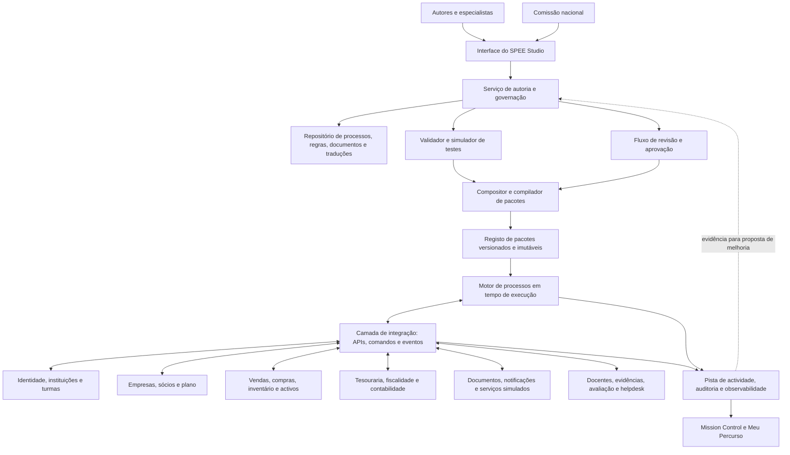

# Backlog de desenvolvimento do *upgrade* do SPEE

**Versão:** 1.6  
**Data:** 25 de Agosto de 2026  
**Estado:** proposta de trabalho para validação funcional, pedagógica e técnica  
**Âmbito:** correcções críticas, internacionalização/localização, SPEE Studio e evolução funcional do SPEE

> Este documento organiza funcionalidades propostas; não constitui, por si só, uma decisão de arquitectura nem uma aprovação institucional. A prioridade deve ser revista após confirmação técnica dos defeitos, testes de usabilidade e validação com docentes, estudantes, helpdesk e equipa do SPEE.

---

## 1. Objectivo e lógica de priorização

O *upgrade* deve primeiro tornar o SPEE actual estável, seguro e compreensível. Depois deve criar as fundações transversais de internacionalização e localização. Sobre essas fundações será desenvolvido o **SPEE Studio**, responsável pela autoria, localização, governação e publicação dos processos. As restantes funcionalidades expandem o ciclo empresarial e a economia simulada.

### Ordem de prioridade

| Prioridade | Frente | Resultado esperado |
|---|---|---|
| **P0** | Aspectos críticos que precisam de correcção ou melhoria | Remover bloqueios, proteger contas e dados, estabilizar os percursos actuais e reduzir a dependência do helpdesk |
| **P1** | Aspectos gerais de internacionalização e localização | Preparar o núcleo para várias línguas, países, jurisdições, formatos, documentos e regras sem duplicar a plataforma |
| **P2** | Desenvolvimento do SPEE Studio | Permitir desenhar, testar, validar, versionar e publicar processos e pacotes nacionais integrados com os módulos do SPEE |
| **P3** | Outras funcionalidades | Completar o ciclo empresarial, a economia simulada, a avaliação por competências e a interoperabilidade |
| **P4** | Expansão e inovação | Suportar práticas transfronteiriças e adoptar tecnologias emergentes apenas quando exista valor demonstrado |

### Regras de ordenação dentro de cada prioridade

1. Segurança, integridade de dados e bloqueios totais precedem conveniência.
2. Problemas que afectam turmas ou múltiplos utilizadores precedem problemas individuais.
3. A fundação comum precede variantes por país ou instituição.
4. A configuração precede a duplicação de código.
5. Nenhuma automatização deve retirar ao estudante a prática que constitui o objectivo de aprendizagem.

---

## 2. Resumo executivo do backlog

| ID | Prioridade | Épico | Dependências principais |
|---|---:|---|---|
| CRIT-01 | P0 | Desempenho, disponibilidade e recuperação | Observabilidade e testes de carga |
| CRIT-02 | P0 | Registo, inscrição e integridade de dados | Identidade, turmas e validações |
| CRIT-03 | P0 | Acesso e recuperação segura de conta | Correio transaccional e segurança |
| CRIT-04 | P0 | Sócios, convites e constituição da empresa | Identidade e modelo de empresa |
| CRIT-05 | P0 | Loja em linha, inventário e activos mínimos | Empresa, catálogo e inventário |
| CRIT-06 | P0 | Mensagens de erro, prevenção e retoma | Contrato comum de erros |
| CRIT-07 | P0 | Centro de Controlo Pedagógico (*Mission Control*) | Rastreabilidade, permissões e auditoria |
| CRIT-08 | P0 | Helpdesk estruturado e base de conhecimento | Contexto técnico e processual |
| CRIT-09 | P0 | Fiabilidade contabilística, fiscal e de relatórios | Documentos e transacções |
| CRIT-10 | P0 | Usabilidade, acesso móvel e acessibilidade de base | Sistema de desenho comum |
| CRIT-11 | P0 | Rastreabilidade da simulação e “Meu Percurso” do estudante | Motor de processos e eventos dos módulos |
| CRIT-12 | P0 | Teste e validação do módulo do INSS — Segurança Social | Pessoas/salários, tesouraria, contabilidade e regras oficiais |
| CRIT-13 | P0 | Teste e validação do módulo de Empreendedorismo | Percurso empreendedor, plano de negócio e avaliação pedagógica |
| I18N-01–11 | P1 | Fundação de internacionalização e localização | Núcleo estável e modelo canónico |
| STUDIO-01–20 | P2 | SPEE Studio e integração modular | P0, P1 e motor de processos |
| FUNC-01–14 | P3 | Ciclo completo, economia simulada e expansão funcional | Studio e módulos estabilizados |
| EXP-01–06 | P4 | Expansão internacional e inovação controlada | Pacotes nacionais e módulos estabilizados |
| MVP-01–09 | 40 dias | SPEE Studio funcional e validação dos modelos de INSS e Empreendedorismo | Equipa dedicada, fontes e validadores disponíveis |

---

## 3. P0 — Aspectos críticos que precisam de correcção ou melhoria

### CRIT-01 — Desempenho, disponibilidade e recuperação

**Problema a resolver:** lentidão, bloqueios, congelamento e falhas que podem interromper uma actividade ou uma turma inteira.

**Funcionalidades:**

- definir indicadores de disponibilidade, latência, erros e sucesso das operações críticas;
- instrumentar autenticação, registo, constituição, loja, transacções, relatórios e submissões;
- criar alertas por degradação, erro recorrente e fila de processamento acumulada;
- garantir gravação automática de rascunhos nos formulários longos;
- permitir repetição segura de operações sem duplicar empresas, documentos, pagamentos ou lançamentos;
- disponibilizar página de estado operacional e comunicação de incidentes;
- criar procedimentos de cópia de segurança, restauro e recuperação após falha;
- executar testes de carga representativos de uma aula e de várias turmas simultâneas.

**Critérios mínimos de aceitação:**

- os fluxos críticos têm métricas, registos técnicos e alertas accionáveis;
- uma falha transitória não apaga o trabalho já guardado;
- a repetição de uma submissão não cria registos duplicados;
- a equipa consegue identificar o módulo, a operação e a versão relacionados com um incidente;
- os objectivos de desempenho e disponibilidade são formalmente definidos antes da entrada em produção.

### CRIT-02 — Registo, inscrição e integridade de dados

**Problema a resolver:** dados não reconhecidos, duplicados, incompletos ou não reflectidos entre estudante, turma, instituição e empresa.

**Funcionalidades:**

- formulário de registo com validação imediata e mensagens específicas por campo;
- verificação de duplicados por regras transparentes e sem expor dados de outras pessoas;
- confirmação do endereço de correio electrónico e estado visível de activação;
- sincronização fiável entre conta, instituição, turma, papel e empresa;
- ecrã de confirmação com resumo dos dados antes da submissão;
- correcção controlada de dados, com histórico e autorização por papel;
- ferramentas para identificar registos órfãos ou inconsistentes;
- importação de turmas com pré-visualização, validação e relatório de erros por linha.

**Critérios mínimos de aceitação:**

- o utilizador vê se a conta está pendente, activa, duplicada ou bloqueada e recebe um próximo passo;
- o docente consegue confirmar o estado de inscrição sem aceder a dados desnecessários;
- qualquer correcção administrativa fica auditada;
- a importação parcial não esconde linhas rejeitadas nem cria duplicados silenciosos.

### CRIT-03 — Acesso e recuperação segura de conta

**Problema a resolver:** dependência do helpdesk para reposição de palavras-passe e risco de partilha de credenciais ou códigos em conversas.

**Funcionalidades:**

- fluxo autónomo de “Esqueci-me da palavra-passe”;
- ligações e códigos de utilização única, com prazo de validade e limitação de tentativas;
- confirmação clara do envio, reenvio controlado e orientação sobre correio não solicitado;
- invalidação de sessões após alteração de palavra-passe quando necessário;
- compatibilidade com início de sessão institucional e autenticação acessível;
- protecção contra enumeração de contas, força bruta e abuso;
- proibição explícita de recolha de palavras-passe no helpdesk;
- mascaramento de palavras-passe, códigos, telefones e endereços de correio nos *exports* de suporte.

**Critérios mínimos de aceitação:**

- o helpdesk nunca precisa de conhecer nem enviar uma palavra-passe;
- o utilizador consegue recuperar a conta por um canal verificado;
- as mensagens não confirmam a existência de uma conta a terceiros;
- tentativas e intervenções privilegiadas ficam registadas sem guardar segredos.

### CRIT-04 — Sócios, convites e constituição da empresa

**Problema a resolver:** bloqueios e incerteza ao convidar, aceitar, rejeitar, substituir ou remover sócios e ao activar a empresa.

**Funcionalidades:**

- estado visível de cada convite: rascunho, enviado, entregue, aceite, rejeitado, expirado ou cancelado;
- validação preventiva de duplicados, incompatibilidades e pertença a outra empresa;
- reenvio e cancelamento controlados;
- tratamento de convite expirado e endereço incorrecto;
- soma e validação das quotas, papéis e capital antes da constituição;
- fluxo autorizado para substituição ou saída de sócio;
- resumo da empresa e confirmação de todos os participantes antes da activação;
- recuperação do processo sem eliminar a empresa ou perder dados válidos;
- notificações ao estudante e visibilidade agregada ao docente.

**Critérios mínimos de aceitação:**

- o sistema explica quem deve agir e o que impede a progressão;
- um estudante não pode aceitar combinações incompatíveis sem explicação;
- alterações após activação exigem autorização, fundamento e auditoria;
- nenhum erro obriga a recriar toda a empresa quando é possível corrigir apenas o elemento inválido.

### CRIT-05 — Loja em linha, inventário e activos mínimos

**Problema a resolver:** dificuldade recorrente para localizar, seleccionar ou adquirir os activos exigidos antes de iniciar operações.

**Funcionalidades:**

- lista de activos mínimos por actividade, sector ou cenário;
- indicação do que já foi adquirido, do que falta e por que motivo é necessário;
- ligação directa do bloqueio para a tarefa ou produto em falta;
- validação de orçamento, disponibilidade, quantidade e duplicação antes da compra;
- confirmação da compra e actualização coerente do inventário e da contabilidade;
- recuperação de operações incompletas sem cobrança ou lançamento duplicado;
- ajuda contextual e exemplo de configuração mínima.

**Critérios mínimos de aceitação:**

- o estudante vê a condição exacta que falta cumprir;
- a aquisição concluída actualiza os módulos dependentes uma única vez;
- um erro fornece acção de recuperação e identificador de apoio;
- o docente consegue distinguir “não iniciado”, “incompleto”, “bloqueado” e “concluído”.

### CRIT-06 — Mensagens de erro, prevenção e retoma

**Problema a resolver:** mensagens genéricas como “não aparece”, “não aceita” ou “operação inválida” não permitem compreender a causa nem recuperar.

**Funcionalidades:**

- contrato comum de erro para todos os módulos;
- validação antes da submissão, junto do campo ou requisito relevante;
- mensagem compreensível com causa, consequência e próximo passo;
- código técnico não sensível e identificador de correlação;
- indicação do actor que pode corrigir a situação;
- retoma no passo exacto, preservando dados válidos;
- ligação para ajuda contextual e abertura de pedido de apoio já preenchido;
- catálogo central de erros, traduções e métricas de ocorrência.

**Critérios mínimos de aceitação:**

- cada bloqueio crítico indica **o que falhou, porquê, quem pode corrigir e como retomar**;
- a mensagem apresentada ao utilizador não expõe detalhes internos nem dados sensíveis;
- o mesmo erro tem código, significado e tratamento consistentes nos diferentes módulos;
- o helpdesk consegue pesquisar o código e consultar o procedimento aprovado.

### CRIT-07 — Centro de Controlo Pedagógico (*Mission Control*) e autonomia do docente

**Problema a resolver:** falta de visibilidade, num único ponto, sobre quem realizou cada actividade, que empresas e estudantes estão a progredir, que subactividades faltam e onde existem bloqueios ou dependências.

**Funcionalidades:**

- visão geral por instituição e turma, com empresas, estudantes, processos activos, progresso, bloqueios e prazos em risco;
- navegação progressiva de turma → empresa → processo → etapa → actividade/subactividade → evento;
- matriz “quem fez o quê”, com estudante, papel assumido, actividade, resultado, data/hora e estado;
- estados normalizados: não disponível, por iniciar, disponível, em curso, à espera de terceiro, bloqueado, submetido, devolvido, aprovado, concluído, vencido e cancelado;
- lista explícita das subactividades concluídas, em falta, opcionais, bloqueadas e vencidas;
- indicação do próximo passo, do actor ou papel responsável e do pré-requisito que impede a progressão;
- filtros por turma, empresa, estudante, função, processo, etapa, estado, prazo, módulo e período;
- cronologia das acções, documentos, aprovações, devoluções, correcções e intervenções;
- comparação da participação e distribuição de trabalho dentro de cada empresa, sem reduzir a avaliação a número de cliques;
- alertas para contas inactivas, convites pendentes, empresas incompletas, tarefas sem responsável, concentração excessiva de trabalho, dependências paradas e prazos em risco;
- identificação de bloqueios colectivos que afectem várias empresas ou uma turma;
- acções controladas para devolver, reabrir, desbloquear ou solicitar correcção;
- pedido de escalamento com contexto já preenchido;
- exportação acessível do progresso, das actividades e das evidências;
- indicação da última actualização e do estado de sincronização dos dados apresentados.

**Critérios mínimos de aceitação:**

- o docente consegue identificar, sem consultar vários módulos, quem executou uma actividade e que subactividades ainda faltam;
- qualquer indicador agregado permite aprofundar até aos eventos e evidências que o fundamentam;
- o progresso apresentado resulta de actividades e estados confirmados, não apenas de acessos ou cliques;
- o *Mission Control* e a vista do estudante usam a mesma fonte de estado e não apresentam conclusões contraditórias;
- as permissões distinguem consulta, orientação, correcção, avaliação e administração;
- nenhuma intervenção docente altera silenciosamente o trabalho do estudante;
- todas as acções privilegiadas exigem fundamento e ficam auditadas;
- o painel mostra dados actualizados e a data da última sincronização.

### CRIT-08 — Helpdesk estruturado e base de conhecimento

**Problema a resolver:** pedidos chegam sem perfil, turma, empresa, módulo, passo ou evidência suficiente, prolongando o diagnóstico.

**Funcionalidades:**

- formulário com perfil, instituição, turma, empresa, tema, módulo, passo e descrição do erro;
- anexo opcional com aviso para não enviar palavras-passe ou dados pessoais desnecessários;
- recolha automática, com consentimento, do processo, tarefa, versão, código de erro e estado de sincronização;
- respostas-modelo editáveis por tema;
- base de conhecimento por papel, processo e erro;
- triagem automática para acesso, convites, activos, pagamentos, dados e erros técnicos;
- encaminhamento por gravidade, impacto e competência;
- estado de resolução, reabertura, reincidência e confirmação do utilizador;
- métricas de cobertura, tempo de resposta, tempo de resolução e esforço.

**Critérios mínimos de aceitação:**

- o pedido contém contexto suficiente sem incluir segredos;
- o sistema distingue resposta inicial de resolução confirmada;
- incidentes que afectam uma turma recebem prioridade superior;
- conteúdos e respostas-modelo têm responsável, versão e data de revisão.

### CRIT-09 — Fiabilidade contabilística, fiscal e de relatórios

**Problema a resolver:** necessidade docente de balancetes, demonstrações, modelos fiscais, comprovativos, estornos e rastreabilidade mais fiáveis.

**Funcionalidades:**

- ligação entre documento de origem, transacção e lançamento contabilístico;
- balancete, diário, razão, demonstrações e relatórios com critérios e períodos explícitos;
- pré-visualização e validação antes do fecho;
- estorno, correcção e substituição sem apagar o histórico;
- calendário de obrigações, alertas, submissão simulada e comprovativo;
- reconciliação entre vendas, compras, inventário, tesouraria, fiscalidade e contabilidade;
- exportação em formatos acessíveis e adequados à análise;
- conjunto de testes de regressão com cenários contabilísticos e fiscais conhecidos.

**Critérios mínimos de aceitação:**

- cada valor de um relatório pode ser rastreado até aos registos de origem;
- correcções preservam o lançamento inicial, o fundamento e o actor;
- os relatórios indicam empresa, período, moeda, regra e versão aplicáveis;
- uma actualização fiscal não altera retroactivamente actividades em curso.

### CRIT-10 — Usabilidade, acesso móvel e acessibilidade de base

**Problema a resolver:** navegação pouco orientada, campos inflexíveis e barreiras em telemóveis, ligações limitadas ou tecnologias de apoio.

**Funcionalidades:**

- mapa do percurso e indicação consistente do estado e próximo passo;
- componentes comuns de formulário, validação, confirmação e ajuda;
- desenho responsivo para as tarefas de maior frequência;
- modo de baixo consumo de dados e preservação de rascunhos;
- navegação por teclado, foco visível, contraste, alvos tácteis e leitores de ecrã;
- redução de introdução repetida de dados;
- documentos gerados com estrutura, leitura e exportação acessíveis;
- testes de usabilidade com estudantes, docentes e utilizadores com deficiência.

**Critérios mínimos de aceitação:**

- os fluxos prioritários cumprem WCAG 2.2 AA;
- autenticação, registo, convites, constituição e consulta de tarefas funcionam em telemóvel;
- o utilizador distingue rascunho, enviado, confirmado e falhado;
- os testes incluem dispositivos e condições de ligação representativos.

### CRIT-11 — Rastreabilidade da simulação e “Meu Percurso” do estudante

**Problema a resolver:** os estudantes não dispõem de uma visão contínua do que já fizeram, do que está em curso, do que ainda falta e da acção seguinte; os módulos também não conservam necessariamente uma pista de actividade comum e comparável.

**Funcionalidades transversais de rastreabilidade:**

- registo de cada actividade e subactividade relevante executada durante a simulação;
- identificação de actor, papel, empresa, turma, processo, etapa, módulo, data/hora e origem da acção;
- registo do estado anterior e posterior, resultado, documento, transacção, regra e versão aplicáveis;
- relação entre actividade principal, subactividades, pré-requisitos, dependências e processo seguinte;
- identificação de acções humanas, automáticas, institucionais, docentes e administrativas;
- registo de submissão, aprovação, devolução, correcção, reabertura, cancelamento e sincronização;
- pista cronológica que não apaga eventos anteriores quando existe uma correcção;
- identificadores de correlação para seguir uma operação entre diferentes módulos;
- retenção, acesso e anonimização definidos de acordo com a finalidade pedagógica e operacional.

**Funcionalidades da área “Meu Percurso”:**

- visão por empresa e processo com percentagem acompanhada da lista real de actividades que a fundamenta;
- mapa ou lista de etapas e subactividades com os respectivos estados;
- separação clara entre “concluído”, “em curso”, “por fazer”, “à espera de outro actor”, “bloqueado” e “vencido”;
- indicação permanente do próximo passo recomendado, respectivo objectivo, prazo, pré-requisitos e ligação directa para execução;
- identificação do papel responsável quando o passo seguinte pertence a um colega, docente ou serviço simulado;
- consulta de quem concluiu cada actividade da empresa, quando e com que resultado, respeitando as permissões;
- acesso aos documentos e evidências produzidos em cada etapa;
- explicação do motivo de bloqueio e da forma de recuperação;
- alertas de tarefa disponível, prazo próximo, devolução para correcção e dependência concluída;
- histórico pessoal e da empresa, com filtros por processo, período e estado;
- abertura de pedido de ajuda a partir da subactividade, com contexto preenchido automaticamente.

**Critérios mínimos de aceitação:**

- em qualquer momento, o estudante consegue responder a “o que está feito?”, “o que falta?” e “qual é o próximo passo?”;
- cada actividade concluída indica actor, papel, data/hora, resultado e evidência, quando aplicável;
- uma subactividade não é marcada como concluída apenas porque o ecrã foi aberto ou um botão foi accionado;
- uma devolução ou correcção actualiza o estado sem eliminar o histórico anterior;
- o progresso é actualizado após eventos confirmados e mostra claramente informação ainda não sincronizada;
- o estudante não vê dados pessoais, avaliações confidenciais ou actividades restritas de outros participantes.

### CRIT-12 — Teste e validação do módulo do INSS — Segurança Social

**Objectivo:** confirmar que o módulo representa, de forma correcta, compreensível e rastreável, o ciclo simulado de inscrição, declaração, contribuição e regularização perante o INSS, bem como as respectivas integrações. As taxas, prazos, formulários e regras aplicáveis devem ser confirmados em fontes oficiais e por especialistas autorizados antes da aprovação.

**Âmbito funcional a testar:**

- inscrição simulada da entidade empregadora e dos trabalhadores;
- associação entre trabalhador, contrato, remuneração e período contributivo;
- determinação da base de incidência e aplicação dos parâmetros contributivos configurados;
- distinção entre contribuição da entidade empregadora e contribuição do trabalhador, quando aplicável;
- geração, revisão, submissão e correcção da declaração simulada;
- calendário, prazo, aviso, atraso, regularização e eventual penalização simulada;
- ordem de pagamento, confirmação, recibo/comprovativo e reconciliação;
- consulta do histórico por trabalhador, período, empresa e estado;
- devolução para correcção, reabertura e anulação controlada;
- resposta humana, automática ou híbrida do serviço INSS simulado.

**Integrações a validar:**

- empresas, trabalhadores, contratos, salários e retenções;
- calendário de obrigações e notificações;
- tesouraria, conta bancária simulada e pagamentos;
- contabilidade, contas a pagar, lançamentos, estornos e reconciliação;
- documentos, comprovativos e arquivo;
- “Meu Percurso”, *Mission Control*, helpdesk e pista de actividade.

**Tipos de teste:**

- casos normais com valores de referência revistos por especialista;
- valores-limite, arredondamentos, períodos incompletos e ausência de dados obrigatórios;
- trabalhador duplicado, contrato terminado, declaração repetida e pagamento duplicado;
- submissão fora do prazo, correcção, regularização e estorno;
- indisponibilidade de um módulo, repetição segura e recuperação sem duplicação;
- permissões por papel, protecção de dados, auditoria e separação entre simulação e realidade;
- usabilidade, acessibilidade, desempenho, localização e clareza das mensagens de erro;
- regressão das integrações com salários, tesouraria e contabilidade.

**Intervenientes na validação:**

- especialista de Segurança Social ou representante institucional autorizado;
- especialista funcional do SPEE;
- contabilista e especialista de salários;
- docentes utilizadores do módulo;
- estudantes representativos do público-alvo;
- equipas técnica, segurança, acessibilidade e helpdesk.

**Critérios mínimos de aceitação:**

- existe uma matriz que liga requisitos, fontes oficiais, regras configuradas, casos de teste e resultados;
- os casos de referência produzem os resultados esperados e são formalmente revistos;
- nenhuma taxa, prazo ou regra substantiva depende de texto disperso ou de valor não versionado no código;
- declaração, pagamento, documento e lançamento contabilístico são rastreáveis de ponta a ponta;
- a repetição de uma operação não duplica declaração, pagamento ou lançamento;
- estudante e docente conseguem ver o estado, as subactividades em falta e o próximo passo;
- defeitos críticos e altos estão resolvidos; excepções aceites têm risco, responsável e prazo documentados;
- é produzido um relatório de validação com decisão fundamentada de aprovação, aprovação condicionada ou não aprovação.

### CRIT-13 — Teste e validação do módulo de Empreendedorismo

**Objectivo:** confirmar a coerência funcional e pedagógica do percurso de Empreendedorismo, desde a identificação de uma oportunidade até à apresentação, revisão e transição para o plano e para a empresa simulada.

**Âmbito funcional a testar:**

- identificação do problema, necessidade ou oportunidade;
- definição do cliente/beneficiário e análise inicial do contexto;
- proposta de valor e diferenciação;
- modelo de negócio, parceiros, actividades, recursos, canais e relações;
- pesquisa e validação de mercado, com registo das evidências recolhidas;
- estimativa de custos, receitas, preço, financiamento e viabilidade inicial;
- identificação de pressupostos, riscos e experiências de validação;
- protótipo ou produto mínimo viável, quando previsto no cenário;
- plano de acção, marcos, responsáveis e prazos;
- elaboração, submissão e revisão do *pitch* e do plano de negócio;
- retorno docente, revisão por pares, correcção e nova submissão;
- trabalho individual e em equipa, com identificação da contribuição de cada estudante.

**Integrações a validar:**

- perfil do estudante, turma, equipa e papéis;
- plano de negócio, orçamento e projecções;
- constituição da empresa, sócios, quotas e actividades económicas;
- catálogo inicial, activos mínimos e necessidades de financiamento;
- documentos, evidências, avaliação por competências e portefólio;
- “Meu Percurso”, *Mission Control*, notificações, helpdesk e pista de actividade.

**Tipos de teste:**

- percurso individual e percurso em equipa;
- caminho normal, rascunho incompleto, devolução, correcção e nova submissão;
- pré-requisitos em falta e mudança controlada de ideia/modelo;
- preservação do trabalho, histórico de versões e recuperação após falha;
- coerência de cálculos e transferência de dados para plano, orçamento e constituição;
- distribuição de tarefas, contribuição individual e separação entre actividade humana e automática;
- clareza das instruções, exemplos, glossário, mensagens e próximo passo;
- usabilidade com estudantes, configurabilidade docente, acessibilidade e utilização em telemóvel;
- validade das rubricas, evidências e indicadores de progresso.

**Intervenientes na validação:**

- docentes e especialistas de Empreendedorismo;
- empreendedores ou profissionais convidados para validação contextual;
- especialistas pedagógicos e de avaliação;
- estudantes representativos do público-alvo;
- equipas funcional, técnica, acessibilidade e helpdesk.

**Critérios mínimos de aceitação:**

- cada etapa possui objectivo, instruções, pré-requisitos, exemplo, condição de conclusão e evidência esperada;
- o estudante consegue guardar, retomar, corrigir e acompanhar o percurso sem perder versões anteriores;
- o docente consegue ver quem realizou cada actividade, as subactividades em falta, os bloqueios e a próxima acção;
- o progresso resulta de evidências e estados confirmados, não apenas de acessos ou cliques;
- os dados aprovados transitam para plano de negócio, orçamento ou constituição sem redigitação desnecessária e com confirmação do estudante;
- as rubricas e critérios de avaliação são compreensíveis antes da submissão e foram revistos pedagogicamente;
- testes com utilizadores confirmam que o percurso, os termos e as mensagens são compreendidos pelo público-alvo;
- defeitos críticos e altos estão resolvidos e é produzido um relatório de validação com decisão fundamentada.

**Produtos obrigatórios da validação dos dois módulos:**

- inventário funcional e mapa de integrações;
- matriz de requisitos e rastreabilidade;
- plano, dados e guiões de teste;
- registo de resultados e evidências;
- lista de defeitos por gravidade, responsável e estado;
- relatório de testes com riscos residuais;
- acta ou registo de validação funcional, pedagógica e técnica;
- decisão de entrada em produção e plano de acompanhamento pós-lançamento.

---

## 4. P1 — Aspectos gerais de internacionalização e localização

### 4.1. Princípio de desenho

**Internacionalização** é a capacidade técnica de o mesmo SPEE suportar várias línguas, países e formatos. **Localização** é a adaptação validada de processos, regras, documentos, instituições, terminologia e conteúdo pedagógico a um contexto concreto.

O país, a jurisdição, a língua, o sector e o cenário pedagógico devem ser dimensões separadas. Uma língua não pode ser usada como substituto de uma jurisdição.

### 4.2. Backlog de internacionalização e localização

| ID | Funcionalidade | Requisitos e critérios de aceitação |
|---|---|---|
| **I18N-01** | Textos externos ao código | Interface, ajuda, erros, notificações e correio electrónico usam chaves estáveis; não existem textos nacionais incorporados na lógica de negócio; há uma língua de reserva definida |
| **I18N-02** | Unicode e conteúdo multilingue | Armazenamento, pesquisa, importação, exportação e documentos usam Unicode/UTF-8; caracteres de todas as línguas suportadas são preservados de ponta a ponta |
| **I18N-03** | Contexto de localização | Cada sessão e cada execução conserva `locale`, língua, país, jurisdição, fuso horário, moeda, sector e versões dos pacotes aplicáveis |
| **I18N-04** | Formatos baseados em CLDR/ICU | Datas, horas, números, percentagens, moedas, pluralização, nomes, endereços e telefones são formatados por configuração, sem concatenação de fragmentos de frase |
| **I18N-05** | Selecção de língua e direcção da escrita | Mudança de língua sem perda de trabalho; preparação para escrita da direita para a esquerda; navegação, pesquisa e ordenação adequadas à língua |
| **I18N-06** | Glossário e terminologia | Glossário empresarial por língua e variante; termos aprovados, sinónimos de pesquisa, responsável, estado e versão; a interface e a ajuda usam a mesma terminologia |
| **I18N-07** | Fluxo editorial de tradução | Estados `rascunho → revisão linguística → revisão funcional → aprovado → publicado`; comparação entre versões; autoria e pareceres registados; tradução assistida nunca é publicada sem revisão humana |
| **I18N-08** | Documentos e comunicações localizados | Modelos têm língua, jurisdição, versão, vigência, numeração e formato; facturas, contratos, declarações, relatórios, notificações e comprovativos preservam a ligação ao tipo canónico |
| **I18N-09** | Pacote de jurisdição e mercado | Configura formas jurídicas, instituições, impostos, taxas, moeda, câmbio, calendários, prazos, regras laborais, segurança social, licenciamento, pagamentos, plano de contas e contratação pública |
| **I18N-10** | Pacote pedagógico e cultural | Configura resultados de aprendizagem, complexidade, ajuda, exemplos, papéis, cenários, rubricas, evidências e práticas profissionais; conteúdos são validados localmente e não assentam em estereótipos |
| **I18N-11** | Qualidade, acessibilidade e conformidade | Pseudolocalização, expansão de texto, formatos longos, RTL, leitores de ecrã, documentos acessíveis, fuso horário, mudança de moeda e matriz por língua/dispositivo fazem parte dos testes de publicação |

### 4.3. Modelo de composição de uma experiência localizada

```text
Processo canónico global
+ pacote de jurisdição e mercado
+ pacote linguístico e cultural
+ pacote pedagógico e de cenário
= definição executável, validada e congelada para a turma
```

#### Regras de composição

- o processo canónico conserva o propósito e as relações empresariais comuns;
- os pacotes substituem ou ampliam apenas os elementos declarados como configuráveis;
- conflitos entre pacotes são detectados antes da publicação;
- uma nova versão não modifica turmas ou processos já iniciados;
- as fontes, simplificações pedagógicas, responsáveis e datas de vigência são obrigatórias;
- a desactivação de uma regra ou modelo não elimina versões utilizadas no passado;
- Moçambique deve ser o primeiro pacote de referência, não uma regra universal incorporada no núcleo.

---

## 5. P2 — Desenvolvimento do SPEE Studio

### 5.1. Papel do SPEE Studio

O **SPEE Studio** será a ferramenta de autoria, localização e governação através da qual equipas autorizadas poderão desenhar, testar, validar, publicar e actualizar os processos empresariais executados no SPEE.

O Studio **não** substitui a interface dos estudantes, o painel docente, a contabilidade, o repositório documental ou os módulos operacionais. Produz definições e pacotes versionados; o **motor de processos**, em tempo de execução, coordena os módulos do SPEE com base nessas definições.

### 5.2. Actores e permissões

| Actor | Capacidades principais |
|---|---|
| Autor de processo | Criar e editar rascunhos dentro do domínio autorizado |
| Especialista funcional | Rever processo, regras, documentos e efeitos |
| Especialista nacional | Validar instituições, terminologia, práticas e fontes locais |
| Contabilista/fiscalista | Validar cálculos, contas, obrigações e efeitos contabilísticos |
| Docente/revisor pedagógico | Validar objectivos, complexidade, ajuda, evidências e avaliação |
| Revisor linguístico | Rever tradução, terminologia e legibilidade |
| Revisor de acessibilidade | Validar interface, conteúdo e documentos |
| Revisor técnico | Validar integração, segurança, testes e compatibilidade |
| Comissão nacional | Aprovar, devolver ou rejeitar versões do pacote nacional |
| Gestor de publicação | Agendar, publicar, suspender e arquivar versões aprovadas |
| Auditor | Consultar decisões, alterações, versões e utilização sem editar |

Deve existir separação de funções: quem cria não aprova sozinho; quem publica não pode contornar a decisão da comissão; intervenções de emergência ficam limitadas, fundamentadas e auditadas.

### 5.3. Backlog funcional detalhado do Studio

#### STUDIO-01 — Catálogo de processos e pacotes

- catálogo pesquisável por ciclo empresarial, família, país, sector, língua e estado;
- criação a partir de modelo, cópia controlada ou importação;
- identificação estável, responsável, fontes, vigência, revisão e dependências;
- visualização das versões publicadas e em preparação;
- mapa de processos anteriores, seguintes e relacionados.

**Aceitação:** cada processo tem identidade única, responsável, estado, fontes, versões e relações visíveis.

#### STUDIO-02 — Modelador de etapas, tarefas e transições

- definição visual e tabular de etapas, tarefas, eventos, decisões e transições;
- caminhos sequenciais, paralelos, condicionais e alternativos;
- condições de início e conclusão;
- pré-requisitos, entradas, saídas, prioridades e prazos;
- tarefas humanas, automáticas, institucionais ou híbridas;
- detecção de estados sem saída, dependências circulares e tarefas inalcançáveis.

**Aceitação:** um autor consegue modelar um percurso completo sem alterar o código do núcleo e o sistema rejeita uma definição estruturalmente inválida.

#### STUDIO-03 — Papéis, atribuição e separação de funções

- papéis empresariais, institucionais, pedagógicos e técnicos;
- atribuição a pessoa, função, equipa, empresa ou serviço simulado;
- regras de substituição, delegação e rotação;
- matrizes de preparação, revisão e aprovação;
- impedimentos configuráveis para evitar auto-aprovação ou conflitos de interesse.

**Aceitação:** o simulador de processo demonstra que as tarefas chegam ao actor correcto e que as regras de separação de funções são aplicadas.

#### STUDIO-04 — Regras, validações e cálculos

- editor declarativo para elegibilidade, pré-requisitos, validações, limites, calendários, autorizações e cálculos;
- fonte, jurisdição, data de vigência, simplificação pedagógica e responsável obrigatórios;
- tabelas e parâmetros versionados;
- explicação compreensível do resultado da regra;
- conjunto de casos de teste por regra;
- análise de impacto nos processos, documentos e módulos dependentes.

**Aceitação:** uma regra pode ser alterada num pacote sem recompilar o núcleo; a publicação exige testes aprovados e não altera instâncias activas.

#### STUDIO-05 — Modelos de documentos

- associação de tipos canónicos a modelos locais;
- campos, secções, numeração, estados, anexos, assinatura e acessibilidade;
- pré-visualização em cada língua e formato;
- validação de campos obrigatórios e cálculos internos;
- relação entre documento, tarefa, transacção e arquivo;
- substituição, cancelamento, rectificação e conservação do histórico.

**Aceitação:** um documento publicado indica tipo canónico, jurisdição, língua, versão e vigência e mantém rastreabilidade até à actividade que o produziu.

#### STUDIO-06 — Efeitos operacionais e contabilísticos

- configuração dos efeitos em inventário, clientes, fornecedores, caixa, banco, fiscalidade e contabilidade;
- proposta de lançamentos por evento ou estado documental;
- distinção entre efeito provisório e definitivo;
- regras de estorno, compensação e regularização;
- visualização da cadeia documento → transacção → efeito → lançamento.

**Aceitação:** o ambiente de teste segue qualquer efeito até à regra, ao documento e à tarefa de origem e impede aplicação duplicada.

#### STUDIO-07 — Calendários, prazos e obrigações

- calendário real, simulado, pedagógico, fiscal e contabilístico;
- dias úteis, feriados, prazos relativos, datas fixas e recorrência;
- avisos, vencimento, tolerância, penalização, regularização e fecho;
- calendários por jurisdição, instituição, turma e cenário.

**Aceitação:** os testes verificam datas-limite em fusos horários e calendários diferentes e explicam qual calendário originou o prazo.

#### STUDIO-08 — Excepções, erros e recuperação

- caminhos de devolução, reabertura, correcção, substituição, suspensão e cancelamento;
- catálogo de erros com severidade, mensagem localizada e acção de recuperação;
- política de compensação para efeitos já aplicados;
- definição do contexto seguro enviado ao helpdesk.

**Aceitação:** cada caminho crítico possui pelo menos um cenário de erro e retoma, sem perda de dados válidos nem duplicação de efeitos.

#### STUDIO-09 — Ajuda, glossário e apoio graduado

- propósito da actividade, lista de verificação, exemplo, modelo preenchido e glossário;
- ajuda por tarefa, papel, língua e nível de dificuldade;
- indicação de pré-requisito, próximo passo e actor seguinte;
- limites para assistência automática, preservando a prática do estudante;
- ligação à base de conhecimento e ao pedido de apoio.

**Aceitação:** a ajuda pode variar por cenário e língua e é revista juntamente com o processo, não como conteúdo isolado.

#### STUDIO-10 — Competências, evidências e avaliação

- associação de resultados de aprendizagem e competências a tarefas;
- evidências exigidas: documento, cálculo, comunicação, aprovação, reconciliação ou reflexão;
- rubricas por completude, correcção, conformidade, rastreabilidade, colaboração, diagnóstico e reflexão;
- identificação das actividades e subactividades que demonstram cada competência;
- distinção entre contribuição individual, trabalho da empresa e acção automática do sistema;
- configuração de revisão por pares e retorno docente.

**Aceitação:** cada processo publicado declara competências, actividades e evidências e o *Mission Control* consegue mostrar quem contribuiu para a sua realização.

#### STUDIO-11 — Gestão de pacotes nacionais

- criação de pacote de jurisdição, pacote linguístico e pacote pedagógico;
- comparação com o processo canónico e com outra variante;
- lista explícita de elementos herdados, substituídos ou ampliados;
- verificação de compatibilidade e conflitos;
- calendário de revisão e aviso de conteúdo próximo do fim de vigência.

**Aceitação:** pelo menos duas jurisdições podem compor variantes do mesmo processo sem duplicar o código do núcleo.

#### STUDIO-12 — Tradução e terminologia

- memória de tradução, glossário aprovado e pesquisa de ocorrências;
- estados de tradução e revisão;
- pré-visualização com expansão de texto, RTL e formatos locais;
- relatório de conteúdo em falta, desactualizado ou divergente;
- importação/exportação em formato aberto de localização.

**Aceitação:** nenhum conteúdo obrigatório é publicado numa língua declarada como suportada enquanto estiver incompleto ou sem revisão.

#### STUDIO-13 — Simulação e ambiente de testes

- execução passo a passo com papéis simulados;
- teste de caminho normal, pré-requisito ausente, devolução, prazo, falha técnica, trabalho sem ligação e variante internacional;
- dados fictícios reutilizáveis;
- comparação entre resultado esperado e obtido;
- relatório de cobertura das tarefas, regras, documentos e eventos.

**Aceitação:** uma versão só pode ser submetida para aprovação depois de passar o conjunto obrigatório de testes.

#### STUDIO-14 — Revisão e governação

- fluxo `rascunho → revisão multidisciplinar → teste → decisão da comissão → publicação`;
- comentários, pareceres, pedidos de alteração e resolução;
- quórum, responsabilidades e registo da decisão;
- procedimentos normal e urgente;
- declaração de conflitos de interesse.

**Aceitação:** cada versão publicada conserva autores, revisores, pareceres, decisão, fundamento, data de vigência e entidade responsável.

#### STUDIO-15 — Versionamento, publicação e ciclo de vida

- versão de rascunho, candidata, aprovada, publicada, suspensa e arquivada;
- comparação detalhada e análise de impacto;
- agendamento de entrada em vigor;
- publicação atómica no registo de pacotes;
- reversão para a última versão válida;
- congelamento da versão utilizada por cada turma ou instância.

**Aceitação:** uma publicação falhada não deixa uma configuração parcial; a reversão não altera processos já concluídos nem apaga auditoria.

#### STUDIO-16 — Observabilidade e retorno de utilização

- métricas por processo, etapa, tarefa, regra, versão, país, língua e dispositivo;
- progresso e distribuição de actividade por turma, empresa, participante, papel e subactividade;
- estados actuais e cronologia das transições que os fundamentam;
- bloqueios, reaberturas, erros, utilização de ajuda, tempo, contactos de apoio e abandono;
- distinção entre erro técnico, dificuldade de utilização e erro de conhecimento;
- proposta de melhoria criada a partir de evidência, sem alterar directamente a versão publicada.

**Aceitação:** a comissão e os autores conseguem identificar as etapas e subactividades com mais problemas sem aceder a dados pessoais desnecessários; os docentes recebem a vista nominal apenas no âmbito das turmas que acompanham.

#### STUDIO-17 — Importação, exportação e reutilização

- exportação de pacote completo, manifesto, dependências, testes e assinaturas de integridade;
- importação com validação, pré-visualização e relatório de conflitos;
- modelos de processo reutilizáveis;
- API documentada para ferramentas autorizadas;
- migração controlada de configurações existentes.

**Aceitação:** um pacote exportado pode ser validado e importado noutro ambiente sem perder versões, fontes, testes ou relações.

#### STUDIO-18 — Segurança, privacidade e auditoria

- acesso por país, domínio, processo, papel e operação;
- autenticação forte para revisores, comissão e publicação;
- registo imutável de criação, alteração, revisão, aprovação, publicação e intervenção privilegiada;
- minimização de dados e separação entre conteúdo de configuração e dados de estudantes;
- cópia de segurança e restauro testados.

**Aceitação:** o Studio não permite consultar dados operacionais de estudantes por defeito e todas as alterações materiais têm actor, instante, fundamento e versão.

#### STUDIO-19 — Administração e sustentabilidade local

- gestão de entidades responsáveis, comissões, mandatos e contactos;
- formação e certificação de autores/revisores;
- atribuição de autoria e condições de reutilização;
- filas de revisão, prazos de decisão e conteúdo por actualizar;
- indicadores de capacidade local de manutenção.

**Aceitação:** uma equipa nacional autorizada consegue propor, testar e submeter uma actualização sem depender da alteração do código pela equipa central.

#### STUDIO-20 — Configuração da rastreabilidade e das vistas de progresso

- definição das actividades e subactividades que contam para o progresso de cada processo;
- estados permitidos, transições, pesos informativos e condições de conclusão;
- configuração do próximo passo para caminhos normais, alternativos, devolvidos e bloqueados;
- definição do actor ou papel responsável por cada actividade;
- selecção dos eventos, resultados, documentos e evidências que confirmam a conclusão;
- regras para distinguir trabalho individual, trabalho da empresa, resposta institucional e automatização;
- configuração dos campos visíveis ao estudante, docente, helpdesk, comissão e equipa técnica;
- modelos de apresentação para “Meu Percurso” e *Mission Control*;
- testes que confirmam consistência entre processo executado, progresso calculado e cronologia;
- política de retenção e anonimização da actividade para análise posterior.

**Aceitação:** um autor consegue configurar a rastreabilidade e as vistas de progresso sem alterar a interface ou o código de cada módulo; nenhuma definição é publicada se existir uma actividade sem condição de conclusão ou sem origem de evidência.

### 5.4. Arquitectura funcional proposta para o Studio



#### Separação essencial

- **Studio:** cria e governa definições; não executa operações de estudantes.
- **Registo de pacotes:** conserva versões aprovadas, assinadas e imutáveis.
- **Motor de processos:** cria instâncias, distribui tarefas e acompanha estados.
- **Módulos do SPEE:** são responsáveis pelos seus dados e executam operações de domínio.
- **Camada de integração:** traduz comandos e eventos entre o motor e os módulos.
- **Pista de actividade/auditoria:** conserva quem fez o quê, em que papel, quando, com que resultado e em que versão.
- **Mission Control/Meu Percurso:** apresentam vistas diferentes sobre a mesma fonte de progresso e actividade, respeitando as permissões.
- **Observabilidade:** identifica bloqueios, falhas, atrasos e padrões de utilização sem substituir a avaliação pedagógica.

### 5.5. Modelo de integração com os outros módulos

#### Princípios obrigatórios

1. **Sem acesso directo às bases de dados dos módulos.** O Studio e o motor usam interfaces documentadas.
2. **Responsabilidade clara pelos dados.** Cada módulo mantém a fonte autorizada do seu domínio.
3. **Comandos para pedir acções; eventos para comunicar factos.** Um comando pode ser recusado; um evento publicado descreve algo que já aconteceu.
4. **Operações idempotentes.** A repetição segura do mesmo pedido não duplica efeitos.
5. **Versões explícitas.** APIs, eventos, processos, regras, documentos e pacotes têm versão.
6. **Rastreabilidade.** Toda a cadeia usa identificadores de instância, tarefa, transacção e correlação.
7. **Consistência transaccional.** Aplicar padrão de caixa de saída/entrada e compensação quando uma operação atravessa módulos.
8. **Falha controlada.** Um módulo indisponível suspende ou encaminha a tarefa; não produz conclusão falsa.
9. **Segurança por contexto.** Autorização considera utilizador, papel, empresa, turma, processo e operação.
10. **Separação entre simulação e realidade.** Integrações externas usam ambientes de treino ou isolamento explícito.
11. **Uma única verdade de progresso.** *Mission Control*, “Meu Percurso”, relatórios e helpdesk calculam o estado a partir dos mesmos eventos confirmados.
12. **Actividade não é mera presença.** Acesso, tempo de sessão ou número de cliques não provam conclusão nem aprendizagem sem resultado ou evidência associada.

#### Responsabilidade e contrato por módulo

| Módulo/capacidade | Dados sob responsabilidade | Integração com o motor e o Studio |
|---|---|---|
| Identidade e acesso | Conta, autenticação, sessão, papel global | Confirma actor autenticado; nunca fornece palavra-passe ao Studio ou ao motor |
| Instituições e turmas | Instituição, curso, turma, inscrição, docente | Fornece contexto pedagógico e recebe estados agregados de execução |
| Empresas e sócios | Empresa simulada, sócios, quotas, funções, estado | Valida elegibilidade e emite eventos de convite, aceitação, constituição e alteração |
| Plano de negócio | Proposta, orçamento, aprovação e versão | Disponibiliza pré-requisitos e evidências para constituição e operação |
| Catálogo, activos e inventário | Produtos, serviços, activos, existências e movimentos | Reserva e movimenta itens; confirma efeitos apenas após validação |
| Vendas e clientes | Cotação, encomenda, entrega, factura e cliente | Executa operações comerciais e emite estados/documentos canónicos |
| Compras e fornecedores | Pedido, aprovação, encomenda, recepção e factura | Executa o lado comprador e coordena mensagens com outra empresa/serviço |
| Tesouraria, banco e pagamentos | Caixa, contas simuladas, ordem, pagamento, cobrança e reconciliação | Autoriza e confirma movimentos; suporta falha, reversão e idempotência |
| Pessoas e salários | Trabalhador, contrato, assiduidade, remuneração e retenções | Produz tarefas e efeitos laborais, fiscais, sociais e contabilísticos |
| Fiscalidade e segurança social | Obrigações, cálculos, declarações, prazos e comprovativos | Aplica regras do pacote nacional e responde como serviço institucional simulado |
| Contabilidade e relato | Plano de contas, diário, razão, período, fecho e demonstrações | Recebe efeitos rastreáveis e devolve estado de contabilização e reconciliação |
| Concursos públicos | Procedimento, proposta, avaliação, adjudicação e contrato | Funciona como serviço institucional e processo multi-entidade |
| Documentos e assinaturas | Ficheiro, modelo, versão, estado, assinatura e arquivo | Gera/valida documentos a partir dos modelos aprovados pelo Studio |
| Notificações e calendário | Preferências, canal, mensagem, entrega e lembrete | Recebe eventos e aplica modelos localizados, sem decidir a regra de negócio |
| Progresso e actividade | Estado calculado, cronologia, próxima actividade e dependências | Consome eventos confirmados e fornece vistas coerentes ao estudante, docente e helpdesk |
| Experiência do estudante | Tarefas apresentadas, preferências de vista e confirmações de leitura | Apresenta “Meu Percurso”; não redefine estados nem fabrica conclusão localmente |
| Docente e avaliação | Intervenção, rubrica, retorno, evidência e nota | Apresenta o *Mission Control*, consulta estados/evidências e envia comandos autorizados de devolução ou reabertura |
| Helpdesk | Pedido, triagem, diagnóstico, resolução e base de conhecimento | Recebe contexto mínimo, códigos e versão; devolve classificação e estado de resolução |
| Auditoria e análise | Eventos, actores, transições, métricas, correlação e retenção | Consolida a pista de actividade sem substituir os registos transaccionais dos módulos |

#### Contrato mínimo de comando

```yaml
command_id: uuid
command_type: task.execute
occurred_at: data-hora
actor_id: identificador-nao-sensivel
actor_role: papel-no-processo
institution_id: identificador
class_id: identificador
company_id: identificador
process_instance_id: identificador
task_instance_id: identificador
definition_version: versao
jurisdiction_package_version: versao
correlation_id: identificador
idempotency_key: chave-unica
payload: dados-minimos-da-operacao
```

#### Contrato mínimo de evento

```yaml
event_id: uuid
event_type: document.issued
event_version: 1
occurred_at: data-hora
producer: modulo-responsavel
actor_id: identificador-nao-sensivel
actor_role: papel-no-processo
process_instance_id: identificador
task_instance_id: identificador
step_id: identificador-da-etapa
subactivity_id: identificador-da-subactividade
transaction_id: identificador
document_id: identificador-opcional
correlation_id: identificador
previous_status: estado-anterior
new_status: estado-confirmado
sync_status: sincronizado
result: dados-minimos-do-resultado
```

Os nomes são conceptuais; a convenção definitiva deve ser decidida na arquitectura técnica detalhada.

#### Eventos de integração iniciais

- `company.invitation.sent`, `company.partner.accepted`, `company.activated`;
- `process.instance.created`, `task.available`, `task.assigned`;
- `activity.started`, `activity.completed`, `activity.reopened`;
- `subactivity.available`, `subactivity.blocked`, `subactivity.overdue`;
- `progress.updated`, `next.action.changed`;
- `task.submitted`, `task.returned`, `task.approved`;
- `document.issued`, `document.corrected`, `document.cancelled`;
- `inventory.reserved`, `inventory.moved`;
- `payment.requested`, `payment.confirmed`, `payment.failed`;
- `transaction.posted`, `accounting.entry.proposed`, `accounting.entry.posted`;
- `rule.failed`, `deadline.approaching`, `process.blocked`;
- `sync.conflict.detected`, `evidence.recorded`, `process.completed`.

### 5.6. Exemplo de integração — constituição de empresa

1. O motor cria a instância usando uma versão congelada do processo e do pacote moçambicano.
2. O módulo de empresas cria o rascunho e devolve o identificador da empresa.
3. O motor atribui ao promotor a tarefa de definir sócios, quotas e funções.
4. O módulo de identidade valida apenas a existência e o estado das contas; o módulo de empresas controla os convites.
5. Cada aceitação gera um evento associado à mesma instância.
6. O motor avalia quotas, incompatibilidades e pré-requisitos através das regras publicadas.
7. O repositório documental gera os documentos de constituição a partir do modelo nacional aprovado.
8. O serviço de registo simulado aprova, devolve ou rejeita o pedido.
9. Após aprovação, o módulo de empresas activa a empresa e emite `company.activated`.
10. O motor disponibiliza tarefas de conta, activos, organização e início de operações.
11. O painel docente, a auditoria e o helpdesk recebem apenas as vistas e o contexto permitidos.

Se um convite falhar, o processo permanece em estado recuperável; não se apaga a empresa nem se aplicam efeitos posteriores.

### 5.7. Exemplo de integração — venda, factura e cobrança

```text
Cliente/oportunidade
→ cotação
→ encomenda
→ aprovação
→ reserva e entrega de inventário
→ emissão de factura
→ imposto e conta a receber
→ cobrança e recibo
→ movimento de caixa/banco
→ reconciliação
→ lançamento contabilístico
→ evidência e retorno pedagógico
```

Cada seta corresponde a um estado ou evento confirmado. O motor coordena a progressão, mas vendas, inventário, documentos, fiscalidade, tesouraria e contabilidade continuam responsáveis pelas operações do seu domínio.

### 5.8. Produto mínimo do SPEE Studio

O primeiro ciclo deve provar o modelo completo com um âmbito limitado.

**Capacidades mínimas:**

- catálogo e autoria de definições versionadas;
- etapas, tarefas, papéis, estados e pré-requisitos;
- regras simples, documentos, prazos e mensagens de ajuda/erro;
- simulador, testes e validação automática;
- revisão multidisciplinar e aprovação por comissão piloto;
- pacote moçambicano separado do núcleo;
- publicação imutável no registo de pacotes;
- integração por API/eventos com módulos seleccionados;
- pista de actividade e métricas por processo, tarefa, empresa e participante;
- “Meu Percurso” do estudante e *Mission Control* do docente sobre a mesma fonte de estado;
- interfaces acessíveis para autores e revisores.

**Processos-piloto:**

1. constituição de empresa e gestão de sócios;
2. venda, facturação, cobrança e recibo;
3. compra, recepção, aprovação e pagamento;
4. obrigação fiscal simples;
5. reconciliação e fecho básico.

**Prova de sucesso:** os cinco processos são configurados, testados, aprovados, publicados e executados sem regras nacionais incorporadas no núcleo. Em cada processo, o estudante consegue identificar o que concluiu, o que falta e a próxima acção; o docente consegue saber quem realizou cada actividade e que subactividades estão incompletas; documentos, efeitos e intervenções permanecem rastreáveis.

---

## 6. P3/P4 — Outras funcionalidades

### 6.1. Completar o ciclo empresarial moçambicano

| ID | Prioridade | Funcionalidade |
|---|---:|---|
| **FUNC-01** | P3 | Ideação, validação da oportunidade, proposta de valor, mercado, custos, projecções e aprovação do plano de negócio |
| **FUNC-02** | P3 | Organização da empresa: funções, delegações, activos, recursos, políticas e separação de responsabilidades |
| **FUNC-03** | P3 | Ciclo comercial completo: catálogo, cotação, encomenda, entrega, factura, cobrança, recibo, devolução e nota de crédito |
| **FUNC-04** | P3 | Ciclo de compras: requisição, aprovação, fornecedor, encomenda, recepção, factura, pagamento e reconciliação |
| **FUNC-05** | P3 | Pessoas e salários: recrutamento, contrato, assiduidade, remuneração, retenções, contribuições e cessação |
| **FUNC-06** | P3 | Fiscalidade e segurança social: calendário, cálculo, declaração, submissão simulada, comprovativo, atraso e regularização |
| **FUNC-07** | P3 | Contabilidade e fecho: lançamentos integrados, reconciliações, ajustamentos, balancete, demonstrações, relatório, auditoria e arquivo |
| **FUNC-08** | P3 | Concursos públicos: anúncio, peças, proposta, avaliação, adjudicação, contrato, execução e prestação de contas |

### 6.2. Economia simulada e serviços institucionais

| ID | Prioridade | Funcionalidade |
|---|---:|---|
| **FUNC-09** | P3 | Serviços simulados de banco, registo, autoridade tributária, segurança social, município, comprador público, auditor e seguradora, com filas humanas, automáticas ou híbridas |
| **FUNC-10** | P3 | Mercado entre empresas simuladas, incluindo clientes, fornecedores, acordos, reputação processual e resolução de conflitos pedagógicos |
| **FUNC-11** | P3 | Empresas mentoras e parceiros profissionais para validar práticas, fornecer casos e participar em auditorias pedagógicas, com regras de independência e protecção de dados |

### 6.3. Aprendizagem, interoperabilidade e gestão

| ID | Prioridade | Funcionalidade |
|---|---:|---|
| **FUNC-12** | P3 | Portefólio de evidências, avaliação por competências, revisão por pares, reflexão, *debriefing* e certificação de facilitadores |
| **FUNC-13** | P3 | Integração LTI 1.3, início de sessão único, importação de turmas, exportação de notas/portefólios e API documentada |
| **FUNC-14** | P3 | Painéis de adopção, qualidade, aprendizagem, acessibilidade, conteúdo desactualizado, apoio e capacidade local de manutenção |

### 6.4. Expansão internacional e inovação controlada

| ID | Prioridade | Funcionalidade | Condição de entrada |
|---|---:|---|---|
| **EXP-01** | P4 | Transacções entre países, câmbio, documentos transfronteiriços, alfândega e comércio regional | Dois pacotes nacionais estáveis e compatíveis |
| **EXP-02** | P4 | Carteiras móveis, agentes, microfinança, grupos de poupança e percursos graduais de formalização | Validação local e separação entre simulação e realidade |
| **EXP-03** | P4 | Línguas africanas, conteúdo bilingue, sectores e cadeias de valor locais | Autoria, revisão linguística e testes locais |
| **EXP-04** | P4 | Cenários de clima, energia, logística, integridade e interrupções de mercado | Objectivo pedagógico e regras de recuperação definidos |
| **EXP-05** | P4 | IA assistiva para explicar termos, localizar ajuda, verificar listas de requisitos, apoiar tradução e sugerir diagnóstico | Fontes, revisão humana, privacidade, transparência e alternativa sem IA |
| **EXP-06** | P4 | XBRL ou outros formatos de relato digital | Taxonomia aplicável e valor institucional demonstrado |

A IA não deve preencher automaticamente a prática completa, avaliar sozinha, inventar regras ou inferir honestidade, emoção ou empregabilidade.

---

## 7. Estimativa indicativa de esforço

### 7.1. Pressupostos da estimativa

As estimativas seguintes são apresentadas em **horas-pessoa** e não em horas de calendário. Foram preparadas para uma equipa de programadores pouco experientes e devem ser usadas para planeamento inicial, não como compromisso contratual.

A estimativa foi recalibrada com base nos exemplos definidos pelo responsável do projecto:

- registo, inscrição e integridade de dados: **80 horas**;
- sócios, convites e constituição: **160 horas**;
- loja em linha, inventário e activos mínimos: **80 horas**.

A mesma lógica foi aplicada às restantes actividades através de blocos de esforço:

- **80 horas:** alteração limitada, concentrada num módulo ou validação de âmbito controlado;
- **160 horas:** fluxo funcional completo, com vários estados, papéis ou integrações;
- **240 horas:** funcionalidade transversal ou domínio especializado;
- **320 horas ou mais:** novo subsistema, motor, integração de vários módulos ou conjunto de funcionalidades.

**Pressupostos considerados:**

- programadores juniores ou com pouca experiência no código e no domínio do SPEE;
- ambiente de desenvolvimento existente e acesso ao código-fonte, bases de teste e responsáveis funcionais;
- produtividade média de **25 horas técnicas por programador/semana**, reservando o restante tempo para reuniões, aprendizagem, apoio e coordenação;
- inclusão de clarificação de requisitos, aprendizagem, implementação, testes unitários e de integração, correcções, revisão de código, documentação e apoio à validação;
- margem adicional para retrabalho, erros de integração e aprendizagem própria de uma equipa pouco experiente;
- desenvolvimento incremental, com demonstração e validação no fim de cada lote;
- reutilização das componentes existentes quando forem tecnicamente adequadas.

**Não incluído:**

- tempo de espera por decisões, pareceres ou aprovações institucionais;
- criação integral de conteúdo nacional, tradução profissional ou levantamento jurídico;
- aquisição de equipamentos, serviços externos ou licenças;
- saneamento massivo de dados históricos;
- reescrita total da plataforma, caso a avaliação técnica conclua que o código actual não é reutilizável;
- correcções estruturais descobertas durante a validação dos módulos do INSS e de Empreendedorismo que ultrapassem o âmbito definido.

> **Margem de incerteza:** cada valor é uma estimativa central e pode variar aproximadamente ±40% antes do diagnóstico técnico. As estimativas devem ser revistas após o Lote 0 e depois de cada protótipo integrado.

### 7.2. P0 — Correcções, rastreabilidade e validação

| Item | Trabalho estimado | Horas-pessoa | Confiança |
|---|---|---:|---|
| CRIT-01 | Desempenho, disponibilidade e recuperação | 160 | Média-baixa |
| CRIT-02 | Registo, inscrição e integridade de dados | **80** | Definida pelo responsável |
| CRIT-03 | Recuperação segura de conta | 80 | Média |
| CRIT-04 | Sócios, convites e constituição | **160** | Definida pelo responsável |
| CRIT-05 | Loja em linha, inventário e activos mínimos | **80** | Definida pelo responsável |
| CRIT-06 | Contrato de erros, prevenção e retoma | 80 | Média |
| CRIT-07 | *Mission Control* docente | 160 | Baixa |
| CRIT-08 | Helpdesk estruturado e base de conhecimento | 80 | Média |
| CRIT-09 | Contabilidade, fiscalidade e relatórios | 240 | Baixa |
| CRIT-10 | Usabilidade, telemóvel e acessibilidade | 160 | Média-baixa |
| CRIT-11 | Pista de actividade e “Meu Percurso” | 160 | Baixa |
| CRIT-12 | Teste e validação do módulo do INSS | 80 | Média-baixa |
| CRIT-13 | Teste e validação do módulo de Empreendedorismo | 80 | Média-baixa |
| **Total P0** |  | **1 600** | **Média-baixa** |

As estimativas de CRIT-12 e CRIT-13 incluem preparação, execução dos testes, documentação e correcção de defeitos de complexidade baixa ou média. Uma reformulação estrutural identificada durante a validação deve originar itens adicionais e nova estimativa.

### 7.3. P1 — Internacionalização e localização

| Item | Trabalho estimado | Horas-pessoa |
|---|---|---:|
| I18N-01 | Textos externos ao código | 80 |
| I18N-02 | Unicode e conteúdo multilingue | 80 |
| I18N-03 | Contexto de localização | 80 |
| I18N-04 | Formatos CLDR/ICU | 80 |
| I18N-05 | Selecção de língua e preparação RTL | 160 |
| I18N-06 | Glossário e terminologia | 80 |
| I18N-07 | Fluxo editorial de tradução | 160 |
| I18N-08 | Documentos e comunicações localizados | 160 |
| I18N-09 | Pacote de jurisdição e mercado | 160 |
| I18N-10 | Pacote pedagógico e cultural | 160 |
| I18N-11 | Qualidade, acessibilidade e conformidade | 160 |
| **Total P1** |  | **1 360** |

**Confiança:** média-baixa. O esforço depende da quantidade de texto actualmente incorporado no código, do número de modelos documentais e da consistência dos dados existentes.

### 7.4. P2 — SPEE Studio, motor e integração

| Grupo de itens | Trabalho estimado | Horas-pessoa |
|---|---|---:|
| STUDIO-01–03 | Catálogo, modelador e papéis | 240 |
| STUDIO-04–08 | Regras, documentos, efeitos, calendários e recuperação | 480 |
| STUDIO-09–12 | Ajuda, competências, pacotes e tradução | 320 |
| STUDIO-13–15 | Simulação, governação e publicação | 320 |
| STUDIO-16–20 | Observabilidade, importação, segurança, administração e rastreabilidade | 480 |
| Fundação técnica | Motor de processos, registo de pacotes e camada de integração | 640 |
| Piloto integrado | Configuração, integração e teste dos cinco processos de referência | 400 |
| **Total P2** |  | **2 880** |

**Confiança:** baixa. Esta estimativa deve ser revista depois de existir um protótipo vertical que atravesse autoria, publicação, execução, pista de actividade e apresentação no *Mission Control*.

### 7.5. P3 — Ciclo empresarial e funcionalidades adicionais

| Grupo de itens | Trabalho estimado | Horas-pessoa |
|---|---|---:|
| FUNC-01–02 | Ideação, plano e organização da empresa | 240 |
| FUNC-03–04 | Vendas, compras e respectivas integrações | 400 |
| FUNC-05–06 | Pessoas, salários, fiscalidade e Segurança Social | 400 |
| FUNC-07–08 | Contabilidade, fecho e concursos públicos | 480 |
| FUNC-09–11 | Serviços institucionais, mercado e empresas mentoras | 400 |
| FUNC-12–14 | Avaliação, interoperabilidade e painéis de gestão | 400 |
| **Total P3** |  | **2 320** |

**Confiança:** baixa. Os módulos contabilístico, fiscal, laboral e de contratação pública exigem validação especializada e podem gerar retrabalho significativo.

### 7.6. P4 — Expansão e inovação

| Item | Trabalho estimado | Horas-pessoa |
|---|---|---:|
| EXP-01 | Transacções e documentos transfronteiriços | 320 |
| EXP-02 | Carteiras móveis, microfinança e formalização | 240 |
| EXP-03 | Línguas africanas e conteúdo bilingue | 160 |
| EXP-04 | Cenários de clima, energia e logística | 160 |
| EXP-05 | IA assistiva e respectivos controlos | 240 |
| EXP-06 | XBRL ou relato digital equivalente | 160 |
| **Total P4** |  | **1 280** |

Os valores de EXP-03 não incluem produção e revisão de todo o conteúdo linguístico. EXP-05 não inclui custos de utilização de modelos ou serviços externos.

### 7.7. Resumo do esforço

| Âmbito | Horas-pessoa acumuladas |
|---|---:|
| Apenas P0 | **1 600** |
| P0 + P1 | **2 960** |
| P0 + P1 + P2 — fundação e SPEE Studio piloto | **5 840** |
| P0 a P3 — produto funcional alargado | **8 160** |
| P0 a P4 — backlog completo | **9 440** |

Deve ser acrescentada aproximadamente **15% de supervisão técnica sénior** para arquitectura, revisão de código, segurança e mentoria. Isto representa cerca de **1 416 horas-pessoa adicionais** no backlog completo, elevando o esforço total técnico para aproximadamente **10 856 horas-pessoa**.

### 7.8. Conversão indicativa para calendário

A tabela seguinte usa 25 horas produtivas por programador/semana. É uma conversão aritmética; dependências, validações e comunicação impedem que o prazo diminua de forma perfeitamente proporcional ao acrescentar pessoas.

| Âmbito | Horas-pessoa | 3 programadores juniores | 5 programadores juniores |
|---|---:|---:|---:|
| P0 | 1 600 | 22 semanas | 13 semanas |
| P0 + P1 | 2 960 | 40 semanas | 24 semanas |
| P0 + P1 + P2 | 5 840 | 78 semanas | 47 semanas |
| Backlog completo | 9 440 | 126 semanas | 76 semanas |

**Composição mínima recomendada:**

- três a cinco programadores juniores;
- um responsável técnico experiente, pelo menos a meio tempo;
- um profissional de testes/qualidade;
- apoio parcial de desenho de experiência e acessibilidade;
- especialistas funcionais e pedagógicos disponíveis em cada ciclo de validação.

Uma equipa constituída exclusivamente por programadores pouco experientes representa risco elevado nas áreas de segurança, identidade, sincronização, contabilidade, fiscalidade, Segurança Social e arquitectura de processos. A supervisão técnica deve ser tratada como requisito de execução, não como actividade opcional.

---

## 8. MVP da primeira iteração — 40 dias

### 8.1. Objectivo

Entregar, em **40 dias úteis**, uma versão funcional do **SPEE Studio** num ambiente de piloto controlado e utilizá-la para configurar, testar e validar dois modelos:

1. modelo do **INSS — Segurança Social**;
2. modelo de **Empreendedorismo**.

Nesta iteração, “versão funcional” significa que um utilizador autorizado consegue criar ou adaptar um processo, validá-lo, submetê-lo a revisão, publicar uma versão e executar uma instância com estudantes e docentes. Não significa que todas as funcionalidades STUDIO-01–20 estejam completas para utilização nacional em produção.

### 8.2. Definição de sucesso do MVP

O MVP será considerado bem-sucedido quando:

- existir uma versão demonstrável do SPEE Studio num ambiente estável de piloto;
- um autor conseguir configurar etapas, actividades, subactividades, papéis, estados, pré-requisitos, regras simples, ajuda e evidências;
- o Studio conseguir validar a definição, executar cenários de teste, submeter para revisão, aprovar e publicar uma versão identificada;
- uma versão publicada puder originar uma instância executável sem alteração manual da base de dados;
- cada instância conservar a versão do modelo com que foi iniciada;
- o estudante conseguir ver o que concluiu, o que falta e qual é o próximo passo;
- o docente conseguir ver quem realizou cada actividade e que subactividades estão pendentes ou bloqueadas;
- as acções relevantes ficarem registadas na pista de actividade;
- o modelo do INSS passar pelos cenários funcionais e pela validação das regras utilizadas;
- o modelo de Empreendedorismo passar pelos cenários funcionais e pela validação pedagógica;
- não existirem defeitos críticos ou altos em aberto no percurso demonstrado;
- existirem relatórios de teste e registos formais da decisão de validação dos dois modelos.

### 8.3. Âmbito funcional do SPEE Studio no MVP

**Incluído:**

- autenticação e papéis mínimos de autor, revisor, publicador, docente e estudante;
- catálogo de modelos com nome, responsável, versão, estado e data de vigência;
- editor simplificado, por formulário ou estrutura tabular, sem exigir modelador gráfico completo;
- definição de etapas, actividades, subactividades, responsáveis, dependências e condições de conclusão;
- regras e cálculos simples baseados em parâmetros versionados;
- associação de ajuda, mensagens, documentos e evidências;
- validação estrutural antes da publicação;
- ambiente de teste para caminho normal, pré-requisito em falta, devolução e correcção;
- fluxo simplificado `rascunho → revisão → aprovado → publicado`;
- publicação e congelamento da versão utilizada numa instância;
- execução de tarefas humanas e automáticas simples;
- pista de actividade com actor, papel, instante, estado e resultado;
- versão básica de “Meu Percurso” para o estudante;
- versão básica do *Mission Control* para o docente;
- registos técnicos, mensagens de erro e contexto mínimo para apoio;
- documentação de utilização e administração do piloto.

### 8.4. Modelo do INSS no MVP

O modelo deve permitir testar, pelo menos:

- inscrição simulada da entidade empregadora e do trabalhador;
- associação do trabalhador a contrato, remuneração e período;
- configuração da base de incidência e dos parâmetros contributivos;
- preparação e submissão de declaração simulada;
- detecção de dados obrigatórios em falta;
- cálculo e apresentação do valor segundo as regras configuradas;
- devolução, correcção e nova submissão;
- registo de pagamento e emissão de comprovativo simulado;
- actualização do estado no “Meu Percurso” e no *Mission Control*;
- rastreabilidade entre actividade, declaração, pagamento e resultado.

**Cenários mínimos de validação:**

1. percurso normal concluído;
2. declaração bloqueada por dados em falta;
3. declaração devolvida, corrigida e novamente submetida;
4. tentativa repetida sem duplicação da declaração ou pagamento.

A validação exige fonte oficial identificada, versão/data das regras e revisão por especialista de Segurança Social ou representante autorizado. O MVP não deve fixar taxas ou prazos no código.

### 8.5. Modelo de Empreendedorismo no MVP

O modelo deve permitir testar, pelo menos:

- identificação do problema, necessidade ou oportunidade;
- definição do cliente ou beneficiário;
- proposta de valor;
- estrutura simplificada do modelo de negócio;
- evidência de pesquisa ou validação de mercado;
- pressupostos básicos de custos, receitas e viabilidade;
- preparação e submissão do *pitch*;
- retorno docente, devolução, correcção e nova submissão;
- trabalho individual ou em equipa com contribuição identificada;
- transição dos dados aprovados para o plano de negócio ou constituição, quando tecnicamente disponível.

**Cenários mínimos de validação:**

1. percurso individual concluído;
2. percurso em equipa com actividades distribuídas;
3. proposta devolvida para revisão e novamente submetida;
4. pré-requisito em falta com orientação para recuperação.

A validação deve envolver docentes ou especialistas de Empreendedorismo e estudantes representativos, usando uma rubrica pedagógica aprovada antes do início dos testes.

### 8.6. Backlog e esforço do MVP

| ID | Entregável | Horas-pessoa |
|---|---|---:|
| MVP-01 | Arranque, confirmação do âmbito, arquitectura mínima e ambiente | 80 |
| MVP-02 | Catálogo, papéis, versões e estados editoriais do Studio | 240 |
| MVP-03 | Editor simplificado e validação estrutural dos processos | 160 |
| MVP-04 | Teste, revisão, publicação e execução de instâncias | 160 |
| MVP-05 | Pista de actividade, “Meu Percurso” e *Mission Control* básicos | 160 |
| MVP-06 | Configuração, teste e validação do modelo do INSS | 80 |
| MVP-07 | Configuração, teste e validação do modelo de Empreendedorismo | 80 |
| MVP-08 | Integrações mínimas com identidade, turmas, documentos e notificações | 80 |
| MVP-09 | Testes finais, correcções, segurança, acessibilidade, implantação e documentação | 160 |
| **Total do MVP** |  | **1 200** |

### 8.7. Equipa e capacidade para 40 dias úteis

| Recurso | Disponibilidade considerada | Capacidade aproximada |
|---|---:|---:|
| 5 programadores juniores | 5 horas produtivas/dia × 40 dias | 1 000 h |
| Responsável técnico experiente | 20 horas/semana × 8 semanas | 160 h |
| Profissional de testes/qualidade | 20 horas/semana × 8 semanas | 160 h |
| **Capacidade técnica total** |  | **1 320 h** |
| **Âmbito planeado** |  | **1 200 h** |
| **Reserva para imprevistos** |  | **120 h** |

Os especialistas do INSS/Segurança Social e de Empreendedorismo devem estar disponíveis para sessões de desenho e validação. O tempo de espera por pareceres não está incluído na capacidade técnica.

Se os 40 dias forem **dias consecutivos de calendário**, e não dias úteis, a capacidade diminui materialmente. Nesse caso, será necessário aumentar a equipa ou retirar funcionalidades do âmbito.

### 8.8. Plano dos 40 dias

| Período | Resultado esperado |
|---|---|
| Dias 1–5 | Âmbito congelado, arquitectura mínima, ambiente funcional, fontes do INSS e rubrica de Empreendedorismo confirmadas |
| Dias 6–15 | Catálogo, papéis, versões e editor simplificado utilizáveis |
| Dias 16–23 | Validação, testes, revisão, publicação e execução básica disponíveis |
| Dias 24–29 | Pista de actividade, “Meu Percurso”, *Mission Control* e integrações mínimas |
| Dias 30–34 | Modelos do INSS e de Empreendedorismo configurados e testados internamente |
| Dias 35–37 | Testes com especialistas, docentes e estudantes; registo e correcção de defeitos |
| Dias 38–40 | Regressão, segurança, acessibilidade, documentação, demonstração e decisão final |

### 8.9. Fora do âmbito do MVP

- modelador gráfico completo compatível com todas as possibilidades BPMN;
- implementação integral das funcionalidades STUDIO-01–20;
- todos os processos do ciclo empresarial;
- pacotes completos de internacionalização para vários países;
- tradução integral da plataforma;
- funcionamento *offline* completo e sincronização de todas as transacções;
- integração definitiva com todos os módulos contabilísticos, fiscais, bancários e laborais;
- migração massiva de dados históricos;
- optimização para escala nacional;
- IA assistiva, XBRL, comércio transfronteiriço e funcionalidades P4.

### 8.10. Condições para iniciar o prazo

O prazo de 40 dias começa apenas quando estiverem disponíveis:

- acesso ao código, ambientes e dados de teste;
- decisão sobre a tecnologia mínima do Studio e do motor;
- responsável de produto com capacidade de decisão diária;
- fontes e especialista para o modelo do INSS;
- rubrica e validadores para o modelo de Empreendedorismo;
- estudantes e docentes para os testes das últimas duas semanas;
- critérios de gravidade dos defeitos e autoridade para a decisão final.

---

## 9. Sequência recomendada de entrega

### Lote 0 — Diagnóstico técnico e critérios de base

- confirmar os defeitos por testes reproduzíveis;
- estabelecer indicadores e objectivos de serviço;
- inventariar módulos, dados, integrações, regras e documentos existentes;
- definir modelo canónico, responsabilidade dos dados e estratégia de migração.

### Lote 1 — Estabilização e segurança

- CRIT-01 a CRIT-06;
- recuperação segura de conta;
- integridade de registo e empresa;
- observabilidade e contrato comum de erros.

### Lote 2 — Autonomia, relatórios, apoio e validação de módulos

- CRIT-07 a CRIT-13;
- painel docente;
- helpdesk estruturado;
- reconciliação e relatórios prioritários;
- teste e validação dos módulos do INSS e de Empreendedorismo;
- usabilidade e acessibilidade dos fluxos críticos.

### Lote 3 — Fundação internacional

- I18N-01 a I18N-11;
- separação do núcleo e do pacote moçambicano;
- modelos canónicos de processo, documento, regra, evento e erro.

### Lote 4 — SPEE Studio piloto

- STUDIO-01 a STUDIO-20 no âmbito do produto mínimo;
- comissão nacional piloto;
- cinco processos de referência;
- publicação e execução do pacote moçambicano.

### Lote 5 — Ciclo completo e primeiro piloto internacional

- FUNC-01 a FUNC-14;
- consolidação do ciclo empresarial moçambicano;
- segundo pacote nacional contrastante;
- comparação de execução, aprendizagem, acessibilidade e manutenção local.

### Lote 6 — Expansão

- EXP-01 a EXP-06, seleccionados com base em evidência de utilização, capacidade institucional e valor pedagógico.

---

## 10. Definição de concluído aplicável a todo o backlog

Um item só deve ser considerado concluído quando:

- os requisitos e exclusões de âmbito estão documentados;
- existem critérios de aceitação e cenários de teste aprovados;
- testes unitários, integração, regressão e segurança passam no ambiente definido;
- o fluxo foi testado com os papéis e permissões relevantes;
- não existem falhas críticas de acessibilidade nos percursos abrangidos;
- mensagens, ajuda e documentação estão completas nas línguas suportadas;
- métricas, registos técnicos, alertas e procedimento de apoio estão disponíveis;
- migração, compatibilidade e reversão foram avaliadas;
- dados pessoais e segredos foram minimizados e protegidos;
- documentos e transacções mantêm rastreabilidade;
- cada actividade relevante regista actor, papel, instante, estado anterior/posterior e resultado;
- “Meu Percurso” e *Mission Control* apresentam estados coerentes e verificáveis;
- o próximo passo e as subactividades em falta são calculados a partir da definição publicada;
- a alteração foi validada funcional e pedagogicamente;
- a versão publicada e a data de vigência estão identificadas;
- o manual do utilizador, a base de conhecimento e a formação do helpdesk foram actualizados.

---

## 11. Decisões que precisam de validação

1. Aprovar o SPEE Studio como eixo de internacionalização e localização do *upgrade*.
2. Confirmar o mandato e a composição da comissão nacional piloto em Moçambique.
3. Aprovar os cinco processos-piloto e as fronteiras dos módulos envolvidos.
4. Identificar as fontes autorizadas de regras fiscais, laborais, contabilísticas e institucionais.
5. Definir os responsáveis pelos dados de identidade, turma, empresa, documento, transacção e contabilidade.
6. Decidir a tecnologia do motor, do registo de pacotes e da integração apenas depois de validar o modelo funcional.
7. Definir objectivos mensuráveis de disponibilidade, desempenho, resolução de apoio, acessibilidade e aprendizagem.
8. Seleccionar o segundo contexto nacional para provar a arquitectura internacional.
9. Definir a granularidade, retenção, acesso e utilização pedagógica da pista de actividade.
10. Identificar as fontes oficiais e os especialistas autorizados para validar as regras do módulo do INSS.
11. Aprovar o quadro pedagógico, as rubricas e o grupo de validação do módulo de Empreendedorismo.
12. Confirmar que a primeira iteração corresponde a 40 dias úteis e assegurar a equipa mínima indicada.
13. Aprovar o âmbito, as exclusões e os critérios de sucesso do MVP antes do início da contagem do prazo.

---

## 12. Evidência e documentos de referência

Este backlog sintetiza propostas e evidências dos seguintes documentos do projecto:

- `outputs/spee_helpdesk_chats_20260630/analise_sentimento_spee_helpdesk.md`;
- `analise_sentimento_recomendacoes.md`;
- `output/revisao_literatura_internacionalizacao_spee_v2.md`;
- `output/especificacao_motor_processos_spee.md`;
- `output/spee_studio_visao_executiva.md`;
- `output/roteiro_apresentacao_final_internacionalizacao_spee.md`.

As análises de helpdesk abrangem 576 conversas e 2 705 mensagens. A classificação entre estudantes e docentes é conservadora e direccional, porque o conjunto de dados não possui um campo de perfil suficientemente completo. Por isso, a frequência de uma reclamação fundamenta investigação e priorização, mas não substitui a reprodução técnica do defeito nem testes de usabilidade.
