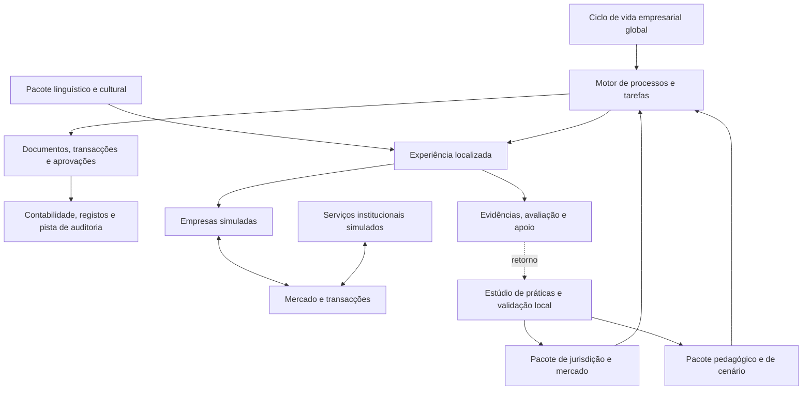
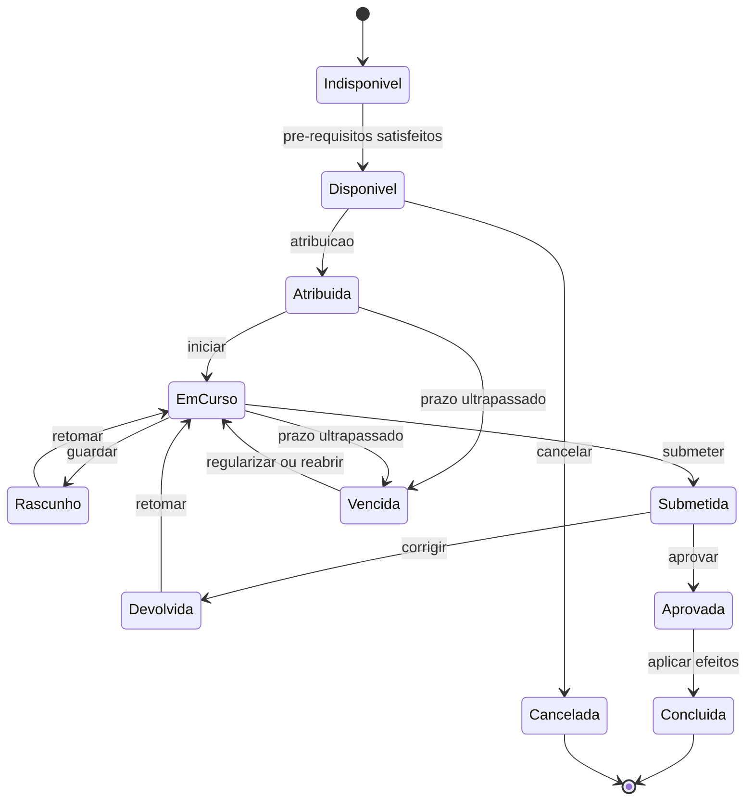
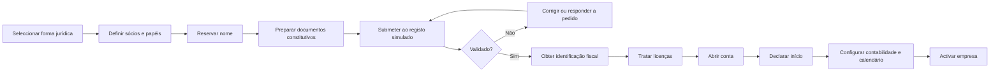

# Motor de Processos do SPEE

## Especificação conceptual e funcional para uma plataforma internacional de práticas empresariais

**Versão:** 1.0 — documento de aprofundamento da revisão de literatura  
**Data:** 3 de Agosto de 2026  
**Âmbito:** Sistema de Práticas Empresariais e Empreendedorismo — SPEE  
**Documento de origem:** `revisao_literatura_internacionalizacao_spee_v2.md`  
**Natureza:** especificação conceptual e funcional; não constitui ainda um contrato técnico de API nem uma selecção definitiva de tecnologia

---

## Resumo executivo

O motor de processos deve ser o componente central que transforma o ciclo de vida empresarial do SPEE em práticas executáveis, localizáveis, auditáveis e pedagogicamente observáveis.

Não deve limitar-se a apresentar uma lista de actividades. Deve coordenar:

- eventos que iniciam uma prática;
- tarefas humanas, automáticas e institucionais;
- papéis, responsabilidades e autorizações;
- pré-requisitos e dependências;
- documentos de entrada e saída;
- regras, cálculos e validações;
- prazos, calendários e notificações;
- aprovações, devoluções e separação de funções;
- excepções, erros e recuperação;
- efeitos sobre transacções, inventário, tesouraria e contabilidade;
- evidências de aprendizagem, avaliação e auditoria;
- variantes de país, língua, sector e cenário pedagógico.

A proposta central é separar o **processo canónico global** das respectivas **variantes locais**. O núcleo pode definir, por exemplo, o significado empresarial de “vender a crédito”. O pacote de jurisdição define os documentos, impostos, moeda, prazos, numeração, aprovações e efeitos contabilísticos aplicáveis. O pacote linguístico e cultural define terminologia, apresentação e comunicação. O pacote pedagógico define complexidade, apoio, competências e evidências.

> **O motor de processos é o mecanismo que converte uma prática empresarial abstracta numa experiência de trabalho localmente credível, globalmente comparável e pedagogicamente avaliável.**

---

## 1. Problema que o motor deve resolver

Os dados internos mostram que muitos bloqueios do SPEE surgem porque o participante não consegue perceber:

- em que etapa se encontra;
- o que já foi concluído;
- que pré-requisito está em falta;
- que documento deve produzir;
- quem deve responder ou aprovar;
- que regra impediu o avanço;
- como corrigir o erro sem perder trabalho;
- qual é o passo seguinte.

No corpus de 576 conversas, as principais dores concentram-se no registo, acesso, erros, navegação e constituição de empresas/sócios. Os erros técnicos ou bloqueios apresentam a maior concentração de sentimento negativo. Entre as conversas classificadas como docentes, destacam-se turmas e gestão pedagógica; entre as classificadas como estudantes, sócios, convites e empresa.

A internacionalização acrescentará documentos, regras, calendários, serviços e excepções. Sem um motor explícito, a complexidade ficará dispersa por módulos e código, tornando a experiência difícil de compreender, manter, localizar e apoiar.

O motor deve, portanto, transformar uma cadeia implícita como:

```text
Constituir empresa
→ validar sócios
→ activar empresa
→ configurar actividade
→ adquirir activos mínimos
→ iniciar operações
→ produzir documentos
→ registar contabilidade
→ fechar e prestar contas
```

num percurso explícito, observável e recuperável.

---

## 2. Objectivos do motor de processos

### 2.1. Objectivos funcionais

1. Executar processos empresariais configuráveis sem incorporar regras nacionais no código do núcleo.
2. Distribuir tarefas por empresa, participante, função e serviço simulado.
3. Controlar estados, dependências, prazos, aprovações e excepções.
4. Ligar cada prática aos documentos e transacções que produz.
5. Propagar efeitos operacionais e contabilísticos de forma rastreável.
6. Permitir continuidade com ligação intermitente e sincronização segura.
7. Dar ao participante orientação, confirmação e recuperação.
8. Dar ao docente visibilidade e intervenção controlada.
9. Fornecer ao helpdesk contexto técnico e processual suficiente.
10. Conservar evidências para aprendizagem, avaliação e auditoria.

### 2.2. Objectivos de internacionalização

1. Separar processo canónico, variante de jurisdição, apresentação linguística e configuração pedagógica.
2. Permitir comparar variantes nacionais do mesmo processo.
3. Fixar uma versão de regras durante a execução de uma turma.
4. Permitir autoria e manutenção locais sem alterar o núcleo.
5. Suportar processos nacionais, regionais e transfronteiriços.

### 2.3. Objectivos pedagógicos

1. Ensinar o propósito e a sequência de cada prática.
2. Tornar visíveis as relações entre áreas funcionais.
3. Permitir rotação e separação de funções.
4. Tratar o erro como oportunidade de diagnóstico e correcção.
5. Avaliar processo, qualidade, conformidade, integração e reflexão — não apenas conclusão ou lucro.

---

## 3. Princípios de desenho

### 3.1. Processo antes do módulo

O utilizador deve compreender a prática empresarial que está a realizar, mesmo quando esta atravessa vários módulos. “Vender”, “contratar”, “pagar imposto” e “fechar contas” são processos; comercial, tesouraria e contabilidade são áreas que participam nesses processos.

### 3.2. Configuração antes de duplicação

As variantes de país, língua, sector e pedagogia devem configurar o processo canónico. Não se deve duplicar o produto por país nem manter regras substantivas dispersas no código.

### 3.3. Rastreabilidade de ponta a ponta

Deve ser possível seguir uma operação desde o evento de origem até:

- tarefas executadas;
- decisões e aprovações;
- documentos produzidos;
- transacções criadas;
- efeitos operacionais;
- lançamentos contabilísticos;
- evidências e avaliação.

### 3.4. Orientar, confirmar e recuperar

Cada prática crítica deve:

1. explicar o objectivo;
2. mostrar dados, documentos e pré-requisitos;
3. permitir executar;
4. validar antes da submissão;
5. confirmar o novo estado;
6. indicar o próximo actor e passo;
7. permitir correcção e retoma sem perda de trabalho.

### 3.5. Apoio graduado

O sistema deve oferecer exemplo, glossário, lista de verificação, ajuda contextual e explicação de erro. A assistência não deve executar automaticamente a prática que o estudante precisa de aprender.

### 3.6. Versão imutável durante a execução

Uma alteração legal, fiscal ou pedagógica não deve modificar silenciosamente um processo já iniciado. Cada instância deve conservar a versão das definições e regras com que começou.

### 3.7. Inclusão e resiliência como fundação

O motor deve suportar telemóvel, baixo consumo de dados, acessibilidade WCAG 2.2 AA, gravação local, sincronização, conflitos e retoma.

---

## 4. Posição do motor na arquitectura do SPEE



O motor ocupa a posição de orquestrador. Não substitui:

- o repositório de documentos;
- o motor contabilístico;
- os serviços institucionais simulados;
- a interface do participante;
- o sistema de avaliação;
- o estúdio de autoria.

Coordena estes componentes através de estados, eventos, comandos e resultados rastreáveis.

---

## 5. Modelo conceptual

### 5.1. Objectos centrais

| Objecto | Responsabilidade no motor |
|---|---|
| Definição de processo | Modelo versionado de uma prática empresarial |
| Instância de processo | Execução concreta de uma definição por uma empresa/turma |
| Etapa | Agrupamento lógico de tarefas dentro do processo |
| Tarefa | Unidade de trabalho atribuída a um actor ou serviço |
| Evento | Ocorrência que inicia, altera, suspende ou conclui trabalho |
| Transição | Mudança autorizada entre estados |
| Papel | Responsabilidade funcional usada para atribuição e autorização |
| Participante | Pessoa que assume um ou mais papéis numa instância |
| Empresa simulada | Unidade organizacional onde a prática ocorre |
| Serviço simulado | Entidade externa à empresa que recebe e responde |
| Documento | Entrada, saída ou evidência da prática |
| Transacção | Relação que altera o estado de entidades e registos |
| Regra | Condição, cálculo, limite, obrigação ou validação |
| Calendário | Prazos, períodos, feriados, fechos e janelas de execução |
| Aprovação | Decisão formal de aceitar, devolver ou rejeitar trabalho |
| Excepção | Situação prevista que altera o caminho normal |
| Incidente | Falha técnica ou operacional que exige diagnóstico |
| Evidência | Prova de execução, competência, comunicação ou reflexão |
| Efeito contabilístico | Consequência que liga o documento à contabilidade |
| Registo de auditoria | Memória imutável de eventos, estados e intervenções |

### 5.2. Identificadores e relações mínimas

Cada instância deve conservar, no mínimo:

- identificador global da instância;
- identificador e versão da definição canónica;
- pacote de jurisdição e respectiva versão;
- pacote linguístico e respectiva versão;
- pacote pedagógico/cenário e respectiva versão;
- empresa simulada, turma e instituição;
- participantes e papéis;
- período contabilístico e calendário aplicável;
- documentos e transacções relacionados;
- estado actual e histórico de estados;
- origem da acção e actor responsável;
- estado de sincronização;
- evidências e eventos de auditoria.

---

## 6. Contrato conceptual de uma definição de processo

Cada processo deve declarar os seguintes elementos.

### 6.1. Identidade e âmbito

- identificador estável;
- nome canónico;
- descrição e objectivo empresarial;
- fase do ciclo de vida;
- família de prática;
- versão;
- estado editorial;
- jurisdições e sectores compatíveis;
- data de vigência e próxima revisão;
- fontes e responsáveis.

### 6.2. Início e conclusão

- evento ou condição de início;
- actor autorizado a iniciar;
- pré-requisitos globais;
- dados e documentos de entrada;
- condições de conclusão;
- resultados e documentos finais;
- processos que podem seguir-se.

### 6.3. Estrutura de trabalho

- etapas;
- tarefas e respectiva ordem;
- tarefas paralelas e dependentes;
- tarefas humanas, automáticas ou institucionais;
- papéis responsáveis;
- preparação, revisão e aprovação;
- prazos e prioridades;
- caminhos normais e alternativos.

### 6.4. Regras e efeitos

- regras de elegibilidade;
- validações de campos e documentos;
- cálculos;
- limites;
- aprovações;
- efeitos em inventário, caixa, clientes, fornecedores, fiscalidade e contabilidade;
- excepções e compensações;
- evidência pedagógica esperada.

### 6.5. Experiência e apoio

- propósito explicado ao participante;
- ajuda contextual;
- exemplo ou modelo preenchido;
- glossário;
- mensagens de validação e erro;
- acção de recuperação;
- contexto a incluir num pedido ao helpdesk;
- retorno formativo e momento de reflexão.

---

## 7. Estados de execução

### 7.1. Estados da instância de processo

| Estado | Significado |
|---|---|
| Planeado | Processo previsto, mas ainda sem condições de arranque |
| Pronto | Pré-requisitos globais verificados |
| Activo | Há trabalho disponível ou em execução |
| Em espera interna | Aguarda outra função ou participante da empresa |
| Em espera externa | Aguarda resposta de serviço, cliente, fornecedor ou entidade |
| Bloqueado por regra | Uma condição de negócio impede o avanço |
| Bloqueado tecnicamente | Uma falha técnica impede a execução |
| Pendente de sincronização | Trabalho local concluído, ainda não confirmado pelo servidor |
| Em revisão | Aguarda validação, devolução ou aprovação |
| Concluído | Condições de conclusão satisfeitas |
| Cancelado | Execução terminada por decisão autorizada |
| Substituído | Instância migrada ou sucedida por outra, preservando histórico |

### 7.2. Estados da tarefa

| Estado | Significado |
|---|---|
| Indisponível | Pré-requisitos ainda não satisfeitos |
| Disponível | Pode ser assumida ou executada |
| Atribuída | Tem responsável definido |
| Em curso | Está a ser executada |
| Rascunho guardado | Trabalho incompleto preservado |
| Submetida | Entregue para validação ou actor seguinte |
| Devolvida | Requer correcção, com fundamento |
| Aprovada | Validada pelo actor competente |
| Concluída | Resultado aceite e efeitos aplicados |
| Vencida | Prazo ultrapassado sem conclusão |
| Cancelada | Terminada sem aplicação normal dos efeitos |

### 7.3. Máquina de estados simplificada



As transições devem exigir:

- actor autorizado;
- condição de negócio válida;
- versão de regra conhecida;
- registo de data e origem;
- fundamento quando há devolução, rejeição, cancelamento ou intervenção administrativa.

---

## 8. Ciclo de vida da definição e da instância

### 8.1. Ciclo editorial da definição

```text
Rascunho
→ revisão de domínio
→ revisão jurídica/contabilística
→ revisão pedagógica
→ revisão linguística e de acessibilidade
→ teste técnico
→ piloto com participantes
→ aprovação
→ publicação
→ monitorização
→ revisão ou arquivo
```

### 8.2. Ciclo operacional da instância

```text
Seleccionar processo e pacotes
→ congelar versões
→ verificar pré-requisitos
→ criar instância e atribuir papéis
→ executar tarefas e trocar documentos
→ tratar aprovações, prazos e excepções
→ aplicar efeitos e conservar auditoria
→ recolher evidências e retorno
→ concluir, avaliar e arquivar
```

### 8.3. Regra de congelamento

Quando uma instância começa, o motor deve conservar uma referência imutável às versões aplicáveis. Uma nova versão pode ser publicada para futuras instâncias sem alterar as execuções em curso. Qualquer migração deve ser explícita, autorizada, testada e auditada.

---

## 9. Papéis, atribuição e separação de funções

### 9.1. Papéis empresariais exemplificativos

- direcção;
- comercial;
- compras;
- operações;
- recursos humanos;
- tesouraria;
- contabilidade;
- fiscalidade;
- contratação pública;
- auditoria interna.

### 9.2. Papéis institucionais exemplificativos

- funcionário de registo;
- técnico tributário;
- operador de segurança social;
- banco ou microfinança;
- operador de moeda electrónica;
- comprador público;
- alfândega;
- seguradora;
- auditor;
- docente ou facilitador.

### 9.3. Modelos de atribuição

O motor deve permitir:

- atribuição directa a participante;
- atribuição por papel;
- fila de trabalho de uma função;
- atribuição por disponibilidade ou rotação;
- atribuição automática a serviço simulado;
- atribuição manual pelo docente, dentro de limites;
- delegação temporária;
- substituição com passagem de contexto;
- escalamento quando o prazo ou risco o justificam.

### 9.4. Separação de funções

Uma definição pode proibir que a mesma pessoa prepare e aprove uma operação. Exemplos:

- quem prepara o pagamento não o aprova;
- quem lança uma reconciliação não valida a sua própria divergência;
- quem prepara uma proposta de concurso não decide sozinho a sua submissão;
- quem executa o fecho não realiza a auditoria final.

A separação deve ser configurável por cenário e dimensão da equipa. Em equipas pequenas, o sistema pode usar revisão docente ou controlos compensatórios.

---

## 10. Regras, cálculos e decisões

### 10.1. Tipos de regra

| Tipo | Exemplo |
|---|---|
| Elegibilidade | A empresa pode concorrer a este procedimento? |
| Pré-requisito | Todos os sócios aceitaram e as quotas somam 100%? |
| Validação | A factura contém os campos obrigatórios? |
| Cálculo | Qual é o imposto, salário líquido ou comissão? |
| Limite | O valor exige aprovação adicional? |
| Calendário | A declaração está dentro do prazo? |
| Autorização | Este papel pode submeter ou aprovar? |
| Sequência | A entrega pode ocorrer antes da encomenda? |
| Consistência | O total do documento coincide com linhas e imposto? |
| Contabilística | Que contas, débitos e créditos são afectados? |
| Pedagógica | Que ajuda está disponível neste nível de dificuldade? |

### 10.2. Regras fora do código

As regras substantivas devem residir em pacotes versionados, com:

- identificador;
- descrição compreensível;
- jurisdição;
- fonte;
- simplificação pedagógica;
- fórmula ou condição;
- data de vigência;
- responsável;
- testes;
- impacto nos processos e documentos.

### 10.3. Explicabilidade

Quando uma regra impede o avanço, o participante deve receber:

1. o que falhou;
2. por que motivo;
3. que dados ou documentos estão afectados;
4. quem pode corrigir;
5. como retomar;
6. referência à regra ou ajuda aplicável.

O motor não deve expor apenas mensagens genéricas como “operação inválida” ou “não foi possível continuar”.

---

## 11. Documentos, transacções e efeitos contabilísticos

### 11.1. Documento canónico e variante local

```text
Tipo global de documento
→ extensão da jurisdição
→ modelo na língua e formato local
→ estado e assinatura
→ efeitos no processo
→ efeitos contabilísticos
→ arquivamento e evidência
```

Uma factura pode ter apresentações diferentes em dois países, mantendo uma identidade canónica que o motor reconhece.

### 11.2. Estados exemplificativos do documento

- em preparação;
- emitido;
- submetido;
- recebido;
- em validação;
- aprovado;
- rejeitado;
- devolvido para correcção;
- cancelado;
- substituído;
- pago ou liquidado;
- arquivado.

### 11.3. Aplicação de efeitos

O motor só deve aplicar os efeitos definitivos quando as condições configuradas forem satisfeitas. A conclusão de uma tarefa pode:

- criar ou actualizar um documento;
- alterar o estado de uma transacção;
- movimentar inventário;
- criar conta a receber ou a pagar;
- produzir obrigação fiscal;
- iniciar uma tarefa noutra função;
- enviar mensagem a serviço simulado;
- gerar proposta de lançamento contabilístico;
- produzir evidência pedagógica.

### 11.4. Rastreabilidade

Cada efeito deve manter ligação ao:

- processo e tarefa de origem;
- actor que executou;
- documento de origem;
- regra e versão aplicadas;
- aprovação necessária;
- data efectiva e data de registo;
- eventual correcção, estorno ou substituição.

---

## 12. Calendários, prazos e eventos

O motor deve distinguir:

- data e hora do mundo simulado;
- data e hora reais da plataforma;
- prazo empresarial;
- prazo fiscal ou institucional;
- prazo pedagógico definido pelo docente;
- período contabilístico;
- estado de sincronização.

### 12.1. Funções do calendário

- dias úteis e feriados por jurisdição;
- prazos relativos e datas fixas;
- avisos antecipados;
- vencimento;
- tolerância e regularização;
- penalizações e juros simulados;
- fecho de período;
- suspensão autorizada;
- repetição de obrigações.

### 12.2. Tipos de evento

- início manual;
- recepção de documento ou mensagem;
- conclusão de processo anterior;
- alteração de estado de entidade;
- data ou prazo;
- decisão de docente;
- ocorrência de cenário;
- resposta de serviço simulado;
- falha técnica ou de sincronização;
- evento externo simulado, como câmbio, energia, clima ou mudança regulatória.

---

## 13. Excepções, erros e recuperação

### 13.1. Classificação obrigatória

O motor deve distinguir:

- erro de conhecimento;
- documento incompleto;
- violação de regra;
- pré-requisito ausente;
- conflito de dados;
- atraso;
- resposta externa pendente;
- falha técnica;
- falha de sincronização;
- incidente de segurança;
- intervenção administrativa.

### 13.2. Resposta ao erro

Cada incidente deve ter:

- código único;
- tipo e gravidade;
- processo, etapa e tarefa;
- empresa, turma e pacote;
- causa conhecida ou provável;
- dados e documentos afectados;
- trabalho já preservado;
- acção de recuperação;
- actor responsável;
- possibilidade de retoma;
- estado de escalamento.

### 13.3. Compensação e correcção

Quando uma operação já produziu efeitos, não se deve apagar silenciosamente o histórico. O motor deve suportar:

- devolução antes da aprovação;
- correcção com nova versão do documento;
- cancelamento com fundamento;
- estorno ou movimento compensatório;
- reabertura autorizada;
- repetição controlada;
- migração explícita;
- preservação da tentativa inicial como evidência pedagógica, quando apropriado.

---

## 14. Continuidade offline e sincronização

### 14.1. Estados locais

O motor deve distinguir claramente:

- rascunho apenas local;
- pronto para sincronizar;
- enviado;
- recebido pelo servidor;
- aceite;
- rejeitado por conflito;
- pendente de intervenção.

### 14.2. Requisitos mínimos

- identificadores temporários seguros;
- comandos idempotentes para impedir duplicação;
- fila local visível;
- ordem e dependências preservadas;
- detecção de conflito;
- política por tipo de conflito;
- pista de auditoria local e central;
- retoma após interrupção;
- explicação dos efeitos sobre prazos;
- confirmação final de sincronização.

### 14.3. Exemplo de conflito

Duas pessoas alteram offline o mesmo documento. O motor não deve escolher silenciosamente uma versão. Deve:

1. identificar campos ou operações incompatíveis;
2. preservar ambas as contribuições;
3. aplicar uma regra de resolução automática apenas quando segura;
4. encaminhar conflitos materiais para um actor autorizado;
5. registar a decisão e o fundamento.

---

## 15. Internacionalização e pacotes

### 15.1. Processo canónico

Define a intenção e a estrutura empresarial comum. Exemplo: “vender a crédito” inclui oferta, encomenda, entrega, facturação, cobrança e reconciliação.

### 15.2. Pacote de jurisdição e mercado

Pode definir:

- forma jurídica e entidades;
- campos e modelos documentais;
- impostos e taxas;
- moeda e câmbio;
- numeração;
- calendário e prazos;
- regras laborais e sociais;
- plano de contas e tratamento contabilístico;
- licenciamento e contratação pública;
- métodos de pagamento;
- processos institucionais.

### 15.3. Pacote linguístico e cultural

Pode definir:

- língua e variante;
- terminologia e glossário;
- formatos de data, número, moeda, nome e endereço;
- nível de linguagem;
- modelos de comunicação;
- exemplos e símbolos;
- orientação da escrita;
- práticas de colaboração e autorização validadas localmente.

### 15.4. Pacote pedagógico e de cenário

Pode definir:

- resultados de aprendizagem;
- nível de dificuldade;
- passos visíveis ou ocultos;
- exemplos e ajuda permitida;
- rotação e separação de funções;
- eventos e choques;
- prazos pedagógicos;
- rubricas e evidências;
- reflexão e *debriefing*;
- condições de intervenção docente.

### 15.5. Ordem de composição

```text
Processo canónico global
+ pacote de jurisdição e mercado
+ pacote linguístico e cultural
+ pacote pedagógico e de cenário
= definição executável congelada para a turma
```

Conflitos entre pacotes devem ser detectados antes da publicação ou instanciação.

---

## 16. Experiência por actor

### 16.1. Participante

A caixa de trabalho deve mostrar:

- empresa e função actual;
- tarefa, objectivo e prioridade;
- origem do pedido;
- prazo;
- dados e documentos necessários;
- estado e dependências;
- actor ou entidade seguinte;
- efeito esperado;
- ajuda e exemplo;
- confirmação de conclusão;
- histórico relevante.

### 16.2. Docente e facilitador

O painel deve permitir:

- acompanhar empresas, processos, funções e participantes;
- ver bloqueios, atrasos e esperas externas;
- identificar concentração de trabalho;
- seguir documentos e efeitos;
- verificar separação de funções;
- devolver, reabrir ou regularizar uma prática;
- ajustar complexidade dentro dos limites da versão;
- inserir ocorrência ou cenário;
- iniciar auditoria;
- avaliar por competência e evidência;
- conduzir reflexão individual e colectiva.

### 16.3. Operador de serviço simulado

Deve receber uma fila com:

- pedidos e documentos;
- prazo de resposta;
- regras aplicáveis;
- validações automáticas;
- decisões disponíveis;
- pedidos de esclarecimento;
- histórico de comunicações;
- impacto da decisão.

Uma tarefa pode ser totalmente automática, totalmente humana ou híbrida.

### 16.4. Helpdesk

Com consentimento e minimização de dados, um pedido de apoio deve incluir automaticamente:

- papel do utilizador;
- instituição e turma;
- empresa;
- país, língua e pacotes/versionamento;
- processo, etapa e tarefa;
- estado actual;
- pré-requisito em falta;
- código do erro;
- estado de sincronização;
- identificadores técnicos não sensíveis.

Nunca deve incluir palavra-passe, documento pessoal integral ou dados sem necessidade operacional.

---

## 17. Evidência, avaliação e retorno pedagógico

### 17.1. Evidências possíveis

- documento produzido;
- cálculo;
- comunicação;
- aprovação;
- reconciliação;
- resposta a excepção;
- sequência de decisões;
- relatório;
- apresentação;
- reflexão;
- revisão por pares;
- observação do docente.

### 17.2. Dimensões de avaliação

| Dimensão | Pergunta ao motor |
|---|---|
| Completude | Os passos e documentos necessários foram concluídos? |
| Correcção | Cálculos, campos e classificações estão correctos? |
| Conformidade | Regras, autorizações e prazos foram respeitados? |
| Rastreabilidade | A operação pode ser seguida da origem às contas? |
| Integração | Os efeitos entre áreas foram tratados? |
| Controlo | Houve revisão, reconciliação e separação de funções? |
| Colaboração | O trabalho foi entregue e comunicado adequadamente? |
| Diagnóstico | Erros e divergências foram corrigidos com fundamento? |
| Julgamento | As excepções foram tratadas de forma adequada? |
| Reflexão | O participante explica o que fez e o que melhoraria? |

O motor deve fornecer evidência; a avaliação de alto impacto não deve ser entregue exclusivamente a uma regra automática ou IA.

---

## 18. Auditoria, segurança e privacidade

### 18.1. Registo de auditoria

Cada evento relevante deve registar:

- quem;
- quando;
- em que papel;
- sobre que objecto;
- estado anterior e posterior;
- comando e resultado;
- regra e versão;
- documento ou transacção relacionada;
- origem: interface, API, sincronização, automação ou intervenção administrativa;
- fundamento, quando aplicável.

### 18.2. Controlo de acesso

- princípio do menor privilégio;
- permissões por papel, empresa, turma, processo e serviço;
- separação entre configuração, execução, avaliação e administração;
- autorização explícita para reabertura, cancelamento e correcção;
- revisão periódica de acessos;
- auditoria das intervenções privilegiadas.

### 18.3. Separação entre simulação e realidade

O motor deve impedir que identificadores, dinheiro, documentos e submissões simulados sejam confundidos com operações reais. Integrações externas devem usar ambientes de treino ou isolamento explícito.

### 18.4. Privacidade

- recolha mínima;
- separação entre identidade, actividade, apoio e investigação;
- retenção definida;
- acesso, correcção e exportação quando aplicável;
- residência e transferência avaliadas por país;
- painéis pedagógicos sem vigilância excessiva.

---

## 19. Interfaces e interoperabilidade

O motor deve disponibilizar interfaces documentadas para:

- interface do participante;
- painel docente;
- estúdio de práticas;
- serviços institucionais simulados;
- documentos e assinaturas;
- contabilidade e relato;
- notificações;
- apoio e diagnóstico;
- eventos de aprendizagem;
- importação de turmas;
- exportação de notas, portefólios e evidências;
- integrações LTI 1.3 e início de sessão único.

### 19.1. Eventos exemplificativos

- `process.instance.created`;
- `task.available`;
- `task.assigned`;
- `task.submitted`;
- `task.returned`;
- `task.approved`;
- `document.issued`;
- `transaction.posted`;
- `rule.failed`;
- `deadline.approaching`;
- `process.blocked`;
- `sync.conflict.detected`;
- `process.completed`;
- `evidence.recorded`.

Os nomes são ilustrativos. A convenção técnica definitiva deve ser decidida durante a arquitectura detalhada.

---

## 20. Exemplo 1 — Venda a crédito

### 20.1. Sequência integrada

```text
Oportunidade
→ cotação
→ encomenda
→ aprovação de condições
→ entrega
→ factura
→ imposto
→ conta a receber
→ cobrança
→ recibo
→ banco/caixa
→ reconciliação
→ contabilidade
→ relatório e contas
```

### 20.2. Quadro de execução

| Passo | Papel principal | Documento/resultado | Regra ou dependência | Efeito |
|---|---|---|---|---|
| Preparar cotação | Comercial | Cotação | Cliente e catálogo válidos | Proposta comercial |
| Receber encomenda | Comercial | Encomenda | Cotação aceite ou condições definidas | Obrigação de entrega |
| Aprovar crédito | Direcção/tesouraria | Decisão | Limite, histórico e cenário | Condição de venda |
| Entregar | Operações | Guia/entrega | Inventário e aprovação | Movimento de inventário |
| Facturar | Comercial/fiscalidade | Factura | Entrega e regras documentais | Imposto e conta a receber |
| Cobrar | Tesouraria | Recebimento | Factura vencida/aberta | Movimento de caixa/banco |
| Emitir recibo | Tesouraria | Recibo | Recebimento confirmado | Liquidação parcial/total |
| Reconciliar | Contabilidade | Reconciliação | Banco/caixa e cliente | Validação dos registos |
| Contabilizar | Contabilidade | Lançamentos | Documentos válidos | Contas e relato |

### 20.3. Variantes locais possíveis

- campos e numeração da factura;
- imposto e taxa;
- moeda;
- documento de transporte;
- assinatura;
- prazo de pagamento;
- retenções;
- tratamento contabilístico;
- meio de cobrança;
- língua e terminologia.

---

## 21. Exemplo 2 — Constituição de empresa



O motor deve tornar visíveis:

- convites emitidos, aceites, rejeitados ou expirados;
- percentagem de quotas e conflitos;
- documentos em falta;
- serviço que está a analisar;
- pedido de esclarecimento;
- prazo e estado;
- causa de rejeição;
- acção para corrigir;
- condição exacta de activação da empresa.

---

## 22. Exemplo 3 — Processo transfronteiriço

Uma venda entre empresas de países diferentes pode combinar:

- proposta e contrato;
- moeda e câmbio;
- condições de entrega;
- factura de exportação/importação;
- origem e documentação;
- alfândega;
- banco ou moeda electrónica;
- protecção de dados;
- comunicação multilingue;
- resolução de divergência.

O processo canónico é partilhado, mas cada lado pode aplicar um pacote de jurisdição diferente. O motor deve coordenar a troca sem presumir que as regras são idênticas.

---

## 23. Exemplo ilustrativo de definição declarativa

O exemplo seguinte serve para orientar arquitectura e autoria. Não constitui um esquema técnico final.

```yaml
process_definition:
  id: spee.sales.credit-sale
  canonical_version: 1.0.0
  lifecycle_stage: operation
  objective: "Vender a crédito, entregar, facturar, cobrar e reconciliar"

  packages:
    jurisdiction: MZ-reference-2026.1
    language: pt-MZ-2026.1
    pedagogy: undergraduate-standard-1.0

  start_event:
    type: manual_or_customer_request
    allowed_roles: [commercial]

  prerequisites:
    - company.status == active
    - customer.status == valid
    - product_catalog.status == published
    - accounting_period.status == open

  roles:
    - commercial
    - operations
    - treasury
    - accounting
    - approver

  tasks:
    - id: prepare_quote
      type: human
      assigned_to: commercial
      output_document: quotation
      due_in: P2D
      completion_rule: quotation.status == issued
      evidence: [document, calculation]

    - id: approve_credit
      type: human_or_rule_assisted
      assigned_to: approver
      prerequisites: [prepare_quote]
      separation_of_duties: approver != quotation.author
      outcomes: [approved, returned, rejected]

    - id: deliver_goods
      type: human
      assigned_to: operations
      prerequisites: [approve_credit]
      effects: [inventory_issue, delivery_document]

    - id: issue_invoice
      type: human_with_validation
      assigned_to: commercial
      prerequisites: [deliver_goods]
      output_document: invoice
      rules: [invoice_required_fields, tax_calculation, document_numbering]
      effects: [tax_obligation, account_receivable, accounting_proposal]

    - id: record_receipt
      type: human
      assigned_to: treasury
      prerequisites: [issue_invoice]
      output_document: receipt
      effects: [cash_or_bank_movement, receivable_settlement]

    - id: reconcile
      type: human
      assigned_to: accounting
      prerequisites: [record_receipt]
      effects: [reconciliation_record, accounting_posting]

  exceptions:
    - late_payment
    - partial_payment
    - returned_goods
    - invoice_correction
    - sync_conflict

  completion:
    all_required_tasks_completed: true
    reconciliation_status: approved
    reflection_required: true

  support_context:
    include: [process_id, task_id, role, package_versions, error_code, sync_state]
    exclude: [password, full_personal_document, real_bank_data]
```

---

## 24. Estúdio de práticas

O estúdio é a interface de autoria e governação do motor. Deve permitir:

1. seleccionar ou criar processo canónico;
2. definir etapas, tarefas e transições;
3. atribuir papéis e separação de funções;
4. associar documentos;
5. configurar regras e cálculos;
6. ligar efeitos operacionais e contabilísticos;
7. definir calendários, prazos e excepções;
8. configurar ajuda, competências e evidências;
9. simular caminhos normais e alternativos;
10. executar testes automáticos;
11. submeter para validação multidisciplinar;
12. publicar, versionar, suspender e arquivar.

### 24.1. Validação obrigatória

Cada prática deve passar por:

- especialista do domínio;
- profissional local;
- contabilista/fiscalista quando aplicável;
- docente;
- especialista linguístico;
- especialista de acessibilidade;
- revisão técnica;
- teste com participantes.

### 24.2. Metadados obrigatórios

- país e jurisdição;
- sector;
- língua;
- fonte;
- simplificação pedagógica;
- responsável;
- vigência e revisão;
- versão;
- processos, documentos e regras afectados;
- compatibilidade;
- condições de arquivo.

---

## 25. Observabilidade e indicadores

### 25.1. Indicadores operacionais

- instâncias iniciadas, concluídas, canceladas e bloqueadas;
- tempo por etapa e tarefa;
- espera interna e externa;
- tarefas vencidas;
- regras que mais bloqueiam;
- erros técnicos por versão;
- conflitos de sincronização;
- reaberturas e correcções;
- contactos de apoio por processo e tarefa.

### 25.2. Indicadores pedagógicos

- conclusão e abandono por etapa;
- erros de conhecimento versus falhas técnicas;
- utilização da ajuda;
- qualidade dos documentos;
- participação por papel;
- rotação e separação de funções;
- diagnóstico e correcção;
- reflexão e revisão por pares;
- intervenção docente.

### 25.3. Indicadores de internacionalização

- processos concluídos por país, língua e dispositivo;
- erros por variante;
- divergências de interpretação;
- regras ou documentos desactualizados;
- percepção de autenticidade;
- acessibilidade;
- capacidade local de manter o pacote.

Os indicadores devem apoiar aprendizagem e melhoria, não vigilância permanente.

---

## 26. Escopo mínimo P0

O primeiro produto do motor deve concentrar-se na fundação.

### 26.1. Capacidades indispensáveis

- definições versionadas;
- instâncias e estados;
- tarefas humanas e automáticas simples;
- papéis, atribuição e autorizações;
- dependências e pré-requisitos;
- documentos e estados;
- regras e validações;
- prazos e notificações;
- aprovação, devolução e reabertura;
- excepções e recuperação;
- auditoria;
- contexto de apoio;
- evidências pedagógicas;
- separação entre núcleo e pacote moçambicano;
- gravação local e sincronização segura para fluxos seleccionados;
- interface acessível para participante e docente.

### 26.2. Processos de referência para o primeiro ciclo

1. constituição de empresa e gestão de sócios;
2. venda, facturação, cobrança e recibo;
3. compra, recepção, aprovação e pagamento;
4. obrigação fiscal simples;
5. reconciliação e fecho básico.

Estes processos cobrem as principais dores internas e testam integração entre actores, documentos, regras, transacções e contabilidade.

---

## 27. Critérios de aceitação

### 27.1. Critérios funcionais

- [ ] uma instância conserva todas as versões aplicáveis;
- [ ] cada tarefa mostra objectivo, pré-requisitos, responsável, prazo e resultado;
- [ ] transições inválidas são impedidas com explicação accionável;
- [ ] documentos mantêm relação com processo, tarefa e transacção;
- [ ] efeitos contabilísticos podem ser seguidos até ao documento de origem;
- [ ] devolução e correcção preservam histórico;
- [ ] o docente vê bloqueios e pode intervir dentro das permissões;
- [ ] o helpdesk recebe contexto sem dados sensíveis;
- [ ] a instância pode ser concluída e arquivada com evidências.

### 27.2. Critérios de internacionalização

- [ ] a mesma definição canónica admite pelo menos duas variantes de jurisdição;
- [ ] texto, regras e modelos locais não estão incorporados no código;
- [ ] uma versão nova não altera instâncias activas;
- [ ] conflitos entre pacotes são detectados antes da execução;
- [ ] língua e jurisdição podem variar independentemente;
- [ ] autores locais conseguem actualizar um pacote sem alterar o núcleo.

### 27.3. Critérios de resiliência

- [ ] um rascunho local sobrevive à perda de ligação;
- [ ] a sincronização não duplica transacções;
- [ ] conflitos são visíveis e recuperáveis;
- [ ] o participante distingue trabalho local, enviado e confirmado;
- [ ] a pista de auditoria conserva origem e estado de sincronização.

### 27.4. Critérios pedagógicos

- [ ] cada processo declara competências e evidências;
- [ ] o participante compreende propósito, estado e próximo passo;
- [ ] o erro permite diagnóstico e correcção;
- [ ] a ajuda não executa automaticamente a prática;
- [ ] o docente consegue avaliar processo, evidência e reflexão;
- [ ] rotação e separação de funções podem ser configuradas.

---

## 28. Cenários mínimos de teste

### Cenário A — Caminho normal

Uma empresa activa vende a crédito, entrega, factura, recebe, emite recibo, reconcilia e contabiliza sem intervenção administrativa.

### Cenário B — Pré-requisito ausente

A empresa tenta facturar antes da entrega. O motor bloqueia, explica o pré-requisito e oferece ligação à tarefa em falta.

### Cenário C — Devolução para correcção

O aprovador devolve um documento incompleto. O autor corrige sem perder a versão anterior; o histórico mostra fundamento e nova submissão.

### Cenário D — Separação de funções

O autor de um pagamento tenta aprová-lo. O motor impede e encaminha para actor autorizado.

### Cenário E — Prazo e regularização

Uma declaração ultrapassa o prazo. O motor aplica o caminho de atraso, aviso, eventual penalização simulada e regularização.

### Cenário F — Falha técnica

A aplicação falha após submissão. Um comando repetido não duplica a transacção e a instância retoma no estado confirmado.

### Cenário G — Trabalho offline

Duas tarefas são preparadas sem ligação, sincronizadas na ordem correcta e confirmadas. Um conflito material é encaminhado para decisão.

### Cenário H — Mudança de regra

É publicada nova versão fiscal. Uma turma activa continua com a versão congelada; uma nova turma recebe a versão actualizada.

### Cenário I — Variante internacional

O processo canónico de venda é executado em duas jurisdições com facturas, impostos e tratamentos contabilísticos diferentes, preservando comparabilidade.

### Cenário J — Apoio e privacidade

Um pedido ao helpdesk inclui processo, tarefa, erro e versões, mas exclui palavra-passe, documento pessoal e dados bancários reais.

---

## 29. Riscos específicos do motor

| Risco | Consequência | Mitigação |
|---|---|---|
| Motor excessivamente genérico | Complexidade sem valor para autores e utilizadores | Começar com processos reais de referência |
| Regras no código | Internacionalização cara e lenta | Pacotes declarativos, versões e testes |
| Processos demasiado rígidos | Incapacidade de representar excepções locais | Caminhos alternativos e extensão governada |
| Processos demasiado flexíveis | Inconsistência e baixa auditabilidade | Contratos, validação e catálogo canónico |
| Estados invisíveis | Mais bloqueios e contactos de apoio | Estado, dependência e próximo passo no ecrã |
| Efeitos não atómicos | Documentos, inventário e contas divergentes | Aplicação coordenada, idempotência e compensação |
| Migração silenciosa | Turmas com regras inconsistentes | Versão congelada e migração explícita |
| *Offline* simplista | Duplicação, conflito ou perda | Fila, estados, idempotência e resolução de conflitos |
| Intervenção docente ilimitada | Perda de integridade e comparabilidade | Permissões, fundamento e auditoria |
| Automatização excessiva | O sistema realiza o trabalho do estudante | Ajuda graduada e limites à IA |
| Observabilidade invasiva | Vigilância e perda de confiança | Minimização, finalidade e acesso controlado |
| Conteúdo local sem manutenção | Regras desactualizadas | Responsável, vigência, revisão e governação |

---

## 30. Decisões de arquitectura ainda necessárias

1. Qual será a notação declarativa interna e o grau de compatibilidade com BPMN 2.0.2?
2. Que elementos pertencem ao motor e quais pertencem aos serviços de documentos, regras e contabilidade?
3. Como serão compostos e validados os pacotes?
4. Que garantias transaccionais são necessárias entre documentos, inventário e contabilidade?
5. Que modelo de eventos e auditoria será adoptado?
6. Que operações devem funcionar offline na primeira versão?
7. Como será feita a resolução de conflitos?
8. Que intervenções docentes são permitidas e como afectam avaliação?
9. Como serão simulados serviços institucionais humanos, automáticos e híbridos?
10. Que processos constituirão a prova inicial do pacote moçambicano?
11. Que dois contextos contrastantes validarão a arquitectura internacional?
12. Que equipa e conselho aprovarão definições e versões?

---

## 31. Sequência recomendada de trabalho

### Etapa 1 — Inventário do SPEE actual

- mapear módulos, processos, documentos, regras, estados e serviços;
- identificar regras moçambicanas incorporadas no código;
- localizar dependências e bloqueios;
- seleccionar processos de referência.

### Etapa 2 — Modelo canónico

- definir objectos e contratos conceptuais;
- definir estados, eventos e auditoria;
- definir composição de pacotes;
- definir ligação a documentos e contabilidade.

### Etapa 3 — Protótipo do motor

- implementar constituição e venda como processos de ponta a ponta;
- oferecer caixa de trabalho e painel docente mínimos;
- testar erros, devoluções, prazos e ajuda contextual.

### Etapa 4 — Pacote moçambicano de referência

- completar documentos, regras, serviços e efeitos;
- validar com especialistas, docentes e participantes;
- fixar critérios de qualidade.

### Etapa 5 — Prova internacional

- adaptar os mesmos processos a duas jurisdições contrastantes;
- testar substituição de regras e documentos sem duplicar código;
- comparar execução, apoio, aprendizagem e manutenção.

### Etapa 6 — Expansão do catálogo

- compras e pagamentos;
- salários e contribuições;
- fiscalidade;
- concursos públicos;
- alfândega e comércio transfronteiriço;
- fecho, auditoria e prestação de contas.

---

## 32. Conclusão

O motor de processos é a peça que permite ao SPEE deixar de funcionar como um conjunto de módulos e evoluir para uma economia internacional de práticas empresariais.

O seu valor não está apenas em ordenar tarefas. Está em ligar:

- objectivos empresariais;
- participantes e funções;
- documentos e transacções;
- regras e instituições;
- inventário, tesouraria e contabilidade;
- erros, correcções e auditoria;
- execução, evidência e aprendizagem;
- núcleo global e variantes locais.

> **Um processo do SPEE só está completo quando o participante consegue compreender o propósito, executar o trabalho, produzir o documento, observar os efeitos, recuperar de erros, explicar a decisão e seguir a operação até às contas.**

O primeiro passo recomendado é seleccionar um conjunto reduzido de processos de alto valor — constituição, venda, compra, obrigação fiscal e fecho básico — e demonstrar que podem ser executados de ponta a ponta, com rastreabilidade, recuperação, evidência pedagógica e duas variantes de jurisdição.

---

## Referências de base

- Bianchi, Hernández-Lara e Gualdi (2015): empresas virtuais e aprendizagem por competências.
- Gualdi (2020): integração de processos empresariais e educação contabilística.
- Object Management Group (2014): BPMN 2.0.2.
- OASIS (2021): Universal Business Language 2.3.
- PEN Worldwide: conceito de *Practice Enterprise* e serviços centrais.
- Riebenbauer e Stock (2015): modelação de empresas virtuais.
- Sequeira (2024); Sequeira et al. (2026): realismo, usabilidade, compatibilidade, acessibilidade e tecnologias emergentes no SPEE.
- Cossa (2018); Cossa et al. (2023a, 2023b): redes, apropriação local e expansão pan-africana do SPEE.
- W3C (2023): WCAG 2.2.
- 1EdTech Consortium (2024): LTI 1.3.
- `revisao_literatura_internacionalizacao_spee_v2.md`: arquitectura funcional, processos, práticas, pacotes, governação e avaliação.
- `analise_sentimento_spee_helpdesk.md` e `analysis_results.json`: evidência interna sobre bloqueios, apoio e experiência por actor.
