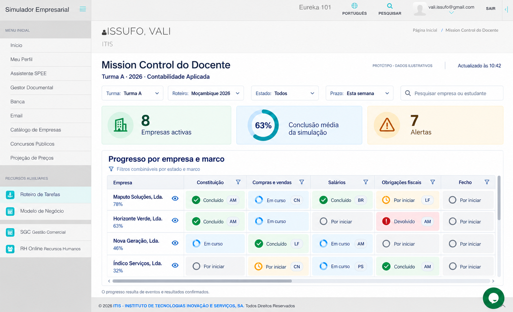
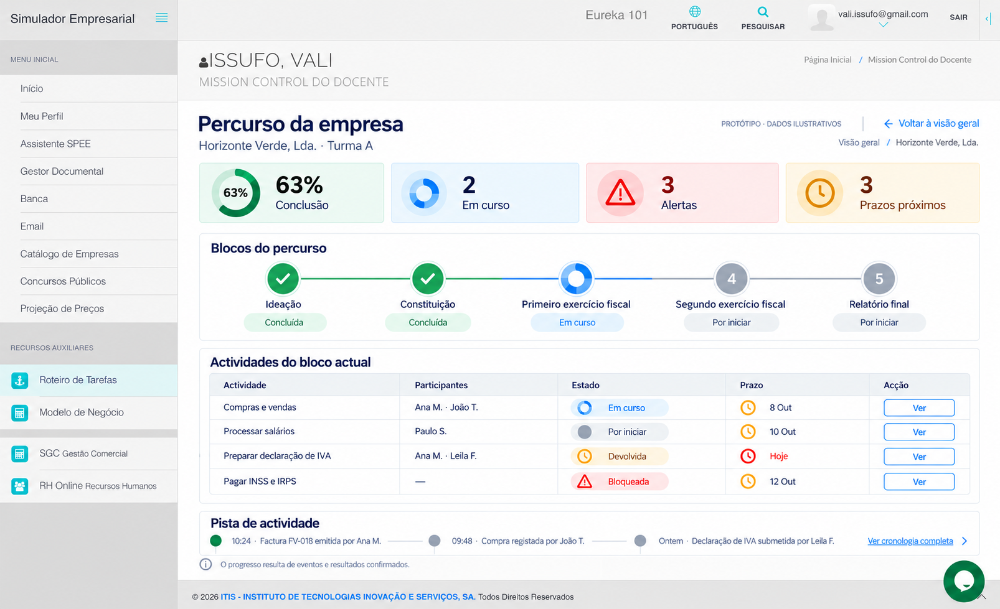
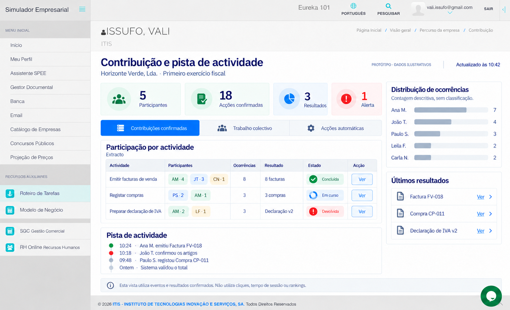

# Mission Control do Docente — v3

Data: 22 de Outubro de 2026. Série de 3 imagens PNG, geradas com a ferramenta integrada `imagegen` e revistas visualmente.

Os ecrãs usam a referência do simulador fornecida pelo utilizador: fundos brancos e cinzentos, ícones turquesa, acções azuis, cabeçalho e menu lateral original. O protótipo do docente e o do estudante continuam separados.

## Ecrãs

1. [Visão geral da turma](mission_control_docente_v3_01_visao_geral.png)
2. [Percurso da empresa](mission_control_docente_v3_02_percurso_empresa.png)
3. [Contribuição e pista de actividade](mission_control_docente_v3_03_contribuicao_pista.png)

## Referência e rastreabilidade

- [Imagem do simulador](../referencias/simulador_menu_2026-10-22.png): autoridade para cores, menu lateral e enquadramento visual.
- Série funcional anterior: docente v2, preservada no projecto.
- [Prompts completos](prompts.json): instruções de geração e correcções finais.
- Os PNGs mantêm a resolução nativa devolvida pela ferramenta, aproximadamente 1607 × 979 px, sem ampliação artificial.
- As quantidades, nomes de empresas, prazos e percentagens são dados ilustrativos.

## Menu lateral conservado

1. Início
2. Meu Perfil
3. Assistente SPEE
4. Gestor Documental
5. Banca
6. Email
7. Catálogo de Empresas
8. Concursos Públicos
9. Projeção de Preços
10. Roteiro de Tarefas
11. Modelo de Negócio
12. SGC Gestão Comercial
13. RH Online Recursos Humanos

As secções “MENU INICIAL” e “RECURSOS AUXILIARES” foram conservadas. A grafia “Projeção de Preços” foi transcrita da referência. “Roteiro de Tarefas” surge destacado visualmente; a associação técnica das rotas e das permissões continua por definir na DEC-007.

## Revisão final

- 3 imagens inspeccionadas, com conteúdo legível e menu completo.
- Cabeçalho, rodapé e enquadramento visual coerentes com a referência.
- Estados apresentados com texto e ícones, além da cor.
- Matriz com deslocamento horizontal e vertical; ecrãs separados para percurso e contribuição.
- Corrigida uma duplicação de “fiscal” no subtítulo da imagem 03.
- O exemplo da contribuição apresenta 5 participantes, correspondentes aos cinco nomes visíveis; a tabela é identificada como extracto. Esta reconciliação dos dados ilustrativos não define uma nova regra de atribuição de contribuição.

## Pré-visualizações

### Visão geral da turma

### Percurso da empresa

### Contribuição e pista de actividade

