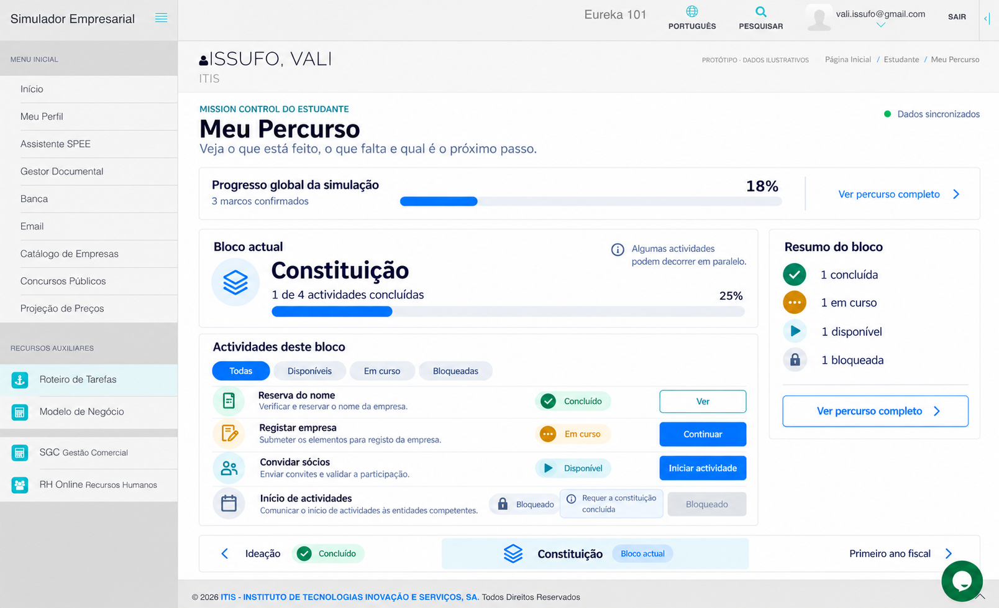
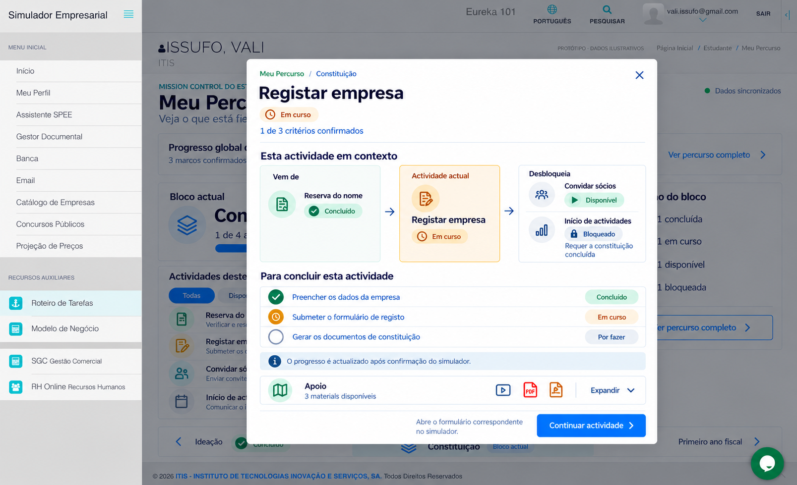
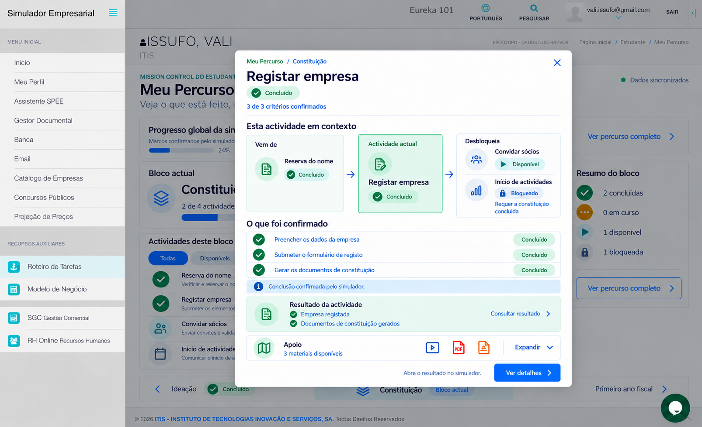
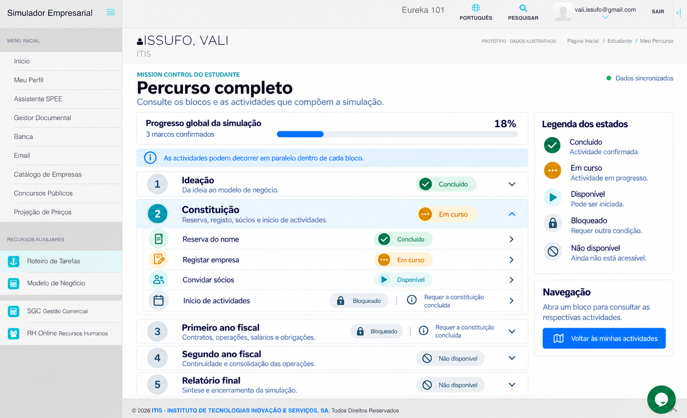

# Mission Control do Estudante — v4

Data: 22 de Outubro de 2026. Série de 4 imagens PNG, geradas com a ferramenta integrada `imagegen` e revistas visualmente.

Os ecrãs usam a referência do simulador fornecida pelo utilizador: fundos brancos e cinzentos, ícones turquesa, acções azuis, cabeçalho e menu lateral original. O protótipo do docente e o do estudante continuam separados.

## Ecrãs

1. [Meu Percurso](mission_control_estudante_v4_01_meu_percurso.png)
2. [Actividade em curso](mission_control_estudante_v4_02_actividade_em_curso.png)
3. [Actividade concluída](mission_control_estudante_v4_03_actividade_concluida.png)
4. [Percurso completo](mission_control_estudante_v4_04_percurso_completo.png)

## Referência e rastreabilidade

- [Imagem do simulador](../referencias/simulador_menu_2026-10-22.png): autoridade para cores, menu lateral e enquadramento visual.
- Série funcional anterior: estudante v3, preservada no projecto.
- [Prompts completos](prompts.json): instruções de geração e correcções finais.
- Os PNGs mantêm a resolução nativa devolvida pela ferramenta, aproximadamente 1607 × 979 px, sem ampliação artificial.
- As quantidades, nomes de empresas, prazos e percentagens são dados ilustrativos.

## Menu lateral conservado

1. Início
2. Meu Perfil
3. Assistente SPEE
4. Gestor Documental
5. Banca
6. Email
7. Catálogo de Empresas
8. Concursos Públicos
9. Projeção de Preços
10. Roteiro de Tarefas
11. Modelo de Negócio
12. SGC Gestão Comercial
13. RH Online Recursos Humanos

As secções “MENU INICIAL” e “RECURSOS AUXILIARES” foram conservadas. A grafia “Projeção de Preços” foi transcrita da referência. “Roteiro de Tarefas” surge destacado visualmente; a associação técnica das rotas e das permissões continua por definir na DEC-007.

## Revisão final

- 4 imagens inspeccionadas, com conteúdo legível e menu completo.
- Cabeçalho, rodapé e enquadramento visual coerentes com a referência.
- Estados apresentados com texto e ícones, além da cor.
- Modal em curso: 1 de 3 critérios confirmados e acção “Continuar actividade”.
- Modal concluído: 3 de 3 critérios confirmados, resultado e acção “Ver detalhes”.
- No fundo do modal concluído, o resumo acompanha a conclusão: 2 actividades concluídas, 0 em curso, 1 disponível e 1 bloqueada.
- O progresso global de 24% nessa imagem é ilustrativo; a fórmula permanece pendente na DEC-008.
- “Primeiro/Segundo ano fiscal” foi conservado; a diferença face a “exercício fiscal” no docente continua registada na DEC-009.

## Pré-visualizações

### Meu Percurso

### Actividade em curso

### Actividade concluída

### Percurso completo

