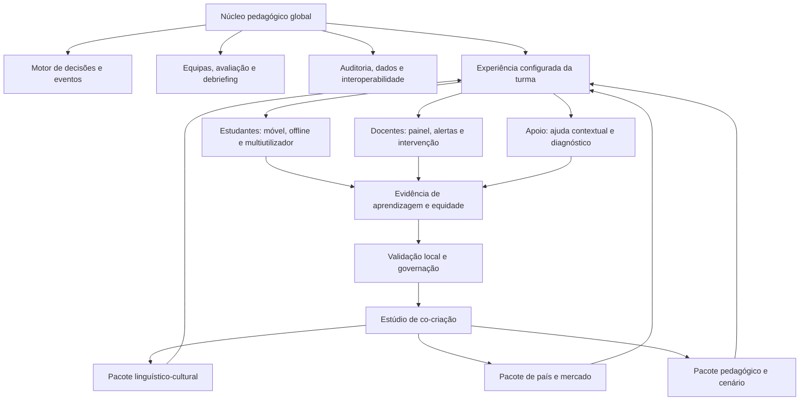

# Internacionalização do Simulador SPEE

## Revisão de literatura e quadro de requisitos para uma plataforma global, orientada ao Sul Global e com enfoque especial em África

**Data:** 28 de Julho de 2026  
**Âmbito:** Sistema de Práticas Empresariais e Empreendedorismo (SPEE)  
**Tipo de documento:** revisão rápida de literatura orientada à concepção de produto  

---

## Resumo executivo

A internacionalização do SPEE não deve ser tratada como a tradução de um simulador moçambicano para outras línguas. A literatura sobre internacionalização de software, jogos de simulação empresarial, desenho intercultural e tecnologias educativas no Sul Global aponta para uma transformação mais profunda: o SPEE deve evoluir para um **núcleo pedagógico global, configurável por pacotes de país, língua, mercado, pedagogia e cenário**, cuja criação e manutenção sejam partilhadas com actores locais.

Esta conclusão é particularmente consistente com os trabalhos de **Gércia Sequeira** e **Gildo Cossa**. Sequeira (2024) e Sequeira et al. (2026) identificam seis dimensões críticas para a evolução do SPEE — realismo, comunicação, usabilidade, compatibilidade, multidisciplinaridade e acessibilidade — e recomendam soluções móveis, híbridas e capazes de funcionar em condições de conectividade limitada. Cossa et al. (2023a, 2023b) demonstram, por sua vez, que um simulador pan-africano não pode assentar num único ambiente moçambicano, apenas em português e sem capacidade de os utilizadores criarem conteúdo. A sua proposta privilegia a apropriação pelos utilizadores finais, o conteúdo representativo da diversidade contextual africana e a interacção multiutilizador.

A análise dos documentos internos reforça esta orientação. O corpus de helpdesk contém **576 conversas e 2 705 mensagens**, entre Março de 2025 e Junho de 2026. Os problemas mais frequentes concentram-se no registo e nos dados, acesso e palavra-passe, erros ou bloqueios, navegação e constituição de empresas/sócios. As conversas sobre erro técnico apresentam uma proporção particularmente elevada de sentimento negativo. Estes dados mostram que a internacionalização ampliará dificuldades já existentes se não for precedida por uma base sólida de orientação contextual, recuperação autónoma, observabilidade, apoio ao docente e apoio técnico estruturado.

Recomenda-se, por isso, uma arquitectura com cinco componentes:

1. **Núcleo global do simulador**, contendo o motor de decisões, equipas, avaliação, debriefing, auditoria e interoperabilidade;
2. **Pacotes de país e de mercado**, contendo moeda, fiscalidade, legislação, formas societárias, pagamentos, trabalho, contabilidade, sectores, economia informal e choques locais;
3. **Pacotes linguísticos e culturais**, que vão além da tradução e incluem terminologia, formatos, exemplos, símbolos, níveis de linguagem, acessibilidade e modelos locais de colaboração;
4. **Estúdio de co-criação governada**, onde universidades, reguladores, empresas e especialistas locais possam propor, validar, versionar e publicar conteúdo;
5. **Camada inclusiva de acesso, apoio e dados**, móvel, de baixo consumo, com funcionamento offline, assistência dentro do fluxo, painéis para docentes e recolha ética de indicadores.

A prioridade inicial não deve ser a Realidade Virtual, a Blockchain ou uma IA omnipresente. A evidência favorece primeiro funcionalidades de alto impacto e maior alcance: aplicação Web progressiva, funcionamento offline, carteiras móveis, notificações, painéis de progresso, tutoriais contextuais, recuperação de erros, ferramentas do docente, conteúdo local e avaliação pedagógica. A IA poderá depois apoiar a pesquisa na base de conhecimento, a autoria de cenários, a tradução assistida e o feedback formativo, sempre com fontes identificadas, validação humana e sem substituir o julgamento pedagógico.

---

## 1. Objectivo e perguntas da revisão

Esta revisão procura responder à pergunta principal:

> **Que abordagens de desenho, governação e funcionalidades devem ser consideradas para transformar o SPEE num sistema internacional, relevante à escala mundial, adequado às condições do Sul Global e especialmente capaz de representar a diversidade de África?**

Foram ainda consideradas quatro perguntas operacionais:

1. Que elementos de uma simulação empresarial podem permanecer globais e quais têm de ser localizados?
2. Que condições de acesso, pedagogia e apoio são necessárias em contextos de recursos e conectividade desiguais?
3. Como representar África sem a reduzir a um único mercado ou a uma visão externa e homogénea?
4. Que sequência de desenvolvimento reduz o risco técnico, pedagógico, regulatório e cultural?

---

## 2. Método, fontes e limitações

### 2.1. Documentos internos analisados

A revisão começou pela leitura dos materiais existentes na pasta do projecto, em particular:

- [resultados agregados da análise de 576 conversas](../outputs/spee_helpdesk_chats_20260630/analysis_results.json);
- [análise de sentimento do helpdesk](../outputs/spee_helpdesk_chats_20260630/analise_sentimento_spee_helpdesk.md);
- [perguntas orientadoras da análise](../outputs/spee_helpdesk_chats_20260630/perguntas_analise_spee_helpdesk.md);
- [guião de workshop com estudantes](../outputs/spee_helpdesk_chats_20260630/guiao_workshop_estudantes_spee.md);
- [relatório preliminar de sentimento e recomendações](../analise_sentimento_recomendacoes.md);
- [perguntas iniciais da análise de helpdesk](../perguntas_analise_helpdesk.md);
- livro de cálculo consolidado e respectivas representações de inspecção;
- apresentações de análise funcional e recomendações;
- formulários, mensagens e documentação de apoio existentes na pasta.

Os 576 ficheiros de conversa foram considerados através da base consolidada e dos resultados agregados. Esta opção evita transformar mensagens individuais, potencialmente sensíveis, em citações de produto.

### 2.2. Pesquisa de literatura

Foi realizada uma revisão rápida e orientada à concepção, actualizada em 28 de Julho de 2026. A pesquisa combinou:

- revisões sistemáticas e estudos empíricos sobre jogos de simulação empresarial;
- estudos de desenho intercultural, localização e computação pós-colonial;
- literatura específica sobre o SPEE e jogos de simulação pan-africanos;
- normas internacionais de internacionalização, acessibilidade, desenho centrado nas pessoas e interoperabilidade;
- estratégias e orientações da União Africana, UNESCO, UIT, Banco Mundial, GSMA e Principles for Digital Development.

Foram privilegiadas fontes científicas com revisão por pares, normas e documentos institucionais primários. A pesquisa deu atenção explícita às publicações de Gércia Sequeira e Gildo Cossa.

### 2.3. Limitações

Este documento **não é uma revisão sistemática exaustiva segundo PRISMA** e não apresenta uma contagem completa de bases, duplicados e exclusões. É uma síntese de evidência orientada a decisões de produto. A literatura de simulação empresarial continua concentrada na Europa e na América do Norte; o próprio balanço de Faisal et al. (2022) mostra esta concentração. Aliyev et al. (2025) também assinalam a sub-representação de estudos não ocidentais, interculturais, inclusivos e de longo prazo. Assim, várias recomendações para África devem ser tratadas como hipóteses a validar através de pilotos locais, e não como verdades universais.

Os dados internos têm igualmente limitações. Em 466 das 576 conversas, o tipo de visitante não pôde ser determinado com confiança. A ausência de uma mensagem visível do assistente não prova, por si só, ausência total de apoio noutro canal. Os indicadores devem, portanto, ser usados para identificar padrões e prioridades, não para atribuir causalidade.

Existe ainda uma divergência entre versões da análise interna. O relatório preliminar classifica 535 conversas como sendo de estudantes e 41 como sendo de docentes, enquanto a análise consolidada e datada de 30 de Junho de 2026 identifica apenas 89 estudantes e 21 docentes, deixando 466 visitantes como indeterminados e explicitando o nível de confiança. Esta revisão usa a versão consolidada como fonte quantitativa principal. As observações específicas do relatório preliminar são aproveitadas apenas como hipóteses qualitativas, não como contagens validadas.

---

## 3. O que os documentos internos revelam sobre a base actual

### 3.1. Retrato do helpdesk

O corpus cobre o período entre **4 de Março de 2025 e 26 de Junho de 2026** e inclui:

| Indicador | Resultado |
|---|---:|
| Conversas | 576 |
| Mensagens | 2 705 |
| Mensagens de visitantes | 1 660 |
| Mensagens de assistentes | 1 045 |
| Conversas com mensagem visível do assistente | 326 (56,6%) |
| Mediana do primeiro tempo de resposta | 1,34 minutos |
| Mediana de mensagens por conversa | 2 |
| Classificação identificada como estudantes | 89 |
| Classificação identificada como docentes | 21 |
| Visitantes de perfil indeterminado | 466 |

Os cinco temas mais recorrentes são:

| Tema | Conversas | Proporção com sentimento negativo | Mediana de mensagens | Mediana de duração |
|---|---:|---:|---:|---:|
| Registo, cadastro e dados | 132 | 48,5% | 6 | 9,01 min |
| Acesso, conta e palavra-passe | 122 | 41,0% | 5 | 8,50 min |
| Erro técnico ou bloqueio | 119 | 66,4% | 6 | 9,35 min |
| Orientação de navegação | 118 | 33,9% | 5 | 8,13 min |
| Sócios, convites e empresa | 115 | 37,4% | 5 | 8,40 min |

As conversas que exigem recolha de evidência e diagnóstico são menos numerosas, mas mais longas: a mediana aproxima-se de 18 minutos e 9,5 mensagens. Isto sugere que o sistema actual não entrega ao apoio técnico contexto suficiente sobre o estado do utilizador, o passo onde ocorreu o problema e a causa provável.

Entre as conversas classificadas como sendo de estudantes, 74,2% referem sócios, convites ou empresa; 48,3% referem registo e dados; e cerca de 36%–37% referem acesso, navegação ou erro. Entre docentes, 71,4% referem turmas e gestão pedagógica. Embora estas subamostras sejam pequenas e a classificação dos estudantes seja maioritariamente de confiança média, o contraste confirma que a experiência deve ser desenhada por papel.

O relatório preliminar acrescenta três sinais funcionais a testar: bloqueios na dependência de “activos mínimos” da loja em linha, erros na associação de sócios e dificuldade em contratos. Refere ainda reposições manuais de palavras-passe e falta de visibilidade docente sobre o estado técnico do estudante. Devido à divergência de classificação descrita acima, estes sinais não são apresentados como frequências definitivas; devem orientar testes de usabilidade e validação com estudantes, docentes e helpdesk.

### 3.2. Implicações para a internacionalização

| Evidência interna | Risco ao internacionalizar | Requisito resultante |
|---|---|---|
| Dificuldades de registo e dados | Novos formatos de nome, telefone, endereço, documento, organização e consentimento aumentarão erros | Formulários configuráveis por país, validação local, exemplos e mensagens de correcção |
| Dificuldades de acesso e palavra-passe | Mais instituições e sistemas de identidade criarão mais pontos de falha | Início de sessão único, recuperação autónoma, autenticação acessível e proibição de partilha de palavras-passe no chat |
| Erros e bloqueios com elevada negatividade | A distância linguística e horária tornará o apoio humano menos disponível | Mensagem que explique causa, consequência e reparação; identificador do erro; diagnóstico automático e retoma do fluxo |
| Dificuldade de navegação | A tradução literal não resolverá a falta de orientação | Lista de próximos passos, estado de conclusão, ajuda contextual, visita guiada e confirmação após cada acção |
| Dificuldades com equipas, sócios e empresas | Regras de constituição e colaboração variam entre países e culturas | Fluxos configuráveis, papéis de equipa, convites rastreáveis e modelos societários por país |
| Dependências pouco visíveis, como “activos mínimos” | Mais regras locais criarão mais pré-condições e bloqueios | Lista de pré-requisitos, validação preventiva e ligação directa à acção em falta |
| Procura docente por gestão de turmas | A expansão multiplica turmas, calendários e diferenças curriculares | Painel docente, alertas, permissões, rubricas, configuração do cenário e intervenção sem dependência do helpdesk |
| Diagnóstico longo | O helpdesk internacional será mais caro e difícil de coordenar | Pedido de apoio estruturado com contexto técnico, língua, país, instituição, passo e evidência anexados automaticamente |
| Apenas oito avaliações explícitas | A satisfação não pode ser inferida com rigor | Instrumentos breves no momento certo, medida de resolução e avaliação pré/durante/pós-simulação |

**Conclusão desta análise:** antes de escalar geograficamente, o SPEE precisa de se tornar mais auto-explicativo, recuperável, observável e configurável. A internacionalização não corrigirá estes problemas; ampliá-los-á.

---

## 4. Quadro conceptual: quatro níveis que não devem ser confundidos

### 4.1. Internacionalização técnica

Segundo o W3C, internacionalização é a concepção e desenvolvimento de um produto de forma a permitir a sua adaptação a diferentes línguas, regiões e culturas sem reengenharia do núcleo. Inclui a utilização de Unicode, a separação entre texto e código, o suporte de diferentes formatos de data, número e moeda, pluralização, ordenação, direcção de escrita, nomes e endereços.

Para o SPEE, isto significa que nenhuma regra moçambicana, moeda, texto em português ou formato de dados deve permanecer embutido no motor global.

### 4.2. Localização

Localização é a adaptação de uma versão do produto a um público ou mercado concreto. Inclui tradução, terminologia, formatos, moeda, fiscalidade, exemplos, imagens, ajuda e requisitos legais.

Uma versão “Português–Angola” e uma versão “Português–Moçambique” podem partilhar a língua, mas não devem necessariamente partilhar terminologia institucional, fiscalidade, segurança social, instrumentos de pagamento ou casos empresariais.

### 4.3. Culturalização

Pyae (2018) mostra que a adaptação de jogos tem de considerar costumes, crenças, valores, símbolos e pressupostos incorporados no conteúdo e na interacção. Du-Babcock e Babcock (2000) demonstram que uma simulação norte-americana aplicada em Hong Kong exigiu adaptações de linguagem, comportamentos organizacionais e pressupostos sobre o ambiente empresarial.

No SPEE, culturalização implica rever, por exemplo:

- como se forma e decide uma equipa;
- como se representa autoridade, negociação, género e conflito;
- que linguagem é adequada para estudantes com diferentes níveis de proficiência;
- que relações entre empresa, família, comunidade e Estado aparecem nos cenários;
- que pressupostos sobre formalidade, contratos, crédito, propriedade e sucesso empresarial estão incorporados no jogo.

### 4.4. Glocalização e co-criação

Glocalização combina uma plataforma comum com conteúdo e decisão local. Os trabalhos de Cossa et al. (2023a, 2023b) tornam esta ideia concreta para o SPEE: o objectivo não é criar um jogo africano uniforme, mas uma estrutura que permita a utilizadores e especialistas representar contextos diferentes, colaborar e apropriar-se do sistema.

Esta abordagem é compatível com a computação pós-colonial (Irani et al., 2010) e com a investigação HCI africana (Winschiers-Theophilus & Bidwell, 2013; Lazem et al., 2022): cultura não deve ser uma lista estática introduzida por uma equipa externa; deve ser produzida e negociada com os actores que conhecem o contexto e suportam as consequências do sistema.

---

## 5. O que a literatura diz sobre simulações empresariais

### 5.1. Benefícios demonstrados

As simulações empresariais colocam estudantes num ambiente seguro em que podem gerir uma organização, tomar decisões, observar consequências e aprender com erros. A revisão de 57 estudos empíricos de Faisal et al. (2022) associa estes sistemas a aquisição de conhecimento, capacidades cognitivas e interactivas, mudança de comportamento, decisão, resolução de problemas e colaboração. A revisão de Platz (2022), com 20 intervenções em educação económica, encontra vantagens relativamente ao conhecimento disciplinar.

O modelo de Garris, Ahlers e Driskell (2002) ajuda a explicar o mecanismo: características do jogo desencadeiam julgamentos e comportamentos do participante; a acção recebe feedback; e a repetição forma um ciclo que pode produzir aprendizagem. A simulação é, portanto, eficaz quando a decisão, o feedback e a reflexão estão ligados a objectivos pedagógicos claros.

### 5.2. Benefícios que não surgem automaticamente

A literatura também impede uma leitura triunfalista. Platz (2022) encontra resultados inconsistentes quanto à motivação. A meta-análise de Sitzmann (2011) mostra benefícios das simulações, mas também evidencia que a comparação depende da qualidade da alternativa pedagógica, do acesso ao jogo e da existência de instrução. Aliyev et al. (2025) concluem que a tecnologia emergente só acrescenta valor quando é pedagogicamente integrada.

Isto conduz a cinco condições de eficácia:

1. **Integração curricular:** a simulação deve estar ligada a resultados de aprendizagem, conteúdos, calendário e avaliação;
2. **Preparação:** estudantes e docentes precisam de indução, exemplos e oportunidades de treino;
3. **Facilitação:** o docente deve conseguir observar, intervir, explicar e ajustar a complexidade;
4. **Feedback e debriefing:** o participante tem de compreender a relação entre decisão, resultado e conceito;
5. **Avaliação múltipla:** o resultado financeiro da empresa simulada não deve ser o único indicador de aprendizagem.

### 5.3. A função crítica do docente

O docente não é substituído pelo simulador. É responsável por enquadrar a actividade, apoiar equipas, interpretar resultados e transformar a experiência em aprendizagem. Estudos interculturais mostram ainda que a percepção das competências adquiridas varia com a cultura, o sistema educativo e a exposição anterior à aprendizagem experiencial (Hernández-Lara et al., 2018). Kerridge e Simpson (2021) mostram que uma simulação em turmas de nacionalidades mistas beneficiou de apoio linguístico e académico incorporado e de docentes bilingues.

Para internacionalizar o SPEE, a “experiência do docente” deve ter o mesmo estatuto da “experiência do estudante”.

---

## 6. Contributos directos de Gércia Sequeira e Gildo Cossa

### 6.1. Gércia Sequeira: modernização do SPEE

A dissertação de Gércia Vânia de Saldanha Sequeira, *Simulação empresarial em contexto de tecnologias emergentes: Caso SPEE* (2024), é a fonte mais directamente alinhada com a presente questão. O estudo combinou revisão de literatura, análise documental e entrevistas e identificou cinco dimensões agregadas: realismo, multidisciplinaridade, comunicação e interacção, facilidade de uso e assistência, e acessibilidade e escala. A versão posteriormente publicada com Pereira, Cossa, Pinto e Roque apresenta seis dimensões, separando usabilidade e compatibilidade (Sequeira et al., 2026).

O estudo de 2026 incluiu 38 trabalhos na síntese da literatura e 20 participantes experientes no SPEE, com saturação temática após aproximadamente 15 entrevistas. Os principais contributos para a internacionalização são:

- **Realismo local:** moeda, flutuação de mercado, custos por sector, carteiras móveis, bolsa, crises políticas, desastres e alterações regulamentares;
- **Experiência do estudante:** assinaturas digitais, roteiro dinâmico, notificações, feedback automático e assistência;
- **Experiência do docente:** auditorias, alertas, relatórios e análise por empresa e por estudante;
- **Comunicação:** notificações, chat, painéis de progresso e menor dependência de WhatsApp ou Zoom;
- **Multidisciplinaridade:** integração entre contabilidade, inventário, recursos humanos, gestão de projecto, sustentabilidade, economia digital e outras áreas;
- **Acessibilidade:** desenho responsivo, aplicação Web progressiva, funcionamento offline e sincronização posterior;
- **Tecnologias emergentes:** IA, Blockchain, Realidade Aumentada e Realidade Virtual, mas introduzidas de acordo com impacto, maturidade e limitações de infra-estrutura.

A prioridade defendida por Sequeira et al. (2026) é particularmente importante: funcionalidades acessíveis e de alto impacto — como carteiras móveis, notificações e painéis — devem preceder tecnologias mais exigentes.

### 6.2. Gildo Cossa: do caso moçambicano ao quadro pan-africano

Em *Pan Africa Business Simulation Game* e *Pan Africa Business Simulation Games: The ITIS Case Study*, Cossa e co-autores partem das particularidades africanas e das experiências do EVER e do Bootcamp. Identificam três limitações que impedem a simples expansão do SPEE:

1. existência de um único ambiente empresarial, centrado em Moçambique;
2. disponibilidade apenas em português;
3. incapacidade de os utilizadores finais criarem novo conteúdo.

Como resposta, propõem uma estrutura pan-africana que suporte:

- desenvolvimento colaborativo e apropriação pelos utilizadores finais;
- conteúdo multiutilizador representativo da diversidade contextual;
- inclusão de realidades como economia informal, instabilidade, corrupção e limitações de dados;
- incorporação da experiência local, em vez da importação de um modelo empresarial uniforme;
- aprendizagem pela acção e experimentação, inspirada na metodologia *lean startup*.

A contribuição de Cossa (2018) sobre capital social e empreendedorismo em Moçambique alarga o que deve ser simulado. Nos seis casos estudados, as redes não surgem espontaneamente: laços fortes têm peso na fase inicial e laços fracos são construídos ao longo da trajectória, apoiando reconhecimento e sustentabilidade. Um simulador africano deve, por conseguinte, representar redes de confiança, mentoria, associações, família, comunidade e relações institucionais — não apenas balanços, vendas e crédito bancário.

### 6.3. Síntese dos dois contributos

| Dimensão | Sequeira | Cossa | Decisão para o SPEE |
|---|---|---|---|
| Realismo | Mercado, moeda, choques, carteiras móveis, sectores | Informalidade, instabilidade, corrupção, diversidade de país | Motor configurável e pacotes de mercado |
| Interacção | Chat, notificações, painéis, feedback | Multiutilizador e colaboração | Trabalho de equipa incorporado no produto |
| Acesso | Móvel, PWA, offline, sincronização | Condições africanas de adopção | Experiência de baixo consumo e tolerante a falhas |
| Conteúdo | Multidisciplinaridade e cenários futuros | Conteúdo criado e apropriado localmente | Estúdio de autoria com governação |
| Tecnologia | IA, Blockchain e RV seleccionadas pelo valor | IA para captar e apoiar experiência local | IA assistiva e responsável; tecnologias avançadas por fases |
| Escala | Compatibilidade e escalabilidade | Estrutura pan-africana, não um mercado único | Núcleo global + pacotes de país + camada continental |

---

## 7. Camada mundial: o que o SPEE precisa para ser verdadeiramente global

### 7.1. Núcleo pedagógico estável

O núcleo global deve conter apenas o que é transferível entre contextos:

- criação de turmas, equipas e papéis;
- objectivos de aprendizagem e competências;
- ciclos de decisão e consequências;
- feedback, reflexão e debriefing;
- avaliação, rubricas e portefólio de evidências;
- registo auditável das decisões;
- motor de eventos e cenários;
- gestão de conteúdo, versões e permissões;
- interoperabilidade com sistemas educativos.

Mesmo estes elementos devem ser configuráveis. Por exemplo, uma equipa pode decidir por maioria, consenso ou papéis funcionais; a avaliação pode ser individual, colectiva ou combinada.

### 7.2. Internacionalização técnica desde a arquitectura

O SPEE deve adoptar:

- **Unicode/UTF-8** em toda a cadeia de dados;
- textos externos ao código e identificados por chaves estáveis;
- regras de pluralização e formatos baseados em CLDR;
- separação entre língua, país, moeda e fuso horário;
- suporte futuro a escrita da direita para a esquerda;
- nomes, endereços, telefones e documentos não presos a um único formato;
- ordenação e pesquisa sensíveis à língua;
- mensagens completas, evitando frases construídas pela concatenação de fragmentos;
- glossário institucional e empresarial por variante linguística;
- tradução com estado, autoria, revisão, data e versão.

### 7.3. Interoperabilidade

Uma plataforma internacional terá de conviver com diferentes ecossistemas institucionais. Deve oferecer:

- integração LTI 1.3 com plataformas de aprendizagem;
- início de sessão único através de protocolos correntes;
- API documentada para instituições e parceiros autorizados;
- importação de turmas e exportação de notas;
- eventos de aprendizagem num esquema interoperável, por exemplo Caliper;
- exportação de dados e portefólios em formatos acessíveis;
- integração opcional com sistemas de contabilidade, pagamento ou dados apenas em ambientes de treino controlados.

### 7.4. Acessibilidade e desenho centrado nas pessoas

O objectivo mínimo deve ser **WCAG 2.2 nível AA**, incluindo:

- navegação por teclado e foco visível;
- compatibilidade com leitores de ecrã;
- contraste, redimensionamento e ausência de informação transmitida apenas por cor;
- legendas e transcrições;
- alvos tácteis de dimensão adequada;
- ajuda apresentada de forma consistente;
- autenticação acessível;
- redução de introdução repetida de dados;
- linguagem simples e explicação de termos especializados.

A conformidade deve ser complementada por testes com pessoas com deficiência nos países-piloto. A norma não substitui a experiência real.

### 7.5. Conteúdo global e comparação entre mercados

O SPEE internacional deve permitir três tipos de cenário:

1. **Cenário de país:** uma empresa opera sob regras de um único mercado;
2. **Cenário comparativo:** equipas diferentes operam em países diferentes e analisam os efeitos institucionais;
3. **Cenário transfronteiriço:** empresas negoceiam entre si, enfrentando câmbio, logística, alfândega, protecção de dados e riscos.

Este desenho transforma a diversidade internacional em objecto de aprendizagem, em vez de a esconder atrás de uma tradução.

---

## 8. Camada Sul Global: adequação a recursos, instituições e desigualdades

“Sul Global” não designa uma realidade uniforme. É útil apenas para destacar assimetrias recorrentes de infra-estrutura, recursos, poder de produção tecnológica e representação na literatura. O desenho deve evitar perfis deficitários — “utilizador pobre”, “baixa literacia” ou “país em desenvolvimento” — e investigar capacidades, práticas e aspirações concretas.

### 8.1. Conectividade intermitente e custo de dados

Embora quase três quartos da população mundial já esteja em linha, a UIT estimava ainda 2,2 mil milhões de pessoas sem acesso em 2025, com diferenças persistentes de qualidade e preço. Por isso, “estar ligado” não significa poder participar numa simulação rica em vídeo, actualizações contínuas e sessões síncronas.

Funcionalidades essenciais:

- aplicação Web progressiva instalável;
- transferência inicial pequena e recursos carregados por necessidade;
- modo de baixo consumo sem vídeo ou animação pesada;
- trabalho offline em decisões, documentos e leitura;
- fila de sincronização visível e retomável;
- resolução explícita de conflitos;
- gravação automática local;
- tolerância à troca entre Wi-Fi e dados móveis;
- actividades assíncronas e janelas flexíveis;
- pacotes descarregáveis no campus para utilização posterior;
- estado claro: “guardado no dispositivo”, “por sincronizar” e “sincronizado”.

### 8.2. Dispositivo móvel como acesso principal

O telemóvel não pode ser uma versão reduzida da experiência de computador. Fluxos de elevada frequência — próximos passos, decisões, notificações, ajuda, chat e carregamento de evidências — devem ser desenhados primeiro para ecrãs pequenos. Tabelas financeiras complexas podem ter vistas resumidas, detalhe progressivo e exportação.

Devem ser testadas condições reais: aparelhos de gama baixa, pouca memória, baterias degradadas, versões antigas de navegador, partilha de dispositivo e interrupções por chamadas.

### 8.3. Literacia digital e linguística heterogénea

O apoio não deve assumir domínio de terminologia contabilística, de navegação Web ou da língua de instrução. Recomenda-se:

- demonstração curta antes de cada operação nova;
- exemplo resolvido e ambiente de treino;
- glossário clicável e áudio opcional;
- linguagem simples, sem eliminar o termo técnico que se pretende ensinar;
- instrução bilingue onde fizer sentido;
- confirmação visual do resultado da acção;
- recuperação que preserve o trabalho já realizado;
- materiais para docentes e monitores locais.

### 8.4. Instituições formais e práticas reais

O realismo não pode significar apenas conformidade com processos formais. Em muitos contextos, empresas combinam registos formais, pagamentos móveis, crédito informal, redes pessoais e práticas graduais de formalização. O simulador deve permitir comparar consequências, riscos e oportunidades, sem normalizar ilegalidade nem moralizar os participantes.

### 8.5. Desigualdade de género, deficiência e segurança

O relatório da GSMA de 2025 indica que a diferença de género no uso da Internet móvel na África Subsariana permanecia em 29%. A avaliação do SPEE deve desagregar, de forma segura, acesso, conclusão e aprendizagem por género, deficiência, língua, dispositivo e qualidade da ligação. A finalidade é identificar barreiras, não vigiar ou classificar pessoas.

O desenho de equipas deve permitir denunciar assédio, redistribuir papéis, verificar participação sem premiar apenas volume de mensagens e oferecer canais de apoio confidenciais.

---

## 9. Camada África: uma plataforma pan-africana sem imaginar um único mercado africano

### 9.1. Princípio de heterogeneidade

África reúne 55 Estados-Membros da União Africana, centenas de línguas, diferentes famílias jurídicas, moedas, regimes fiscais, infra-estruturas e ecossistemas financeiros. “Localizar para África” não é uma unidade de trabalho válida.

O desenho recomendado possui três escalas:

- **núcleo global**, comum a todos;
- **camada continental/regional**, com comércio intra-africano, mobilidade, normas emergentes e cenários AfCFTA;
- **pacote de país ou sub-região**, com regras e conteúdo validados localmente.

O Protocolo de Comércio Digital da AfCFTA, adoptado em 2024, e as estratégias digitais e de IA da União Africana podem alimentar cenários prospectivos. Não devem, porém, ser tratados como regras já implementadas de forma idêntica em todos os países.

### 9.2. O que deve existir num pacote de país

Cada pacote deverá incluir, no mínimo:

| Categoria | Conteúdo |
|---|---|
| Identidade do mercado | País/região, línguas, fusos horários, moeda e calendários relevantes |
| Constituição | Formas societárias, registo, licenças, propriedade e identificação |
| Fiscalidade | Impostos, taxas, obrigações, prazos e penalizações, com data de vigência |
| Trabalho | Contratação, folha salarial, segurança social, benefícios e direitos |
| Contabilidade | Plano de contas, documentos, demonstrações e convenções |
| Finanças | Bancos, microfinança, poupança, crédito, moeda electrónica e carteiras móveis |
| Pagamentos | Numerário, transferência, cartão, agente, USSD e pagamento móvel |
| Comércio | Compras, vendas, facturação, logística, alfândega e câmbio |
| Sectores | Custos, sazonalidade, activos, licenças e cadeias de valor |
| Informalidade | Percursos de formalização e comparação de riscos, custos e benefícios |
| Choques | Inflação, câmbio, clima, desastre, conflito, falha logística e mudança legal |
| Sustentabilidade | Energia, água, resíduos, emprego digno e impacto comunitário |
| Cultura empresarial | Negociação, redes, confiança, linguagem e práticas organizacionais |
| Fontes e validade | Fonte, especialista responsável, aprovação e data da próxima revisão |

### 9.3. Conteúdo empresarial particularmente relevante

#### Carteiras móveis e finanças inclusivas

Sequeira e participantes do estudo SPEE atribuem elevada importância às carteiras móveis. Em África, a simulação de pagamentos deve considerar agentes, USSD, limites, comissões, reconciliação, liquidez e interrupções, e não apenas uma conta bancária convencional.

#### Economia informal e formalização

O estudante deve poder comparar trajectórias: operar informalmente, formalizar gradualmente ou iniciar já formalizado. O jogo pode mostrar acesso a mercados, protecção, custo fiscal, financiamento, risco e tempo administrativo. A informalidade deve ser representada analiticamente, não como falha moral.

#### Capital social e redes

Inspirado em Cossa (2018), o motor pode representar:

- laços fortes usados para capital inicial e confiança;
- laços fracos que abrem mercados, conhecimento e oportunidades;
- mentores, associações empresariais, incubadoras e redes da diáspora;
- reputação e reciprocidade;
- risco de dependência excessiva ou conflito de interesses.

#### Instabilidade, corrupção e dilemas éticos

Cossa et al. (2023a, 2023b) identificam instabilidade e corrupção como elementos do contexto. A sua simulação exige cuidado: os cenários devem desenvolver análise ética, conformidade, denúncia e desenho de controlos; nunca treinar a execução de práticas corruptas. O participante deve compreender consequências legais, sociais e empresariais.

#### Clima, energia e cadeias de abastecimento

Eventos climáticos, falhas de energia, volatilidade de preço, fronteiras e logística podem alterar procura, inventário, caixa e operações. A estratégia deve incluir resiliência, fornecedores alternativos, seguros, adaptação e impacto comunitário.

#### Comércio intra-africano

Cenários AfCFTA podem ensinar câmbio, regras de origem, logística, pagamentos, protecção de dados, comércio digital e negociação entre empresas de países diferentes. As regras devem ser versionadas e acompanhadas por notas que distingam norma continental, implementação nacional e simplificação pedagógica.

### 9.4. Línguas africanas e variantes de línguas internacionais

Uma estratégia de línguas por fases pode começar por variantes de português já próximas da base existente, mas não deve limitar a visão. O suporte posterior a inglês, francês, árabe e línguas africanas deve ser determinado pelos países-piloto e pelos objectivos pedagógicos.

Princípios:

- separar “língua da interface”, “língua do conteúdo” e “língua de colaboração”;
- permitir conteúdo bilingue e alternância de língua;
- criar glossários de negócios validados por docentes e profissionais;
- permitir áudio e explicações em língua local quando a escrita padronizada ou a proficiência for uma barreira;
- não usar tradução automática sem revisão para conceitos legais, fiscais e de avaliação;
- reconhecer variantes nacionais, em vez de impor uma única versão de português, inglês ou francês.

### 9.5. Autoria e soberania do conteúdo

O “Estúdio SPEE” deve permitir a criação local sem comprometer qualidade:

1. autor local cria ou adapta um pacote;
2. especialista jurídico/fiscal/contabilístico valida regras;
3. docente valida objectivos, dificuldade, feedback e debriefing;
4. especialista linguístico e de acessibilidade revê apresentação;
5. instituição responsável aprova publicação;
6. pacote recebe versão, data de vigência e fontes;
7. alterações legais geram revisão, teste e nova versão;
8. turmas em curso permanecem ligadas à versão com que começaram.

Autores locais devem receber crédito, direitos claros de utilização e, quando aplicável, participação no valor económico do conteúdo. Esta governação reduz o risco de extracção de conhecimento e corresponde às recomendações de desenho com as pessoas, capacidade local e justiça epistémica.

---

## 10. Arquitectura funcional proposta

Esta arquitectura separa:

- **código** de **conteúdo**;
- **regra** de **apresentação**;
- **regra global** de **regra de país**;
- **dados do participante** de **indicadores agregados**;
- **publicação de conteúdo** de **autoria livre**;
- **resultado do jogo** de **avaliação da aprendizagem**.

---

## 11. Funcionalidades-chave e prioridade

### 11.1. Prioridade P0 — fundação indispensável

| Área | Funcionalidade | Justificação |
|---|---|---|
| Arquitectura | Separação entre núcleo e pacotes configuráveis | Evita duplicar produto por país |
| Internacionalização | Unicode, CLDR, chaves de texto, formatos e pluralização | Base técnica para novas línguas |
| Conteúdo | Modelo versionado de país, mercado, pedagogia e cenário | Mantém coerência e auditabilidade |
| Experiência | Próximos passos, estado, confirmação e recuperação | Responde directamente às fricções do helpdesk |
| Erros | Código, causa provável, acção de reparação e retoma | Reduz bloqueios e tempo de diagnóstico |
| Acesso | Recuperação de conta e autenticação acessível | Reduz dependência do helpdesk e risco de segurança |
| Móvel | Desenho responsivo e de baixo consumo | Condição de acesso no Sul Global |
| Offline | PWA, fila de sincronização e resolução de conflito | Condição de resiliência |
| Docente | Painel de turma, progresso, alertas e permissões | Escala pedagógica e operacional |
| Apoio | Pedido estruturado com contexto automático | Reduz o custo de apoio internacional |
| Segurança | Controlo por papel, auditoria, minimização e cifragem | Base de confiança |
| Acessibilidade | WCAG 2.2 AA e testes com utilizadores | Inclusão desde o início |
| Avaliação | Objectivos, rubricas, debriefing e múltiplas evidências | Garante valor pedagógico |

### 11.2. Prioridade P1 — primeiro produto internacional

| Área | Funcionalidade | Justificação |
|---|---|---|
| Localização | Pacotes completos para países-piloto | Prova a arquitectura |
| Colaboração | Papéis de equipa, chat, menções, notificações e decisões | Interacção multiutilizador |
| Realismo | Moeda, fiscalidade, trabalho, pagamentos e custos por sector | Relevância local |
| Finanças | Carteiras móveis, agentes, comissões e reconciliação | Elevado valor contextual |
| Conteúdo | Economia informal e percursos de formalização | Realismo no Sul Global e África |
| Docente | Configuração de dificuldade, prazos, eventos e avaliação | Adequação curricular |
| Ajuda | Base de conhecimento por língua, país, papel e passo | Apoio contextual |
| Interoperabilidade | LTI, início de sessão único, importação e exportação | Adopção institucional |
| Dados | Eventos de aprendizagem e painéis de equidade | Melhoria contínua |
| Autoria | Fluxo controlado de adaptação e validação | Apropriação local |

### 11.3. Prioridade P2 — expansão africana e transfronteiriça

| Área | Funcionalidade | Justificação |
|---|---|---|
| Multi-país | Empresas em mercados diferentes no mesmo exercício | Comparação e comércio |
| AfCFTA | Câmbio, logística, regras de origem e comércio digital | Competências continentais |
| Línguas | Conteúdo bilingue, variantes e áudio local | Inclusão linguística |
| Redes | Mentoria, associações, reputação e capital social | Realismo empresarial africano |
| Choques | Clima, energia, câmbio, fronteira e mudança legal | Resiliência e decisão |
| Sustentabilidade | Impacto social, ambiental e emprego digno | Alinhamento curricular e continental |
| Comunidade | Biblioteca de cenários revistos e reutilizáveis | Escala de conteúdo |

### 11.4. Prioridade P3 — tecnologias emergentes condicionadas à evidência

| Tecnologia | Utilização aceitável | Condição |
|---|---|---|
| IA generativa | Pesquisa na ajuda, explicação formativa, tradução assistida e apoio à autoria | Fontes, revisão humana, protecção de dados, medição de erro e opção de não utilização |
| IA adaptativa | Recomendar apoio ou dificuldade | Não manipular avaliação de alto impacto; explicabilidade |
| Blockchain | Credenciais ou activos apenas se resolver problema concreto de confiança/interoperabilidade | Análise de custo, energia, governação e alternativa mais simples |
| RA/RV | Exercícios imersivos específicos | Equipamento disponível, alternativa acessível e ganho pedagógico demonstrado |

**Decisão recomendada:** não fazer de IA, Blockchain ou RV a definição da internacionalização. São instrumentos possíveis, não a fundação do produto.

---

## 12. Interacção e apoio: do helpdesk reactivo a uma experiência assistida

### 12.1. Modelo “orientar, confirmar e recuperar”

Cada operação crítica deve:

1. indicar o objectivo;
2. mostrar os dados e documentos necessários;
3. apresentar um exemplo;
4. permitir executar;
5. confirmar o novo estado;
6. indicar o próximo passo;
7. oferecer recuperação sem perda de trabalho.

Este modelo responde às fricções de navegação, registo e constituição de empresas identificadas no corpus interno.

### 12.2. Apoio dentro do contexto

A ajuda deve conhecer, com consentimento e limites:

- papel do utilizador;
- instituição e turma;
- país e língua;
- módulo e passo actual;
- versão do pacote;
- código do erro;
- estado de sincronização.

Assim, em vez de “envie uma captura de ecrã”, o pedido pode anexar automaticamente informação técnica não sensível. Nunca deve anexar palavra-passe, documento pessoal integral ou conteúdo desnecessário.

### 12.3. Painel docente

O docente deve conseguir:

- ver progresso por equipa e estudante;
- identificar bloqueios e ausência de actividade;
- distinguir trabalho guardado de trabalho sincronizado;
- enviar orientação a uma equipa ou turma;
- reabrir etapas, corrigir atribuições e gerir convites;
- configurar eventos, prazos e dificuldade;
- consultar decisões e respectivos fundamentos;
- usar rubricas e feedback;
- iniciar debriefing com comparações entre decisões;
- exportar evidências e notas.

### 12.4. Organização do apoio

O helpdesk internacional precisa de:

- catálogo de tipos de pedido;
- prioridades e acordos de serviço por instituição;
- macros localizadas, mas editáveis;
- base de conhecimento com responsável e data de revisão;
- encaminhamento por língua, país e especialidade;
- ligação entre erro de produto e conversas afectadas;
- medida de resolução no primeiro contacto, reabertura e esforço do utilizador;
- protecção explícita contra recolha de palavras-passe e dados excessivos.

---

## 13. IA responsável no SPEE

A UNESCO recomenda uma abordagem humana, adequada à idade, com protecção de dados e validação pedagógica. A Estratégia Continental de IA da União Africana acrescenta a necessidade de uma abordagem inclusiva, responsável e centrada nas prioridades africanas.

### 13.1. Casos de uso com valor provável

- assistente de ajuda baseado apenas em documentação aprovada;
- explicação de um erro ou conceito na língua escolhida;
- pesquisa semântica no glossário e nos regulamentos simulados;
- criação assistida de rascunhos de cenário;
- geração de variações de um evento para revisão docente;
- tradução inicial, sempre marcada como não revista;
- feedback formativo que remeta para a decisão e para a fonte;
- detecção de lacunas de conteúdo ou inconsistências entre versões.

### 13.2. Limites

- não usar IA como avaliador único de aprendizagem;
- não inferir personalidade, honestidade, emoção ou empregabilidade;
- não enviar dados de estudantes para modelos sem base legal, transparência e controlo;
- não apresentar conteúdo gerado como lei, norma ou verdade factual;
- não substituir validação local;
- não treinar modelos com conversas de apoio sem anonimização, finalidade definida e autorização;
- fornecer alternativa não baseada em IA;
- registar versão do modelo, fonte, instrução e revisão quando o resultado influencia conteúdo publicado.

---

## 14. Governação, ética e sustentabilidade

### 14.1. Conselho de conteúdo por país

Cada pacote deve ter uma estrutura que inclua:

- instituição de ensino;
- especialista contabilístico/fiscal;
- representante de entidade reguladora quando possível;
- empreendedores e associações empresariais;
- estudantes e docentes;
- mulheres, pessoas com deficiência e grupos sub-representados;
- especialista linguístico;
- equipa técnica e pedagógica do SPEE.

### 14.2. Ciclo de vida de regras

Cada regra deve indicar:

- jurisdição;
- fonte;
- simplificação pedagógica realizada;
- responsável;
- data de entrada em vigor;
- data da última revisão;
- próxima revisão;
- versão;
- impacto em cenários em curso.

Uma alteração legal não deve alterar silenciosamente uma turma a meio da simulação.

### 14.3. Dados e privacidade

O Quadro de Política de Dados da União Africana e os Principles for Digital Development apoiam uma abordagem centrada nas pessoas. O SPEE deve:

- recolher apenas o necessário;
- separar dados de identidade, aprendizagem, suporte e investigação;
- definir prazos de retenção;
- permitir acesso, correcção e exportação quando aplicável;
- usar perfis e permissões mínimos;
- manter auditoria administrativa;
- avaliar requisitos de residência e transferência de dados por país;
- publicar linguagem de privacidade compreensível;
- avaliar impacto antes de introduzir IA ou análises de risco;
- impedir que painéis docentes se transformem em vigilância permanente.

### 14.4. Modelo sustentável de expansão

Uma biblioteca internacional exige manutenção contínua. O modelo financeiro deve prever:

- custo de actualização anual de cada pacote;
- formação e certificação de autores/revisores;
- apoio por língua e fuso horário;
- testes com dispositivos e conectividade reais;
- incentivos para conteúdo local;
- reutilização com licenças claras;
- arquivo de pacotes obsoletos;
- métricas de utilização que informem investimento.

---

## 15. Roteiro recomendado

### Fase 0 — preparar o núcleo

**Objectivo:** eliminar dependências moçambicanas embutidas e reduzir fricções actuais.

Entregáveis:

- mapa de regras, textos e dados actualmente fixos;
- modelo de pacotes e versões;
- fundação de internacionalização;
- orientação, confirmação e recuperação nos fluxos críticos;
- pedido de apoio estruturado;
- painel docente mínimo;
- eventos de produto e aprendizagem;
- segurança, privacidade e acessibilidade de base.

**Critério de saída:** a versão moçambicana funciona como um pacote configurado sobre o núcleo, sem perda de funcionalidade, e os principais problemas de helpdesk mostram redução mensurável.

### Fase 1 — piloto em África lusófona

**Objectivo:** provar que uma língua partilhada não elimina diferenças de mercado e cultura.

Abordagem:

- manter Moçambique como pacote de referência;
- seleccionar pelo menos dois contextos lusófonos contrastantes;
- criar pacotes com parceiros locais;
- testar variantes terminológicas, moedas, fiscalidade, pagamentos, informalidade e sectores;
- executar pilotos com docentes e estudantes;
- comparar aprendizagem, esforço, sincronização e apoio.

**Critério de saída:** instituições locais conseguem validar e manter conteúdo; estudantes completam os fluxos essenciais em condições móveis e de ligação intermitente.

### Fase 2 — diversidade linguística e regional africana

**Objectivo:** testar a arquitectura para além da proximidade lusófona.

Seleccionar, por critérios transparentes, pelo menos:

- um contexto anglófono;
- um contexto francófono;
- quando a procura justificar, um contexto arabófono;
- uma língua africana para experiência bilingue;
- mercados com diferentes infra-estruturas, regimes jurídicos e ecossistemas de pagamento.

Introduzir cenários comparativos e comércio transfronteiriço.

**Critério de saída:** tradução, conteúdo, avaliação e apoio funcionam em múltiplas famílias linguísticas e o conselho de conteúdo consegue gerir conflitos entre regras continentais, regionais e nacionais.

### Fase 3 — plataforma global

**Objectivo:** levar o modelo validado a outras regiões sem perder a orientação africana.

Entregáveis:

- catálogo global de pacotes;
- mercado/biblioteca de cenários governado;
- ferramentas de comparação entre países;
- interoperabilidade institucional madura;
- IA assistiva multilingue avaliada;
- investigação longitudinal e publicação de resultados.

---

## 16. Quadro de avaliação

A avaliação deve ocorrer antes, durante e depois da simulação.

### 16.1. Antes

- conhecimentos e competências-alvo;
- experiência anterior com simulações;
- língua preferida e proficiência na língua de instrução;
- dispositivo e condição de ligação;
- necessidades de acessibilidade;
- preparação do docente e qualidade do pacote local.

### 16.2. Durante

- conclusão e abandono por etapa;
- tempo por tarefa;
- erros, repetição e recuperação;
- estado de sincronização;
- pedidos de apoio e resolução;
- participação por papel, sem equiparar quantidade a qualidade;
- decisões, fundamentos e revisões;
- utilização da ajuda e do glossário;
- intervenção docente.

### 16.3. Depois

- conhecimento e capacidade de aplicação;
- tomada de decisão, colaboração e reflexão;
- transferência para projecto, estágio ou negócio real;
- qualidade do debriefing;
- satisfação e esforço;
- confiança do docente;
- diferenças de resultado por língua, género, deficiência, dispositivo e ligação;
- intenção e capacidade da instituição de repetir a actividade.

### 16.4. Indicadores específicos de internacionalização

| Dimensão | Indicadores exemplificativos |
|---|---|
| Técnica | erros por localidade, cobertura de tradução, suporte de formatos e dispositivos |
| Cultural | problemas identificados por revisores locais, autenticidade percebida, incidentes de conteúdo inadequado |
| Regulatória | regras com fonte e revisão válida, tempo de actualização, conflitos de versão |
| Pedagógica | ganho de aprendizagem, qualidade do debriefing, alinhamento curricular |
| Inclusão | conclusão e desempenho desagregados, utilização offline, acessibilidade |
| Operacional | contactos por 100 utilizadores, resolução no primeiro contacto, reabertura, tempo de diagnóstico |
| Sustentabilidade | custo de manutenção por pacote, número de autores locais activos, reutilização de cenários |

Sempre que possível, os pilotos devem combinar indicadores quantitativos, entrevistas, observação, testes de usabilidade e análise pedagógica. Uma melhoria de satisfação sem aprendizagem, ou aprendizagem apenas entre estudantes com melhor ligação, não constitui sucesso.

---

## 17. Principais riscos e mitigação

| Risco | Consequência | Mitigação |
|---|---|---|
| Traduzir sem reestruturar | Produto aparentemente global, mas funcionalmente moçambicano | Núcleo desacoplado e testes de pacote |
| Imaginar “África” como mercado único | Conteúdo incorrecto e baixa legitimidade | Pacotes nacionais/regionais e governação local |
| Escalar antes de corrigir usabilidade | Explosão do helpdesk | Fase 0 e métricas de recuperação |
| Conteúdo desactualizado | Ensino de regras incorrectas | Fonte, versão, vigência e responsável |
| Excesso de tecnologia emergente | Custo, exclusão e complexidade | Priorizar valor pedagógico e alcance |
| IA sem governação | Erro, enviesamento e exposição de dados | Fontes, revisão, limites e alternativa |
| Centralização da autoria | Dependência e extracção de conhecimento | Estúdio, crédito, formação e incentivos locais |
| Painéis usados para vigilância | Perda de confiança | Minimização, finalidade e controlo |
| Offline mal implementado | Perda ou conflito de trabalho | Estado visível, testes e resolução explícita |
| Avaliar apenas lucro simulado | Incentivos pedagógicos distorcidos | Rubricas, reflexão, processo e múltiplas evidências |
| Dependência do docente “herói” | Baixa replicabilidade | Formação, guias, alertas e automação adequada |
| Personalização excessiva por país | Fragmentação do produto | Contratos de pacote, APIs e testes comuns |

---

## 18. Conclusão

A literatura converge numa resposta clara: a internacionalização do SPEE deve combinar **padronização do núcleo** com **descentralização responsável do conteúdo**.

À escala mundial, o SPEE precisa de internacionalização técnica, acessibilidade, interoperabilidade, comparação entre mercados e solidez pedagógica. No Sul Global, precisa de funcionar em telemóveis modestos, com dados caros e ligação intermitente, apoiar diferentes níveis de literacia e reconhecer a coexistência entre instituições formais e práticas económicas reais. Em África, precisa de evitar um modelo continental uniforme, representar carteiras móveis, informalidade, capital social, choques, sustentabilidade e comércio intra-africano, e dar a actores locais capacidade efectiva de criar, validar e manter os cenários.

Os trabalhos de Gércia Sequeira e Gildo Cossa não são periféricos a esta conclusão; constituem a sua base mais directa. Sequeira estabelece as dimensões de modernização e a prioridade de soluções acessíveis e de alto impacto. Cossa demonstra que a passagem de um SPEE moçambicano para uma plataforma pan-africana exige conteúdo criado pelos utilizadores, interacção multiutilizador e representação da diversidade contextual.

Assim, a proposta central desta revisão é:

> **Construir o SPEE como uma plataforma internacional de aprendizagem empresarial composta por um núcleo global, pacotes locais versionados, cenários transfronteiriços e um estúdio de co-criação governada — móvel, offline, acessível, pedagogicamente assistida e responsável no uso de dados e IA.**

O primeiro marco de sucesso não será o número de línguas disponíveis. Será a capacidade de uma instituição noutro país criar uma experiência empresarial localmente credível, executá-la em condições reais, apoiar estudantes e docentes, medir aprendizagem e actualizar as regras sem alterar o núcleo do produto.

---

## Referências

1EdTech Consortium. (2024). *Learning Tools Interoperability (LTI) implementation guide*. [https://standards.1edtech.org/lti/guides/implementation_guide/implementation-guide](https://standards.1edtech.org/lti/guides/implementation_guide/implementation-guide)

1EdTech Consortium. (s.d.). *Caliper Analytics*. [https://www.1edtech.org/standards/caliper](https://www.1edtech.org/standards/caliper)

African Union. (2020). *The Digital Transformation Strategy for Africa (2020–2030)*. [https://au.int/en/documents/20200518/digital-transformation-strategy-africa-2020-2030](https://au.int/en/documents/20200518/digital-transformation-strategy-africa-2020-2030)

African Union. (2022). *AU Data Policy Framework*. [https://au.int/en/documents/20220728/au-data-policy-framework](https://au.int/en/documents/20220728/au-data-policy-framework)

African Union. (2024a). *Protocol to the Agreement Establishing the African Continental Free Trade Area on Digital Trade*. [https://au.int/en/treaties/protocol-agreement-establishing-african-continental-free-trade-area-digital-trade](https://au.int/en/treaties/protocol-agreement-establishing-african-continental-free-trade-area-digital-trade)

African Union. (2024b). *Continental Artificial Intelligence Strategy*. [https://au.int/en/documents/20240809/continental-artificial-intelligence-strategy](https://au.int/en/documents/20240809/continental-artificial-intelligence-strategy)

African Union. (2025). *Continental Education Strategy for Africa 2026–2035*. [https://au.int/en/documents/20250616/continental-education-strategy-africa-2026-2035](https://au.int/en/documents/20250616/continental-education-strategy-africa-2026-2035)

Aliyev, M., Fatullayev, V., & Aliyeva, S. (2025). Business simulation games integrated with emerging technologies in business education: A review. *Entertainment Computing, 55*, 101006. [https://doi.org/10.1016/j.entcom.2025.101006](https://doi.org/10.1016/j.entcom.2025.101006)

Cossa, G. (2018). Capital social, redes sociais e empreendedorismo em Moçambique – Análise de casos de jovens empreendedores. *Revista Comunicação e Sociedade*, 66–85. [https://www.cec.org.mz/wp-content/uploads/2019/09/GILDO-COSSA-pp66-85.pdf](https://www.cec.org.mz/wp-content/uploads/2019/09/GILDO-COSSA-pp66-85.pdf)

Cossa, G., Alturas, B., Pinto, A. C., & Roque, L. G. (2023a). Pan Africa business simulation games: The ITIS case study. In N. Becu (Ed.), *Simulation and Gaming for Social and Environmental Transitions: Proceedings of the 54th Conference of the International Simulation and Gaming Association* (pp. 142–149). [http://hdl.handle.net/10071/31097](http://hdl.handle.net/10071/31097)

Cossa, G., Roque, L. G., Alturas, B., & Pinto, A. C. (2023b). Pan Africa business simulation game. In *2023 18th Iberian Conference on Information Systems and Technologies (CISTI)*. IEEE. [https://doi.org/10.23919/CISTI58278.2023.10211280](https://doi.org/10.23919/CISTI58278.2023.10211280)

Du-Babcock, B., & Babcock, R. D. (2000). Adapting an American-based simulation to a Hong Kong classroom. *Business Communication Quarterly, 63*(2). [https://doi.org/10.1177/108056990006300202](https://doi.org/10.1177/108056990006300202)

Faisal, N., Chadhar, M., Goriss-Hunter, A., & Stranieri, A. (2022). Business simulation games in higher education: A systematic review of empirical research. *Human Behavior and Emerging Technologies, 2022*, 1578791. [https://doi.org/10.1155/2022/1578791](https://doi.org/10.1155/2022/1578791)

Ferreira, F., González-González, C. S., & Adamatti, D. F. (2021). Business simulation games analysis supported by human–computer interfaces: A systematic review. *Sensors, 21*(14), 4810. [https://doi.org/10.3390/s21144810](https://doi.org/10.3390/s21144810)

Garris, R., Ahlers, R., & Driskell, J. E. (2002). Games, motivation, and learning: A research and practice model. *Simulation & Gaming, 33*(4), 441–467. [https://doi.org/10.1177/1046878102238607](https://doi.org/10.1177/1046878102238607)

GSMA. (2025). *The Mobile Gender Gap Report 2025*. [https://www.gsma.com/r/gender-gap/](https://www.gsma.com/r/gender-gap/)

Hernández-Lara, A. B., Serradell-López, E., & Fitó-Bertran, À. (2018). Do business games foster skills? A cross-cultural study from learners’ views. *Intangible Capital, 14*(2). [https://doi.org/10.3926/ic.1066](https://doi.org/10.3926/ic.1066)

Irani, L., Vertesi, J., Dourish, P., Philip, K., & Grinter, R. E. (2010). Postcolonial computing: A lens on design and development. In *Proceedings of the SIGCHI Conference on Human Factors in Computing Systems*. ACM. [https://doi.org/10.1145/1753326.1753522](https://doi.org/10.1145/1753326.1753522)

ISO. (2019). *ISO 9241-210:2019 — Ergonomics of human-system interaction: Human-centred design for interactive systems*. [https://www.iso.org/standard/77520.html](https://www.iso.org/standard/77520.html)

ITU. (2025). *Facts and Figures 2025*. [https://www.itu.int/itu-d/reports/statistics/facts-figures-2025/](https://www.itu.int/itu-d/reports/statistics/facts-figures-2025/)

Kerridge, C. R., & Simpson, C. (2021). Tutor and international student perspectives on an action research project: Use of a business strategy simulation with mixed nationality cohorts. *Journal of International Education in Business, 14*(2), 240–258. [https://doi.org/10.1108/JIEB-07-2019-0034](https://doi.org/10.1108/JIEB-07-2019-0034)

Lazem, S., Giglitto, D., Nkwo, M. S., Mthoko, H., Upani, J., & Peters, A. (2022). Challenges and paradoxes in decolonising HCI: A critical discussion. *Computer Supported Cooperative Work*. [https://doi.org/10.1007/s10606-021-09398-0](https://doi.org/10.1007/s10606-021-09398-0)

Platz, L. (2022). Learning with serious games in economics education: A systematic review of the effectiveness of game-based learning in upper secondary and higher education. *International Journal of Educational Research, 115*, 102031. [https://doi.org/10.1016/j.ijer.2022.102031](https://doi.org/10.1016/j.ijer.2022.102031)

Principles for Digital Development. (2024). *The Principles for Digital Development*. [https://digitalprinciples.org/principles/](https://digitalprinciples.org/principles/)

Pyae, A. (2018). Understanding the role of culture and cultural attributes in digital game localization. *Entertainment Computing, 26*, 105–116. [https://doi.org/10.1016/j.entcom.2018.02.004](https://doi.org/10.1016/j.entcom.2018.02.004)

Sequeira, G. V. de S. (2024). *Simulação empresarial em contexto de tecnologias emergentes: Caso SPEE* [Dissertação de mestrado, Iscte – Instituto Universitário de Lisboa]. Repositório Iscte. [http://hdl.handle.net/10071/34546](http://hdl.handle.net/10071/34546)

Sequeira, G., Pereira, R., Cossa, G., Pinto, A. C., & Roque, L. G. (2026). Business simulation in the context of emerging technologies: The SPEE case study. In F. Trautwein, B. Zürn, H. Lukosch, S. Meijer, & T. Alf (Eds.), *Shaping the Future through Simulation and Gaming* (Lecture Notes in Computer Science, Vol. 16439, pp. 362–378). Springer. [https://doi.org/10.1007/978-3-032-20129-4_24](https://doi.org/10.1007/978-3-032-20129-4_24)

Sitzmann, T. (2011). A meta-analytic examination of the instructional effectiveness of computer-based simulation games. *Personnel Psychology, 64*(2), 489–528. [https://doi.org/10.1111/j.1744-6570.2011.01190.x](https://doi.org/10.1111/j.1744-6570.2011.01190.x)

UNESCO. (2021). *Recommendation on the Ethics of Artificial Intelligence*. [https://www.unesco.org/en/legal-affairs/recommendation-ethics-artificial-intelligence](https://www.unesco.org/en/legal-affairs/recommendation-ethics-artificial-intelligence)

UNESCO. (2023a). *Global Education Monitoring Report 2023: Technology in education — A tool on whose terms?* [https://gem-report-2023.unesco.org/technology-in-education/](https://gem-report-2023.unesco.org/technology-in-education/)

UNESCO. (2023b). *Guidance for generative AI in education and research*. [https://www.unesco.org/en/articles/guidance-generative-ai-education-and-research](https://www.unesco.org/en/articles/guidance-generative-ai-education-and-research)

UNESCO. (2025). *Languages matter: Global guidance on multilingual education*. [https://www.unesco.org/en/articles/languages-matter-global-guidance-multilingual-education](https://www.unesco.org/en/articles/languages-matter-global-guidance-multilingual-education)

Unicode Consortium. (s.d.). *Unicode Common Locale Data Repository (CLDR)*. [https://cldr.unicode.org/](https://cldr.unicode.org/)

W3C. (s.d.-a). *Localization vs. internationalization*. [https://www.w3.org/International/questions/qa-i18n](https://www.w3.org/International/questions/qa-i18n)

W3C. (s.d.-b). *Internationalization quick tips for the Web*. [https://www.w3.org/International/quicktips/](https://www.w3.org/International/quicktips/)

W3C. (2023). *Web Content Accessibility Guidelines (WCAG) 2.2*. [https://www.w3.org/TR/WCAG22/](https://www.w3.org/TR/WCAG22/)

Winschiers-Theophilus, H., & Bidwell, N. J. (2013). Toward an Afro-centric indigenous HCI paradigm. *International Journal of Human–Computer Interaction, 29*(4), 243–255. [https://doi.org/10.1080/10447318.2013.765763](https://doi.org/10.1080/10447318.2013.765763)

World Bank. (2021). *How to provide online learning and skills training to youth in low-bandwidth areas*. [https://blogs.worldbank.org/en/jobs/how-provide-online-learning-and-skills-training-youth-low-bandwidth-areas](https://blogs.worldbank.org/en/jobs/how-provide-online-learning-and-skills-training-youth-low-bandwidth-areas)

World Bank. (2023). *Digital Africa: Technological transformation for jobs*. [https://www.worldbank.org/en/region/afr/publication/digital-africa](https://www.worldbank.org/en/region/afr/publication/digital-africa)

---

## Apêndice A — Lista de verificação para aprovar um novo país

### Conteúdo e realismo

- [ ] Há fontes oficiais ou especializadas para todas as regras críticas?
- [ ] O pacote distingue lei, prática, simplificação pedagógica e cenário hipotético?
- [ ] Inclui pagamentos, crédito e instrumentos realmente usados?
- [ ] Representa sectores e cadeias de valor relevantes?
- [ ] Permite discutir formalidade, informalidade e transição?
- [ ] Foi revisto por empreendedores, docentes e especialistas locais?

### Língua e cultura

- [ ] A variante linguística foi definida?
- [ ] O glossário foi validado?
- [ ] Expressões, imagens e casos foram testados localmente?
- [ ] Há explicações adequadas a diferentes níveis de proficiência?
- [ ] O desenho de equipas e autoridade foi testado, não presumido?
- [ ] Há estratégia para conteúdo bilingue quando necessário?

### Pedagogia

- [ ] Os resultados de aprendizagem estão explícitos?
- [ ] O cenário tem preparação, feedback e debriefing?
- [ ] A dificuldade pode ser configurada?
- [ ] A avaliação não depende apenas do resultado financeiro?
- [ ] O docente recebeu formação e dispõe de painel?

### Acesso e inclusão

- [ ] Os fluxos essenciais funcionam num telemóvel de gama baixa?
- [ ] Funcionam com ligação intermitente?
- [ ] O estado de sincronização é compreensível?
- [ ] A versão foi testada com tecnologias de apoio?
- [ ] Foram incluídas pessoas com diferentes perfis de género, língua e deficiência nos testes?

### Governação

- [ ] Cada regra tem fonte, responsável, versão e vigência?
- [ ] Existe plano e orçamento de manutenção?
- [ ] Autores locais recebem crédito e direitos claros?
- [ ] Existem mecanismos de reclamação e correcção?
- [ ] Privacidade, residência e transferência de dados foram avaliadas?
- [ ] O piloto definiu critérios de sucesso e de interrupção?

## Apêndice B — Decisão mínima recomendada

Se for necessário reduzir toda a revisão a uma decisão de produto, recomenda-se a seguinte:

> **Não criar “versões nacionais” independentes do SPEE. Criar uma só plataforma, com um núcleo global testado, pacotes locais versionados e uma estrutura de autoria e validação que permita a cada país representar o seu mercado sem fragmentar o produto.**

O primeiro piloto internacional deverá validar simultaneamente quatro hipóteses:

1. a arquitectura consegue substituir regras moçambicanas sem alterar código;
2. os estudantes conseguem trabalhar em telemóvel e offline;
3. docentes locais conseguem configurar, acompanhar e avaliar sem apoio técnico constante;
4. parceiros locais conseguem actualizar o conteúdo com qualidade, rastreabilidade e autonomia.
