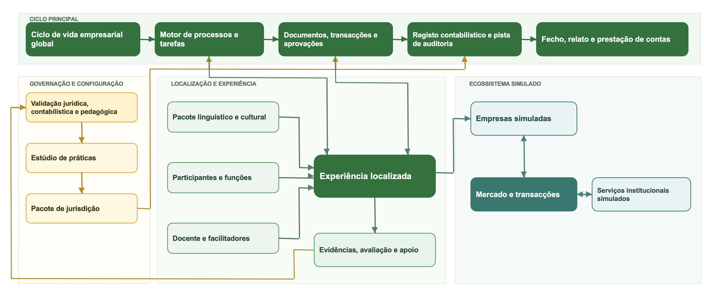

# Internacionalização do Sistema de Práticas Empresariais e Empreendedorismo — SPEE

## Revisão de literatura e quadro de requisitos para uma plataforma global de práticas empresariais, orientada ao Sul Global e com enfoque especial em África

**Versão:** 2 — revisão para a equipa SPEE  
**Data:** 28 de Julho de 2026  
**Âmbito:** Sistema de Práticas Empresariais e Empreendedorismo (SPEE)  
**Formato:** revisão rápida de literatura orientada à concepção do sistema  

---

## Resumo executivo

A internacionalização do SPEE deve abranger todo o percurso realizado pelos participantes: ideia e plano de negócio, constituição da empresa, organização do trabalho, compras, vendas, facturação, cobranças, pagamentos, salários, custos fixos, impostos, contabilidade, concursos públicos, fecho do período e prestação de contas.

A literatura sobre aprendizagem pela prática empresarial reforça a importância de ligar departamentos, funções, documentos, prazos, validações, efeitos contabilísticos e relações institucionais. Gualdi (2020), Tampieri (2015), Bianchi, Hernández-Lara e Gualdi (2015) e Riebenbauer e Stock (2015) salientam a integração de processos, a rotação por funções, a execução de tarefas e a reflexão sobre o trabalho realizado.

Internacionalizar o SPEE implica, por isso, desenvolver uma **economia configurável de práticas empresariais**, composta por:

1. um ciclo de vida empresarial comum, desde a ideia até à prestação de contas;
2. processos configuráveis, tais como constituir a empresa, vender, comprar, contratar, pagar salários, liquidar impostos, concorrer e encerrar contas;
3. documentos e registos próprios de cada jurisdição;
4. calendários, aprovações, prazos e controlos;
5. instituições simuladas, incluindo registo comercial, autoridade tributária, segurança social, bancos, operadores de moeda electrónica, entidades adjudicantes, alfândegas e serviços públicos;
6. empresas simuladas que transaccionam entre si;
7. papéis de trabalho, separação de funções e colaboração;
8. evidências que permitam avaliar a execução, a conformidade, a articulação entre áreas e a reflexão do participante.

Os trabalhos de **Gércia Sequeira** e **Gildo Cossa** são centrais. As dimensões identificadas por Sequeira — realismo, multidisciplinaridade, comunicação, usabilidade, compatibilidade e acessibilidade — devem materializar-se em processos completos e ligados entre si. A proposta pan-africana de Cossa requer que cada país possa representar as suas práticas, instituições, documentos e serviços, em vez de apenas alterar parâmetros de um contexto moçambicano.

A análise dos documentos internos confirma a importância operacional destas ligações. As 576 conversas de *helpdesk* concentram-se no registo, acesso, erros, navegação, constituição da empresa, sócios e gestão pedagógica. Quando um pré-requisito não é concluído, operações posteriores ficam bloqueadas. A internacionalização aumentará o número de regras e dependências. Por isso, o sistema terá de mostrar o processo, os pré-requisitos, o estado, o documento produzido, a entidade que deve responder e a forma de recuperar de um erro.

A recomendação central desta revisão é:

> **Transformar o SPEE numa plataforma internacional de empresas simuladas, assente num núcleo global de ciclo de vida, processos, documentos, registos e evidências, complementado por pacotes de jurisdição e por uma rede de instituições e empresas simuladas mantida com parceiros locais.**

---

## 1. Âmbito funcional da internacionalização

A revisão toma como ponto de partida o ciclo de trabalho já estabelecido no SPEE:

1. ideação e validação da oportunidade;
2. elaboração do plano de negócio;
3. constituição e instalação da empresa;
4. organização de pessoas, funções, activos e recursos;
5. operação comercial, financeira, laboral, fiscal e contabilística;
6. participação em concursos públicos e relação com instituições;
7. fecho do período, relato e prestação de contas;
8. continuidade, transformação ou encerramento.

Para suportar este ciclo em diferentes países, a base tecnológica deve articular:

- motor de ciclo de vida empresarial;
- motor de processos e fluxos de trabalho;
- motor de transacções e documentos;
- registos operacionais, contabilísticos e de auditoria;
- calendário de obrigações;
- rede de serviços institucionais simulados;
- espaço de trabalho por empresa, função e participante;
- sistema de evidências e avaliação da prática.

---

## 2. Objectivo e perguntas da revisão

A pergunta principal é:

> **Que abordagens, componentes e funcionalidades devem ser considerados para internacionalizar um simulador de práticas empresariais que cobre o ciclo completo da empresa, à escala mundial, no Sul Global e especialmente em África?**

Perguntas complementares:

1. Que partes do ciclo empresarial podem constituir um núcleo global?
2. Que processos, documentos e instituições têm de ser configurados por país?
3. Como pode o sistema reproduzir o trabalho quotidiano sem se tornar excessivamente complexo?
4. Como deve funcionar uma economia simulada com empresas, bancos, autoridades e compradores públicos?
5. Como preservar continuidade, rastreabilidade e avaliação quando há conectividade limitada?
6. Como permitir que actores africanos criem e mantenham práticas empresariais localmente credíveis?

---

## 3. Método, fontes e limitações

### 3.1. Documentos internos analisados

Foram analisados:

- [resultados agregados de 576 conversas](../outputs/spee_helpdesk_chats_20260630/analysis_results.json);
- [análise consolidada de sentimento](../outputs/spee_helpdesk_chats_20260630/analise_sentimento_spee_helpdesk.md);
- [perguntas orientadoras](../outputs/spee_helpdesk_chats_20260630/perguntas_analise_spee_helpdesk.md);
- [guião de workshop com estudantes](../outputs/spee_helpdesk_chats_20260630/guiao_workshop_estudantes_spee.md);
- [relatório preliminar de recomendações](../analise_sentimento_recomendacoes.md);
- livro de cálculo consolidado e respectivas representações de inspecção;
- apresentações de análise, formulários e materiais de contacto presentes na pasta.

As conversas individuais foram consideradas através da base consolidada, evitando reproduzir mensagens potencialmente sensíveis.

### 3.2. Literatura pesquisada

A pesquisa deu prioridade a:

- aprendizagem experiencial, aprendizagem pela prática empresarial e formação baseada no trabalho;
- educação empresarial e contabilística através de processos integrados;
- ciclo de criação, operação, fecho e prestação de contas;
- redes de empresas simuladas e serviços centrais;
- internacionalização de processos, documentos e relato financeiro;
- contexto do Sul Global e de África;
- trabalhos de Gércia Sequeira e Gildo Cossa.

Foram privilegiados artigos com revisão por pares, normas abertas, documentação de redes internacionais de empresas simuladas e fontes institucionais primárias.

### 3.3. Limitações

Esta é uma revisão rápida orientada à concepção, e não uma revisão sistemática exaustiva. A literatura directamente aplicável a ambientes integrados de práticas empresariais é relativamente limitada. Bianchi et al. (2015) observam que há necessidade de mais estudos empíricos, avaliações objectivas e comparações interculturais.

Nos documentos internos existe uma divergência de classificação. O relatório preliminar atribui 535 conversas a estudantes e 41 a docentes, enquanto a análise consolidada identifica 89 estudantes, 21 docentes e 466 visitantes indeterminados, com níveis de confiança. A versão consolidada é usada como fonte quantitativa; o relatório preliminar é usado apenas para formular hipóteses funcionais.

---

## 4. Fundamentos da aprendizagem pela prática empresarial

### 4.1. Execução de processos como método de aprendizagem

Tampieri (2015), Gualdi (2020), Bianchi et al. (2015) e Riebenbauer e Stock (2015) associam a aprendizagem empresarial prática à execução de operações, ao cumprimento de prazos, à produção de documentos, à colaboração entre funções e à reflexão sobre o trabalho. A PEN Worldwide acrescenta evidência sobre a articulação de empresas, formadores, empresas mentoras e serviços institucionais em redes nacionais e internacionais.

O valor pedagógico decorre de quatro movimentos:

- aplicar conhecimento numa tarefa com finalidade;
- observar as consequências da execução;
- receber retorno de colegas, docentes e sistema;
- reflectir e corrigir a prática.

O docente actua inicialmente como orientador mais directo e, à medida que a equipa ganha autonomia, passa a treinador, supervisor e facilitador. Esta mudança é coerente com a aprendizagem experiencial e com a formação baseada no trabalho.

### 4.2. Integração entre departamentos

Uma das limitações do ensino empresarial tradicional é a separação entre disciplinas. O estudante aprende contabilidade, fiscalidade, marketing, recursos humanos e finanças em unidades diferentes, mas pode não compreender como uma venda cria:

- uma encomenda;
- uma obrigação de entrega;
- uma factura;
- uma conta a receber;
- um movimento de inventário;
- imposto;
- lançamento contabilístico;
- fluxo de caixa;
- informação para controlo e prestação de contas.

Gualdi (2020) defende uma utilização integrada dos sistemas de informação. O processo contabilístico não começa na elaboração das demonstrações financeiras: começa no plano e no orçamento, continua nas compras, vendas, cobranças, pagamentos, financiamento, custos com pessoal e obrigações fiscais, e termina no fecho e no relato.

Para o SPEE, cada operação deve ser simultaneamente:

- uma actividade de trabalho;
- uma transacção entre actores;
- uma fonte de documentos;
- uma alteração do estado da empresa;
- uma evidência de aprendizagem;
- uma entrada para contabilidade, controlo e relato.

### 4.3. Ciclo empresarial completo

Gualdi (2020) descreve um percurso que abrange constituição, gestão, comércio, cumprimento fiscal, contabilidade, auditoria, demonstrações financeiras e eventual encerramento. A PEN Worldwide documenta ainda a interacção com empresas nacionais e internacionais e com serviços que reproduzem bancos, alfândegas, impostos, salários, utilidades e registo. A Organização Internacional do Trabalho, através do programa **Start and Improve Your Business**, acrescenta módulos sobre ideia, plano de negócio, marketing, custos, compras e inventário, registos, planeamento, pessoas e produtividade.

Estes contributos permitem organizar o SPEE em seis fases:

1. **Ideação e validação:** problema, oportunidade, cliente, proposta de valor e modelo;
2. **Planeamento:** mercado, operações, organização, financiamento, projecções e plano de negócio;
3. **Constituição e instalação:** forma jurídica, registos, licenças, contas, contratos e organização interna;
4. **Operação quotidiana:** comprar, vender, receber, pagar, contratar, remunerar, produzir, armazenar, concorrer e cumprir;
5. **Fecho e prestação de contas:** reconciliação, inventário, ajustamentos, impostos, demonstrações, relatório, auditoria e apresentação;
6. **Continuidade, transformação ou encerramento:** crescimento, alteração, crise, reestruturação, cessação e arquivamento.

### 4.4. Competências e avaliação

Bianchi et al. (2015), num estudo com 76 estudantes, encontraram valorização de aprendizagem, adaptação, resolução de problemas e trabalho em equipa. Contudo, competências específicas como análise de demonstrações financeiras receberam avaliações mais baixas. Os autores recomendam melhor ligação entre conhecimento teórico, prática e avaliação objectiva.

Esta limitação é importante. Um sistema de práticas não é automaticamente eficaz por reproduzir tarefas. Cada processo deve explicitar:

- competência técnica;
- padrão de qualidade;
- evidência esperada;
- retorno formativo;
- oportunidade de repetição;
- momento de reflexão;
- relação com processos anteriores e posteriores.

---

## 5. Evidência interna: onde as práticas se interrompem

### 5.1. Retrato do helpdesk

O corpus consolidado inclui 576 conversas e 2 705 mensagens, entre 4 de Março de 2025 e 26 de Junho de 2026.

| Tema | Conversas | Proporção com sentimento negativo | Mediana de mensagens | Mediana de duração |
|---|---:|---:|---:|---:|
| Registo, inscrição e dados | 132 | 48,5% | 6 | 9,01 min |
| Acesso, conta e palavra-passe | 122 | 41,0% | 5 | 8,50 min |
| Erro técnico ou bloqueio | 119 | 66,4% | 6 | 9,35 min |
| Orientação de navegação | 118 | 33,9% | 5 | 8,13 min |
| Sócios, convites e empresa | 115 | 37,4% | 5 | 8,40 min |

Nas conversas classificadas como sendo de estudantes, 74,2% referem sócios, convites ou empresa. Entre docentes, 71,4% referem turmas e gestão pedagógica. Estas subamostras são limitadas, mas indicam que os problemas estão ligados à progressão dentro das práticas.

O relatório preliminar identifica ainda bloqueios relacionados com activos mínimos, loja em linha, contratos, associação de sócios, reposição de palavras-passe e falta de visibilidade docente. Como as classificações divergem, estes elementos devem ser validados em testes de usabilidade antes de serem tratados como frequências definitivas.

### 5.2. Interpretação processual

Um erro no SPEE raramente é apenas um erro de interface. Pode interromper uma cadeia:

```text
Constituir empresa
→ validar sócios
→ activar empresa
→ configurar actividade
→ obter activos mínimos
→ iniciar operações
→ emitir documentos
→ registar contabilidade
→ prestar contas
```

Se o sistema não tornar as dependências visíveis, o estudante sabe apenas que “não consegue avançar”. A internacionalização acrescentará mais documentos, validações, instituições e prazos, tornando este problema ainda mais crítico.

### 5.3. Requisitos derivados

| Evidência | Requisito |
|---|---|
| Bloqueio em etapas iniciais | Mapa do ciclo, pré-requisitos e estado de cada prática |
| Erros técnicos longos | Identificador, causa, dados afectados, reparação e retoma |
| Dificuldade com sócios | Fluxo de convite, aceitação, rejeição, conflito e substituição |
| Dependências como activos mínimos | Validação preventiva e ligação directa à tarefa em falta |
| Reposição manual de palavra-passe | Recuperação autónoma e autenticação institucional |
| Falta de visibilidade docente | Painel por empresa, participante, processo e obrigação |
| Diagnóstico com muitas mensagens | Pedido de apoio com contexto técnico e processual automático |
| Poucas avaliações explícitas | Medida de conclusão, resolução, aprendizagem e esforço |

---

## 6. Contributos de Gércia Sequeira e Gildo Cossa

### 6.1. Gércia Sequeira: modernização e qualidade das práticas

Sequeira (2024) e Sequeira et al. (2026) identificam dimensões de realismo, comunicação, usabilidade, compatibilidade, multidisciplinaridade e acessibilidade. Aplicadas à internacionalização do SPEE, estas dimensões significam:

| Dimensão | Aplicação ao simulador de práticas |
|---|---|
| Realismo | Processos, documentos, prazos, entidades e efeitos coerentes |
| Comunicação | Entregas, pedidos, notificações, aprovações e colaboração entre funções |
| Usabilidade | Saber o que fazer, porquê, com que dados e qual o resultado |
| Compatibilidade | Integração entre módulos, documentos, contabilidade e sistemas institucionais |
| Multidisciplinaridade | Uma mesma prática activa conhecimentos comerciais, fiscais, laborais, financeiros e éticos |
| Acessibilidade | Executar e acompanhar trabalho em dispositivos e ligações diversos |

As funcionalidades sugeridas — assinaturas digitais, notificações, roteiros, feedback, auditorias, relatórios, carteiras móveis e funcionamento offline — fazem particular sentido quando ligadas a práticas. Uma notificação não deve dizer apenas “há uma actividade”; deve indicar que uma factura aguarda aprovação, que um imposto vence, que uma reconciliação está incompleta ou que um concurso recebeu esclarecimento.

### 6.2. Gildo Cossa: ecossistemas empresariais africanos

Cossa et al. (2023a, 2023b) identificam limitações à expansão pan-africana do SPEE:

- um único ambiente centrado em Moçambique;
- português como única língua;
- ausência de autoria local de conteúdo.

Num sistema de práticas, “novo conteúdo” significa mais do que um caso ou evento. Inclui:

- novo tipo de empresa;
- procedimento de registo;
- documento comercial;
- imposto e respectivo calendário;
- regime laboral;
- método de pagamento;
- serviço institucional;
- processo de concurso público;
- modelo de contas;
- cadeia de valor sectorial;
- interacção transfronteiriça.

Cossa (2018) demonstra também o papel das redes e do capital social no empreendedorismo moçambicano. O SPEE deve permitir praticar relações com mentores, fornecedores, associações, clientes, instituições, redes da diáspora e comunidade, mantendo a distinção entre confiança legítima, conflito de interesses e prática indevida.

### 6.3. Síntese

Sequeira ajuda a definir **como tornar as práticas utilizáveis, integradas e acessíveis**. Cossa ajuda a definir **quem deve representar as práticas africanas e como a diversidade deve entrar no sistema**. A internacionalização exige ambos.

---

## 7. O que tem de ser internacionalizado

### 7.1. Entidades

O sistema deve permitir configurar:

- empresário em nome individual;
- sociedades e outras formas jurídicas;
- sócios, administradores e procuradores;
- trabalhadores e prestadores;
- clientes e fornecedores;
- banco, microfinança e moeda electrónica;
- autoridade tributária;
- segurança social;
- registo e licenciamento;
- município e serviços públicos;
- alfândega;
- entidades adjudicantes;
- seguradoras;
- auditor ou revisor;
- tribunais, mediação ou reclamação, quando pedagogicamente apropriado.

### 7.2. Processos

Cada processo necessita de:

- objectivo;
- evento de início;
- papéis;
- passos;
- documentos de entrada e saída;
- regras e cálculos;
- prazos;
- aprovações;
- excepções;
- efeitos noutros módulos;
- evidência de conclusão;
- retorno pedagógico.

O núcleo global pode definir a estrutura “vender a crédito”, mas o pacote de jurisdição define os campos da factura, imposto, numeração, moeda, prazo, documento de transporte, forma de cobrança e tratamento contabilístico.

### 7.3. Documentos

Famílias de documentos:

- plano de negócio e orçamento;
- estatutos, requerimentos e licenças;
- contratos;
- catálogos, propostas e cotações;
- encomendas, guias, facturas e notas;
- recibos, ordens de pagamento e extractos;
- folhas de salário e declarações;
- mapas de impostos e segurança social;
- peças de concurso e propostas;
- inventários, reconciliações e diários;
- balancetes e demonstrações financeiras;
- relatórios de gestão, actas e prestação de contas.

Cada modelo deve ter versão, jurisdição, língua, período de validade e relação com a transacção que o produziu.

### 7.4. Regras e calendários

- moeda e câmbio;
- impostos e taxas;
- segurança social;
- salário, benefícios e retenções;
- dias úteis, feriados e prazos;
- numeração documental;
- aprovação e assinatura;
- conservação de documentos;
- plano de contas;
- princípios de reconhecimento e mensuração;
- limites e critérios de contratação pública;
- penalizações, juros e correcções.

### 7.5. Práticas e cultura de trabalho

Internacionalizar implica também considerar:

- níveis de formalidade;
- comunicação escrita e oral;
- responsabilidade individual e colectiva;
- hierarquia e autorização;
- negociação;
- relação entre família, comunidade e empresa;
- resolução de conflito;
- ética, integridade e denúncia;
- práticas de trabalho presencial, remoto e móvel.

Estas dimensões não devem ser codificadas como estereótipos nacionais. Devem ser validadas com actores locais e apresentadas como contextos possíveis.

---

## 8. Camada mundial: núcleo comum e padrões abertos

### 8.1. Núcleo global do ciclo de vida

O núcleo comum deve oferecer:

- criação de ideia e plano;
- constituição configurável;
- organização da empresa e papéis;
- catálogo de processos;
- transacções entre entidades;
- documentos e aprovações;
- calendário;
- registo contabilístico;
- fecho e prestação de contas;
- evidências e avaliação;
- auditoria técnica e pedagógica.

As regras substantivas devem permanecer fora do código, em pacotes versionados.

### 8.2. Modelação de processos

BPMN 2.0.2, mantido pelo Object Management Group, oferece uma notação internacional para representar processos, eventos, tarefas, mensagens e excepções. O SPEE não precisa de mostrar diagramas técnicos aos estudantes, mas pode adoptar um modelo interno compatível para:

- tornar processos legíveis e reutilizáveis;
- comparar variantes nacionais;
- testar caminhos e excepções;
- separar definição do processo e interface;
- permitir autoria sem alterar o núcleo.

### 8.3. Modelo canónico de documentos

A Universal Business Language 2.3 oferece estruturas abertas para encomendas, facturas, respostas, cancelamentos e outros documentos. Não deve substituir modelos nacionais, mas pode inspirar um modelo canónico:

```text
Documento global
→ extensão de país
→ apresentação na língua e formato local
→ efeitos no processo
→ efeitos contabilísticos
→ arquivamento e evidência
```

Esta abordagem permite que uma factura de dois países tenha apresentações diferentes, mas continue a ser reconhecida pelo motor como factura.

### 8.4. Contabilidade e relato

O IFRS for SMEs pode funcionar como referência internacional para cenários de relato, mas não deve ser presumido como norma nacional única. A terceira edição foi emitida em 2025 e é aplicável a períodos iniciados a partir de 1 de Janeiro de 2027, com adopção antecipada permitida. Cada pacote deve indicar se usa IFRS for SMEs, norma nacional, regime simplificado ou uma aproximação pedagógica.

XBRL pode ser considerado para exportação e validação futura de demonstrações, porque separa a estrutura digital do relatório da taxonomia que define os conceitos. Não é requisito para o primeiro produto.

### 8.5. Internacionalização técnica

Requisitos mínimos:

- Unicode/UTF-8;
- textos externos ao código;
- língua separada de país e jurisdição;
- pluralização, número, moeda, data e fuso horário baseados em CLDR;
- suporte a diferentes formatos de nome, endereço, telefone e identificação;
- preparação para escrita da direita para a esquerda;
- pesquisa e ordenação adequadas à língua;
- glossário empresarial por variante;
- tradução com autoria, revisão, estado e versão;
- mensagens completas, sem concatenação de fragmentos.

### 8.6. Interoperabilidade

- LTI 1.3 para plataformas de aprendizagem;
- início de sessão único;
- API documentada;
- importação de turmas;
- exportação de notas e portefólios;
- eventos de aprendizagem;
- exportação de documentos e dados da empresa simulada;
- integração opcional com ferramentas educativas de contabilidade, nunca com sistemas reais sem isolamento e controlo.

### 8.7. Acessibilidade

O objectivo mínimo deve ser WCAG 2.2 AA, incluindo navegação por teclado, foco visível, contraste, leitores de ecrã, legendas, alvos tácteis, autenticação acessível, ajuda consistente e redução de introdução repetida de dados.

Documentos gerados — facturas, mapas, relatórios e contas — também têm de ser acessíveis. Não basta tornar acessível o menu que os abre.

---

## 9. Camada Sul Global: continuidade da prática em condições desiguais

### 9.1. Conectividade e continuidade transaccional

Numa plataforma de práticas, o modo offline é mais exigente do que num sistema de leitura. Uma venda offline pode afectar inventário, factura, imposto, cliente e contabilidade. O sistema deve:

- permitir preparar trabalho offline;
- distinguir rascunho de transacção submetida;
- atribuir identificadores temporários;
- mostrar o que aguarda sincronização;
- impedir duplicação;
- resolver conflitos;
- conservar uma pista de auditoria;
- retomar processos sem perda;
- explicar que prazos são pedagógicos e quais dependem de sincronização.

### 9.2. Dispositivo móvel

Fluxos adequados ao telemóvel:

- consultar tarefas;
- aprovar ou devolver documento;
- emitir recibo simples;
- registar pagamento;
- carregar evidência;
- comunicar com a equipa;
- receber aviso de prazo;
- acompanhar caixa, obrigações e estado.

Operações intensivas, como reconciliação ou elaboração de contas, devem ter vistas móveis progressivas e possibilidade de continuação num computador.

### 9.3. Literacia digital, empresarial e linguística

Cada prática deve incluir:

- explicação do propósito;
- pré-requisitos;
- exemplo;
- glossário;
- modelo preenchido;
- exercício de treino;
- validação antes da submissão;
- explicação do erro;
- oportunidade de correcção.

O sistema deve ensinar a prática, não apenas verificar se o participante já a conhece.

### 9.4. Ecossistemas híbridos

No Sul Global coexistem:

- numerário e pagamentos digitais;
- registos em papel e plataformas electrónicas;
- relações formais e informais;
- bancos, microfinanças, grupos de poupança e moeda electrónica;
- empresas registadas e percursos graduais de formalização.

O SPEE deve representar esta coexistência e permitir compreender custos, riscos, direitos e oportunidades, sem apresentar a informalidade apenas como erro ou a digitalização apenas como progresso automático.

### 9.5. Inclusão

A avaliação deve examinar barreiras por género, deficiência, língua, dispositivo e qualidade de ligação. Na África Subsariana, a GSMA estimava em 29% a diferença de género no uso da Internet móvel em 2025. Fluxos de alto valor, incluindo constituição, conta, pagamentos e concursos, devem ser testados com pessoas sub-representadas.

---

## 10. Camada África: localizar uma economia de práticas

### 10.1. África não é uma jurisdição

A camada africana deve ser composta por:

- núcleo global;
- cenários continentais e regionais;
- pacote de país;
- variantes sectoriais;
- conteúdo produzido e validado localmente.

A AfCFTA pode suportar práticas transfronteiriças, mas o respectivo Protocolo de Comércio Digital não deve ser aplicado como se todos os países já tivessem procedimentos idênticos.

### 10.2. Serviços centrais simulados

A experiência da PEN Worldwide mostra a importância de escritórios centrais que reproduzem funções macroeconómicas. No SPEE, uma implementação nacional ou regional pode disponibilizar:

| Serviço simulado | Práticas suportadas |
|---|---|
| Registo empresarial | Reserva de nome, constituição, alteração e cessação |
| Licenciamento | Pedido, pagamento, renovação e inspecção |
| Autoridade tributária | Registo, declarações, liquidação, pagamento, correcção e fiscalização |
| Segurança social | Inscrição, declaração salarial, contribuição e regularização |
| Banco | Conta, transferência, crédito, extracto e reconciliação |
| Moeda electrónica | Carteira, agente, comissão, limite, liquidez e reconciliação |
| Serviços públicos | Contrato, consumo, factura, pagamento e interrupção |
| Entidade adjudicante | Anúncio, peças, esclarecimentos, proposta, avaliação, adjudicação e contrato |
| Alfândega | Classificação, declaração, direitos, libertação e trânsito |
| Seguradora | Proposta, apólice, prémio e sinistro |
| Auditoria | Pedido de evidência, teste, constatação e relatório |
| Centro de coordenação | Catálogo de empresas, mercado, apoio, formação e qualidade |

Estes serviços devem responder a actos dos participantes e gerar documentos, estados e prazos.

### 10.3. Catálogo mínimo de práticas

#### A. Ideia e plano

- identificar problema e oportunidade;
- observar mercado e cliente;
- definir produto ou serviço;
- construir proposta de valor e modelo;
- estimar custos, preço e procura;
- preparar plano de negócio;
- elaborar orçamento e necessidades de financiamento;
- apresentar e rever o plano.

#### B. Constituição

- escolher forma jurídica;
- seleccionar sócios e papéis;
- reservar nome;
- elaborar documentos constitutivos;
- requerer registo;
- obter identificação fiscal;
- tratar licenças;
- abrir conta;
- declarar início;
- configurar contabilidade e arquivamento documental.

#### C. Organização inicial

- definir estrutura e funções;
- contratar ou designar trabalhadores;
- criar catálogo;
- estabelecer fornecedores;
- adquirir activos;
- contratar serviços fixos;
- definir controlos e autorizações;
- preparar calendário de obrigações.

#### D. Vendas e cobranças

- procurar cliente;
- emitir cotação;
- receber encomenda;
- verificar condições;
- entregar;
- facturar;
- receber;
- emitir recibo;
- tratar devolução, desconto, atraso e incobrável;
- reconciliar cliente e banco.

#### E. Compras e pagamentos

- identificar necessidade;
- pedir propostas;
- seleccionar fornecedor;
- emitir encomenda;
- receber e verificar;
- registar factura;
- aprovar;
- pagar;
- reconciliar;
- tratar devolução, divergência e adiantamento.

#### F. Recursos humanos e salários

- definir posto;
- recrutar e seleccionar;
- contratar;
- registar trabalhador;
- controlar presença ou trabalho;
- calcular remuneração;
- processar retenções e contribuições;
- pagar;
- emitir documento salarial;
- gerir férias, ausência, avaliação e cessação.

#### G. Tesouraria e financiamento

- prever caixa;
- receber e pagar;
- transferir;
- usar numerário, banco ou moeda electrónica;
- solicitar crédito;
- tratar juros e prestações;
- reconciliar contas;
- gerir insuficiência de liquidez.

#### H. Inventário, activos e custos

- receber, armazenar e movimentar;
- contar e reconciliar inventário;
- adquirir e manter activos;
- calcular depreciação quando aplicável;
- processar renda, energia, comunicação e outros custos fixos;
- imputar custos a produtos ou actividades.

#### I. Fiscalidade e segurança social

- determinar obrigação;
- calcular;
- preparar declaração;
- validar;
- submeter;
- pagar;
- corrigir;
- responder a notificação;
- manter evidência.

#### J. Contabilidade

- receber documentos das áreas;
- validar integridade;
- classificar;
- lançar;
- controlar contas;
- reconciliar;
- ajustar;
- fechar;
- produzir balancete e demonstrações;
- manter pista de auditoria.

#### K. Concursos públicos

- localizar oportunidade;
- analisar elegibilidade;
- obter peças;
- pedir esclarecimento;
- preparar documentos administrativos, técnicos e financeiros;
- garantir autorizações;
- submeter;
- responder a pedido;
- receber o resultado da avaliação;
- reclamar quando aplicável;
- celebrar e executar contrato;
- facturar, reportar e encerrar.

Os princípios de objectividade, transparência, concorrência, integridade e possibilidade de impugnação presentes na Lei Modelo da UNCITRAL oferecem uma referência global. O pacote nacional deve definir o procedimento efectivo. Dados do Banco Mundial indicam que as PME participam menos do que empresas maiores, o que justifica tratar preparação para concursos como competência empresarial.

#### L. Fecho e prestação de contas

- completar documentos em falta;
- reconciliar banco, caixa, clientes, fornecedores e impostos;
- contar inventário;
- registar ajustamentos;
- calcular imposto;
- fechar período;
- produzir demonstrações financeiras;
- preparar notas e relatório de gestão;
- comparar plano, orçamento e realizado;
- submeter contas;
- responder a auditoria;
- apresentar resultados a sócios e docentes;
- arquivar e reflectir.

### 10.4. Capital social, informalidade e ética

Inspirado em Cossa (2018), o sistema pode representar redes como recursos e responsabilidades. Um participante pode obter indicação de fornecedor, mentoria ou acesso a mercado, mas deve declarar conflitos e distinguir relação legítima de favorecimento.

Em processos de fiscalização e contratação pública, corrupção e fraude devem surgir como dilemas de integridade, controlos e denúncia. O sistema não deve treinar a execução de práticas ilícitas.

### 10.5. Comércio intra-africano

Empresas de países diferentes podem praticar:

- proposta e contrato transfronteiriço;
- moeda e câmbio;
- condições de entrega;
- facturação;
- pagamento;
- alfândega;
- origem e documentação;
- protecção de dados;
- resolução de divergência;
- comunicação multilingue.

O valor pedagógico está no trabalho coordenado entre empresas, bancos, alfândegas e serviços, não apenas numa variável que altera o preço.

---

## 11. Arquitectura funcional proposta



### 11.1. Objectos centrais

| Objecto | Função |
|---|---|
| Empresa simulada | Unidade organizacional onde as práticas se realizam |
| Participante | Pessoa com papéis, competências e evidências |
| Função | Responsabilidade por tarefas e autorizações |
| Processo | Sequência configurável de trabalho |
| Tarefa | Acção atribuída, com prazo e resultado |
| Documento | Evidência comercial, laboral, fiscal ou financeira |
| Transacção | Relação que altera o estado de duas ou mais entidades |
| Regra | Condição, cálculo, limite ou obrigação |
| Calendário | Prazos, períodos, feriados e fechos |
| Serviço simulado | Entidade que recebe, valida e responde |
| Conta/registo | Memória operacional e contabilística |
| Evidência pedagógica | Prova da competência exercida |

### 11.2. Uma transacção como unidade integrada

Exemplo de venda:

```text
Oportunidade
→ cotação
→ encomenda
→ aprovação
→ entrega
→ factura
→ imposto
→ conta a receber
→ cobrança
→ recibo
→ banco/caixa
→ reconciliação
→ contabilidade
→ relatório e contas
```

Cada passo pode ser executado por função diferente. O sistema deve preservar a ligação entre todos os documentos e efeitos.

---

## 12. Funcionalidades-chave e prioridades

### 12.1. P0 — consolidar a fundação

| Área | Funcionalidade |
|---|---|
| Modelo | Ciclo de vida empresarial explícito |
| Processos | Motor de fluxo com tarefas, papéis, prazos, aprovações e excepções |
| Documentos | Modelos versionados, numeração, anexos, assinatura e estado |
| Transacções | Ligação entre empresas, instituições e documentos |
| Contabilidade | Efeito integrado e pista até ao documento de origem |
| Calendário | Obrigações, notificações, atraso, regularização e fecho |
| Papéis | Funções, separação de responsabilidades e rotação |
| Experiência | Mapa do processo, pré-requisitos, confirmação e recuperação |
| Apoio | Pedido estruturado com processo, passo, empresa, versão e erro |
| Docente | Painel por empresa, função, processo, obrigação e participante |
| Internacionalização | Unicode, CLDR e separação entre núcleo e pacote moçambicano |
| Acesso | PWA, baixo consumo, gravação local e sincronização segura |
| Segurança | Permissões, auditoria, minimização de dados e recuperação de conta |
| Acessibilidade | WCAG 2.2 AA para interface e documentos |

### 12.2. P1 — ciclo completo moçambicano como pacote de referência

| Fase | Funcionalidades |
|---|---|
| Ideia e plano | Proposta de valor, mercado, custos, projecções, plano e aprovação |
| Constituição | Sócios, forma, documentos, registos, licenças e conta |
| Operação | Vendas, compras, recebimentos, pagamentos, activos e custos fixos |
| Pessoas | Contratos, trabalho, salários, retenções e contribuições |
| Estado | Impostos, segurança social, notificações e regularização |
| Mercado público | Concurso, proposta, adjudicação, contrato e execução |
| Contabilidade | Documentos, lançamentos, reconciliações, ajustamentos e fecho |
| Contas | Demonstrações, relatório, auditoria, apresentação e arquivamento |
| Economia simulada | Empresas, clientes, fornecedores, bancos e serviços institucionais |

### 12.3. P2 — primeiro produto internacional

- pacotes de duas ou mais jurisdições contrastantes;
- estúdio de autoria e validação;
- língua e terminologia por variante;
- comparação de processos;
- transacções entre empresas de países diferentes;
- câmbio e documentos transfronteiriços;
- início de sessão único e LTI;
- formação e certificação de facilitadores;
- indicadores comparáveis de execução e aprendizagem.

### 12.4. P3 — expansão africana

- carteiras móveis e agentes;
- percursos de formalização;
- serviços centrais nacionais;
- concursos públicos nacionais e regionais;
- alfândega e comércio AfCFTA;
- línguas africanas e conteúdo bilingue;
- sectores e cadeias de valor locais;
- capital social, associações e mentoria;
- clima, energia e interrupções logísticas;
- biblioteca pan-africana de práticas validadas.

### 12.5. P4 — tecnologias emergentes

| Tecnologia | Utilização possível | Condição |
|---|---|---|
| IA | Ajuda contextual, explicação de erro, pesquisa, tradução assistida e rascunho de prática | Fontes, revisão humana, privacidade e alternativa |
| IA processual | Detectar inconsistência ou sugerir próximo passo | Não executar automaticamente a prática do estudante |
| XBRL | Exportação e validação de relato | Taxonomia adequada e valor institucional |
| Blockchain | Credencial ou prova específica | Apenas se superar uma alternativa simples |
| RA/RV | Prática física ou espacial concreta | Ganho pedagógico, equipamento e alternativa acessível |

Uma IA que preencha automaticamente facturas, declarações e contas pode destruir precisamente a aprendizagem que o SPEE pretende criar. A assistência deve ser graduada e transparente.

---

## 13. Experiência dos participantes

### 13.1. Caixa de trabalho

O participante deve ver:

- empresa e função actual;
- tarefas atribuídas;
- prioridade e prazo;
- origem do pedido;
- dados e documentos necessários;
- estado;
- dependências;
- pessoa ou entidade seguinte;
- efeito esperado;
- ajuda e exemplo.

### 13.2. Rotação de funções

Para desenvolver compreensão sistémica, o sistema deve permitir rotação por:

- comercial;
- compras;
- recursos humanos;
- tesouraria;
- contabilidade;
- fiscalidade;
- operações;
- direcção;
- contratação pública;
- auditoria interna.

A rotação deve preservar responsabilidade individual e passagem de trabalho. O novo responsável precisa de receber contexto, documentos pendentes e riscos.

### 13.3. Separação de funções

Práticas como pagamento, contratação ou fecho podem exigir preparação, revisão e aprovação por pessoas diferentes. Isto ensina controlo interno e reduz a representação irreal de uma empresa onde todos podem fazer tudo.

### 13.4. Erro como oportunidade de aprendizagem

O sistema deve distinguir:

- erro de conhecimento;
- documento incompleto;
- violação de regra;
- pré-requisito ausente;
- conflito de dados;
- atraso;
- falha técnica;
- falha de sincronização.

A resposta deve explicar a causa, permitir correcção e conservar a primeira tentativa como evidência quando pedagogicamente adequado.

---

## 14. Experiência do docente e dos serviços simulados

### 14.1. Painel docente

O docente deve conseguir:

- acompanhar empresas e processos;
- ver tarefas bloqueadas ou vencidas;
- identificar concentração de trabalho numa pessoa;
- consultar documentos e respectivas ligações;
- verificar separação de funções;
- reabrir ou devolver prática;
- inserir uma ocorrência;
- ajustar complexidade;
- iniciar auditoria;
- orientar fecho e prestação de contas;
- avaliar por competência e evidência;
- conduzir reflexão individual e colectiva.

### 14.2. Operadores de serviços simulados

Determinados actores podem ser desempenhados por docentes, monitores ou serviços automáticos:

- funcionário de registo;
- técnico tributário;
- banco;
- comprador público;
- auditor;
- cliente ou fornecedor especial.

O sistema deve permitir combinar resposta automática e intervenção humana. Uma declaração pode ser validada automaticamente; uma fiscalização pode exigir interpretação do docente.

### 14.3. Empresas mentoras

A literatura sobre aprendizagem empresarial prática atribui às empresas mentoras a função de aproximar processos e documentos da realidade. Parceiros empresariais podem:

- validar práticas;
- fornecer produtos e casos fictícios;
- explicar funções;
- participar em entrevistas;
- rever apresentações;
- realizar auditorias pedagógicas;
- ajudar a actualizar conteúdo.

Devem existir regras de independência, protecção de dados e ausência de recrutamento ou promoção abusiva.

---

## 15. Avaliar práticas e competências

### 15.1. O que não deve ser o único indicador

- lucro da empresa;
- velocidade total;
- número de cliques;
- volume de mensagens;
- nota atribuída por IA;
- ausência de erros.

Uma empresa pode ter lucro e manter contabilidade incorrecta. Um estudante pode executar lentamente e demonstrar elevada compreensão. Um erro corrigido com diagnóstico pode produzir mais aprendizagem do que uma tarefa concluída à primeira tentativa.

### 15.2. Dimensões de avaliação

| Dimensão | Pergunta |
|---|---|
| Completude | Todos os passos e documentos necessários foram concluídos? |
| Correcção | Cálculos, campos e classificações estão correctos? |
| Conformidade | Regras, autorizações e prazos foram respeitados? |
| Rastreabilidade | É possível seguir a operação da origem às contas? |
| Integração | O participante compreende efeitos noutros departamentos? |
| Controlo | Houve revisão, reconciliação e separação de funções? |
| Colaboração | O trabalho foi entregue e comunicado adequadamente? |
| Diagnóstico | Erros e divergências foram identificados e corrigidos? |
| Julgamento | Excepções foram tratadas com fundamento? |
| Reflexão | O participante explica o que fez, porquê e o que melhoraria? |

### 15.3. Evidências

- documento produzido;
- registo de etapas;
- cálculo;
- comunicação;
- aprovação;
- reconciliação;
- resposta a excepção;
- relatório;
- apresentação;
- reflexão;
- revisão por pares;
- observação do docente.

### 15.4. Avaliação da internacionalização

Além da aprendizagem, medir:

- processos concluídos por país, língua e dispositivo;
- erros por variante;
- obrigações cumpridas;
- tempo de sincronização;
- contactos de apoio por prática;
- divergências de interpretação;
- conteúdo desactualizado;
- acessibilidade;
- percepção de autenticidade;
- capacidade local de manter o pacote.

---

## 16. Autoria e governação dos pacotes

### 16.1. Estúdio de práticas

O estúdio deve permitir:

1. modelar o processo;
2. definir papéis;
3. criar documentos;
4. configurar regras e cálculos;
5. ligar efeitos contabilísticos;
6. definir prazos e excepções;
7. associar competência e evidência;
8. simular;
9. testar;
10. submeter para validação;
11. publicar e versionar.

### 16.2. Validação

Cada prática deve passar por:

- especialista do domínio;
- profissional local;
- contabilista/fiscalista quando aplicável;
- docente;
- especialista linguístico;
- especialista de acessibilidade;
- revisão técnica;
- teste com participantes.

### 16.3. Metadados obrigatórios

- país e jurisdição;
- sector;
- língua;
- fonte;
- simplificação pedagógica;
- responsável;
- data de vigência;
- data de revisão;
- versão;
- processos afectados;
- documentos afectados;
- compatibilidade;
- condições de arquivamento.

### 16.4. Soberania e sustentabilidade

Autores e instituições locais devem:

- controlar a validação do seu conteúdo;
- receber crédito;
- conhecer as condições de reutilização;
- participar no valor gerado;
- poder corrigir representação inadequada;
- dispor de formação e ferramentas;
- não depender da equipa central para cada actualização.

---

## 17. Dados, segurança e IA

### 17.1. Separar simulação e realidade

O sistema deve tornar inequívoco que:

- dinheiro e documentos são simulados;
- identificadores não são documentos reais;
- submissões não chegam a autoridades reais;
- dados reais não são necessários para aprender;
- integrações externas usam ambientes de treino.

Nunca se deve pedir ao participante palavra-passe real, conta bancária real ou documento pessoal completo para executar uma prática.

### 17.2. Privacidade

- recolha mínima;
- separação entre identidade, actividade, apoio e investigação;
- perfis de acesso;
- retenção definida;
- auditoria administrativa;
- avaliação de residência e transferência de dados;
- consentimento quando necessário;
- painéis que apoiam aprendizagem sem vigilância excessiva.

### 17.3. IA

Casos adequados:

- localizar ajuda para a prática actual;
- explicar termo;
- comparar documento com lista de requisitos;
- sugerir onde procurar um erro;
- apoiar tradução;
- criar rascunho para revisão do autor.

Casos inadequados:

- executar toda a prática;
- gerar prestação de contas sem participação;
- avaliar sozinho;
- inferir honestidade, emoção ou empregabilidade;
- inventar regra;
- usar dados de estudantes sem finalidade e base claras.

---

## 18. Roteiro recomendado

### Fase 0 — consolidar o modelo do produto

- mapear o ciclo actual;
- identificar processos, documentos, regras e serviços;
- definir modelo canónico;
- documentar o pacote moçambicano.

**Saída:** todos os módulos podem ser explicados através de práticas e ligações ao ciclo empresarial.

### Fase 1 — completar e estabilizar o ciclo moçambicano

- ideia e plano;
- constituição;
- operação comercial;
- salários e obrigações;
- impostos;
- contabilidade;
- concursos;
- fecho e prestação de contas;
- painéis e apoio.

**Saída:** uma empresa percorre o ciclo completo, com documentos ligados e contas rastreáveis.

### Fase 2 — provar a arquitectura internacional

- seleccionar dois contextos lusófonos contrastantes;
- criar pacotes com equipas locais;
- substituir processos e documentos sem duplicar código;
- testar transacções entre países;
- avaliar estudantes, docentes e operadores.

**Saída:** a mesma prática global admite variantes locais credíveis e mantidas localmente.

### Fase 3 — expansão africana

- adicionar contexto anglófono e francófono;
- experimentar conteúdo bilingue;
- introduzir serviços centrais;
- acrescentar moeda electrónica, informalidade, concursos e comércio transfronteiriço;
- formar autores e facilitadores.

**Saída:** funciona uma pequena economia pan-africana de empresas simuladas.

### Fase 4 — plataforma global

- catálogo internacional;
- padrões de interoperabilidade;
- biblioteca de práticas;
- qualidade e certificação;
- relato digital opcional;
- investigação longitudinal;
- IA assistiva validada.

---

## 19. Riscos e mitigação

| Risco | Consequência | Mitigação |
|---|---|---|
| Traduzir sem localizar procedimentos | Práticas legal e culturalmente incorrectas | Pacotes de jurisdição |
| Modelar África como um país | Perda de legitimidade | Conteúdo nacional e autoria local |
| Automatizar demasiado | O sistema executa o trabalho pelo estudante | Assistência graduada |
| Processos demasiado complexos | Sobrecarga e abandono | Progressão por níveis e detalhe gradual |
| Processos demasiado simples | Prática sem autenticidade | Validação profissional e ligação entre áreas |
| Alterar regras a meio da turma | Resultados inconsistentes | Fixar versão por execução |
| Offline sem controlo transaccional | Duplicação e perda de dados | Estados, identificadores, conflitos e auditoria |
| Avaliar apenas conclusão | Automatismo sem compreensão | Evidência, fundamento e reflexão |
| Contabilidade separada da operação | Contas sem rastreabilidade | Integração desde o documento de origem |
| Serviço simulado pouco responsivo | Empresas sem mercado ou instituições | Operação humana/automática e acordos de serviço |
| Conteúdo centralizado | Dependência e desactualização | Estúdio, formação e governação local |
| IA que preenche tudo | Perda da aprendizagem prática | Limites por actividade e transparência |

---

## 20. Conclusão

A internacionalização do SPEE deve preservar e ampliar o ciclo completo de práticas: transformar uma ideia num plano, constituir a entidade, organizar pessoas e activos, vender, comprar, facturar, cobrar, pagar, remunerar, cumprir impostos, manter contabilidade, participar em concursos, gerir prazos, reconciliar registos, fechar o período e prestar contas. O valor pedagógico está na ligação entre estas práticas, nos documentos que circulam, nos papéis que colaboram e na capacidade de explicar o que aconteceu.

À escala mundial, o SPEE precisa de um núcleo comum de ciclo de vida, processos, documentos, transacções, contabilidade, evidências e acessibilidade. No Sul Global, precisa de preservar continuidade em telemóveis e ligações intermitentes, representar ecossistemas híbridos e ensinar cada prática de forma assistida. Em África, precisa de pacotes nacionais, serviços centrais simulados, moeda electrónica, percursos de formalização, concursos públicos, redes empresariais, comércio transfronteiriço e autoria local.

Gércia Sequeira fornece dimensões críticas para a qualidade e modernização do sistema. Gildo Cossa fornece a orientação para a apropriação e a diversidade pan-africanas. A literatura sobre aprendizagem pela prática reforça a integração entre processos, documentos, funções, instituições e prestação de contas.

> **A versão internacional do SPEE deve ser uma rede de empresas e instituições simuladas onde participantes de diferentes países aprendem a criar, operar, controlar e prestar contas de uma empresa segundo práticas localmente credíveis e globalmente interoperáveis.**

---

## Referências

1EdTech Consortium. (2024). *Learning Tools Interoperability (LTI) implementation guide*. [https://standards.1edtech.org/lti/guides/implementation_guide/implementation-guide](https://standards.1edtech.org/lti/guides/implementation_guide/implementation-guide)

African Union. (2020). *The Digital Transformation Strategy for Africa (2020–2030)*. [https://au.int/en/documents/20200518/digital-transformation-strategy-africa-2020-2030](https://au.int/en/documents/20200518/digital-transformation-strategy-africa-2020-2030)

African Union. (2022). *AU Data Policy Framework*. [https://au.int/en/documents/20220728/au-data-policy-framework](https://au.int/en/documents/20220728/au-data-policy-framework)

African Union. (2024a). *Protocol to the Agreement Establishing the African Continental Free Trade Area on Digital Trade*. [https://au.int/en/treaties/protocol-agreement-establishing-african-continental-free-trade-area-digital-trade](https://au.int/en/treaties/protocol-agreement-establishing-african-continental-free-trade-area-digital-trade)

African Union. (2024b). *Continental Artificial Intelligence Strategy*. [https://au.int/en/documents/20240809/continental-artificial-intelligence-strategy](https://au.int/en/documents/20240809/continental-artificial-intelligence-strategy)

African Union. (2025). *Continental Education Strategy for Africa 2026–2035*. [https://au.int/en/documents/20250616/continental-education-strategy-africa-2026-2035](https://au.int/en/documents/20250616/continental-education-strategy-africa-2026-2035)

Bianchi, M., Hernández-Lara, A. B., & Gualdi, D. (2015). The contribution of virtual enterprises to competence-based learning: An assessment from the students’ perspective. *Technology, Innovation and Education, 1*, 4. [https://doi.org/10.1186/s40660-015-0005-x](https://doi.org/10.1186/s40660-015-0005-x)

Cossa, G. (2018). Capital social, redes sociais e empreendedorismo em Moçambique – Análise de casos de jovens empreendedores. *Revista Comunicação e Sociedade*, 66–85. [https://www.cec.org.mz/wp-content/uploads/2019/09/GILDO-COSSA-pp66-85.pdf](https://www.cec.org.mz/wp-content/uploads/2019/09/GILDO-COSSA-pp66-85.pdf)

Cossa, G., Alturas, B., Pinto, A. C., & Roque, L. G. (2023a). Pan Africa business simulation games: The ITIS case study. In N. Becu (Ed.), *Simulation and Gaming for Social and Environmental Transitions: Proceedings of the 54th Conference of the International Simulation and Gaming Association* (pp. 142–149). [http://hdl.handle.net/10071/31097](http://hdl.handle.net/10071/31097)

Cossa, G., Roque, L. G., Alturas, B., & Pinto, A. C. (2023b). Pan Africa business simulation game. In *2023 18th Iberian Conference on Information Systems and Technologies*. IEEE. [https://doi.org/10.23919/CISTI58278.2023.10211280](https://doi.org/10.23919/CISTI58278.2023.10211280)

GSMA. (2025). *The Mobile Gender Gap Report 2025*. [https://www.gsma.com/r/gender-gap/](https://www.gsma.com/r/gender-gap/)

Gualdi, D. (2020). ICT and accounting education: An innovative teaching method — The Practice Enterprise. In *6th International Conference on Higher Education Advances* (pp. 1101–1108). Editorial Universitat Politècnica de València. [https://doi.org/10.4995/HEAd20.2020.11208](https://doi.org/10.4995/HEAd20.2020.11208)

IFRS Foundation. (2025). *IFRS for SMEs Accounting Standard* (3.ª ed.). [https://www.ifrs.org/issued-standards/ifrs-for-smes/](https://www.ifrs.org/issued-standards/ifrs-for-smes/)

International Labour Organization. (s.d.). *Start and Improve Your Business*. [https://www.ilo.org/start-and-improve-your-business-siyb](https://www.ilo.org/start-and-improve-your-business-siyb)

Irani, L., Vertesi, J., Dourish, P., Philip, K., & Grinter, R. E. (2010). Postcolonial computing: A lens on design and development. In *Proceedings of the SIGCHI Conference on Human Factors in Computing Systems*. ACM. [https://doi.org/10.1145/1753326.1753522](https://doi.org/10.1145/1753326.1753522)

ISO. (2019). *ISO 9241-210:2019 — Ergonomics of human-system interaction: Human-centred design for interactive systems*. [https://www.iso.org/standard/77520.html](https://www.iso.org/standard/77520.html)

ITU. (2025). *Facts and Figures 2025*. [https://www.itu.int/itu-d/reports/statistics/facts-figures-2025/](https://www.itu.int/itu-d/reports/statistics/facts-figures-2025/)

Lazem, S., Giglitto, D., Nkwo, M. S., Mthoko, H., Upani, J., & Peters, A. (2022). Challenges and paradoxes in decolonising HCI: A critical discussion. *Computer Supported Cooperative Work*. [https://doi.org/10.1007/s10606-021-09398-0](https://doi.org/10.1007/s10606-021-09398-0)

Majurin, E. (2014). *Start and Improve Your Business implementation guide*. International Labour Organization. [https://www.ilo.org/publications/siyb-implementation-guide](https://www.ilo.org/publications/siyb-implementation-guide)

Object Management Group. (2014). *Business Process Model and Notation, Version 2.0.2*. [https://www.omg.org/spec/BPMN/2.0.2/](https://www.omg.org/spec/BPMN/2.0.2/)

OASIS. (2021). *Universal Business Language Version 2.3*. [https://docs.oasis-open.org/ubl/os-UBL-2.3/UBL-2.3.html](https://docs.oasis-open.org/ubl/os-UBL-2.3/UBL-2.3.html)

PEN Worldwide. (s.d.-a). *Practice Enterprise training concept*. [https://penworldwide.org/practice-enterprise-training-concept/](https://penworldwide.org/practice-enterprise-training-concept/)

PEN Worldwide. (s.d.-b). *Central Offices and national networks*. [https://penworldwide.org/locations/](https://penworldwide.org/locations/)

PEN Worldwide. (2025). *PEN-QM Platform user manual*. [https://penqm.penworldwide.org/pdfs/en-GB/PEN-QM%20PLATFORM%20USER%20MANUAL.pdf](https://penqm.penworldwide.org/pdfs/en-GB/PEN-QM%20PLATFORM%20USER%20MANUAL.pdf)

Principles for Digital Development. (2024). *The Principles for Digital Development*. [https://digitalprinciples.org/principles/](https://digitalprinciples.org/principles/)

Riebenbauer, E., & Stock, M. (2015). Design is our success: The importance of modeling a virtual enterprise. *International Journal for Business Education, 155*(1), Article 4. [https://doi.org/10.30707/IJBE155.1.1648133093.391539](https://doi.org/10.30707/IJBE155.1.1648133093.391539)

Sequeira, G. V. de S. (2024). *Simulação empresarial em contexto de tecnologias emergentes: Caso SPEE* [Dissertação de mestrado, Iscte – Instituto Universitário de Lisboa]. [http://hdl.handle.net/10071/34546](http://hdl.handle.net/10071/34546)

Sequeira, G., Pereira, R., Cossa, G., Pinto, A. C., & Roque, L. G. (2026). Business simulation in the context of emerging technologies: The SPEE case study. In F. Trautwein, B. Zürn, H. Lukosch, S. Meijer, & T. Alf (Eds.), *Shaping the Future through Simulation and Gaming* (Lecture Notes in Computer Science, Vol. 16439, pp. 362–378). Springer. [https://doi.org/10.1007/978-3-032-20129-4_24](https://doi.org/10.1007/978-3-032-20129-4_24)

Tampieri, L. (2015). Innovating the didactical methodologies applied in universities through Second Life and Practice Firm: Case study. *Technology, Innovation and Education, 1*, 3. [https://doi.org/10.1186/s40660-015-0006-9](https://doi.org/10.1186/s40660-015-0006-9)

UNCITRAL. (2011). *UNCITRAL Model Law on Public Procurement*. [https://uncitral.un.org/en/texts/procurement/modellaw/public_procurement](https://uncitral.un.org/en/texts/procurement/modellaw/public_procurement)

UNESCO. (2021). *Recommendation on the Ethics of Artificial Intelligence*. [https://www.unesco.org/en/legal-affairs/recommendation-ethics-artificial-intelligence](https://www.unesco.org/en/legal-affairs/recommendation-ethics-artificial-intelligence)

UNESCO. (2023). *Global Education Monitoring Report 2023: Technology in education — A tool on whose terms?* [https://gem-report-2023.unesco.org/technology-in-education/](https://gem-report-2023.unesco.org/technology-in-education/)

Unicode Consortium. (s.d.). *Unicode Common Locale Data Repository*. [https://cldr.unicode.org/](https://cldr.unicode.org/)

W3C. (s.d.). *Localization vs. internationalization*. [https://www.w3.org/International/questions/qa-i18n](https://www.w3.org/International/questions/qa-i18n)

W3C. (2023). *Web Content Accessibility Guidelines 2.2*. [https://www.w3.org/TR/WCAG22/](https://www.w3.org/TR/WCAG22/)

Winschiers-Theophilus, H., & Bidwell, N. J. (2013). Toward an Afro-centric indigenous HCI paradigm. *International Journal of Human–Computer Interaction, 29*(4), 243–255. [https://doi.org/10.1080/10447318.2013.765763](https://doi.org/10.1080/10447318.2013.765763)

World Bank. (2023). *Digital Africa: Technological transformation for jobs*. [https://www.worldbank.org/en/region/afr/publication/digital-africa](https://www.worldbank.org/en/region/afr/publication/digital-africa)

World Bank. (2024). Firm-level surveys can inform reform efforts to promote more SME participation in public procurement. [https://blogs.worldbank.org/en/governance/firm-level-surveys-can-inform-reform-efforts-promote-more-sme-participation-public](https://blogs.worldbank.org/en/governance/firm-level-surveys-can-inform-reform-efforts-promote-more-sme-participation-public)

XBRL International. (s.d.). *The standard for reporting*. [https://www.xbrl.org/the-standard/what/the-standard-for-reporting/](https://www.xbrl.org/the-standard/what/the-standard-for-reporting/)

---

## Apêndice A — Estrutura mínima de um pacote de jurisdição

### Identidade

- [ ] País, região e âmbito;
- [ ] línguas e variantes;
- [ ] moeda e câmbio;
- [ ] fusos, calendário e feriados;
- [ ] fontes e responsáveis.

### Ciclo empresarial

- [ ] ideia e plano;
- [ ] constituição;
- [ ] licenciamento;
- [ ] organização inicial;
- [ ] vendas;
- [ ] compras;
- [ ] pessoas e salários;
- [ ] tesouraria;
- [ ] inventário e activos;
- [ ] fiscalidade;
- [ ] segurança social;
- [ ] contabilidade;
- [ ] concursos públicos;
- [ ] fecho e contas;
- [ ] alteração e encerramento.

### Para cada prática

- [ ] objectivo;
- [ ] papéis;
- [ ] pré-requisitos;
- [ ] passos;
- [ ] documentos;
- [ ] regras;
- [ ] prazos;
- [ ] aprovações;
- [ ] excepções;
- [ ] efeitos contabilísticos;
- [ ] evidências;
- [ ] retorno;
- [ ] fonte, versão e vigência.

### Serviços

- [ ] registo;
- [ ] autoridade tributária;
- [ ] segurança social;
- [ ] banco;
- [ ] moeda electrónica;
- [ ] serviços públicos;
- [ ] contratação pública;
- [ ] alfândega;
- [ ] auditoria;
- [ ] apoio.

### Validação

- [ ] profissional local;
- [ ] docente;
- [ ] contabilista/fiscalista;
- [ ] especialista linguístico;
- [ ] acessibilidade;
- [ ] teste técnico;
- [ ] teste com participantes;
- [ ] plano de manutenção.

## Apêndice B — Cenário mínimo de validação internacional

Uma empresa deve conseguir:

1. criar e aprovar uma ideia;
2. preparar plano e orçamento;
3. constituir-se;
4. abrir conta e configurar obrigações;
5. contratar uma pessoa;
6. adquirir um activo e um serviço fixo;
7. comprar mercadoria ou matéria-prima;
8. vender a outra empresa;
9. facturar e cobrar;
10. pagar fornecedor e salário;
11. declarar e pagar uma obrigação;
12. concorrer a um contrato;
13. reconciliar banco, clientes e fornecedores;
14. fechar o período;
15. produzir e apresentar contas;
16. responder a uma verificação.

O pacote só deve ser considerado funcional quando este percurso estiver completo, rastreável, acessível e pedagogicamente validado.
