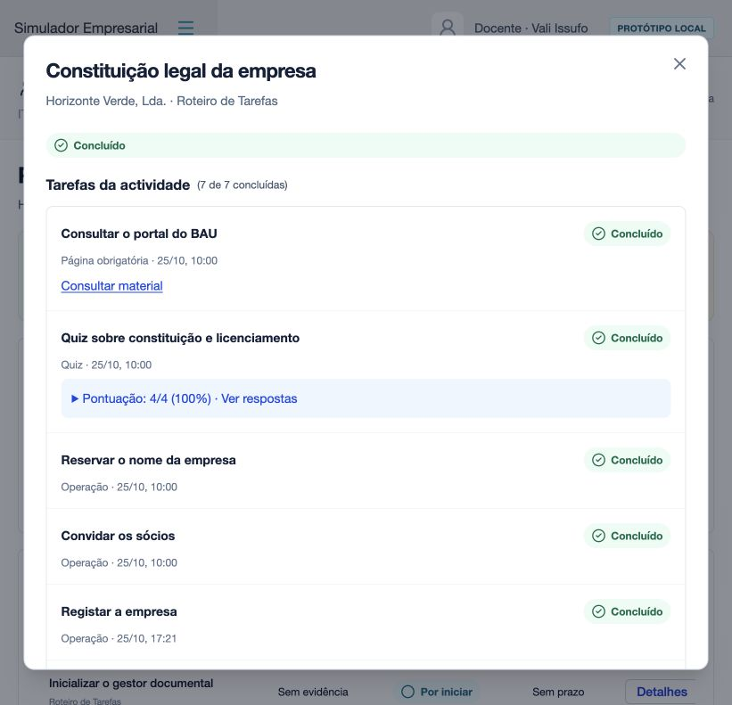
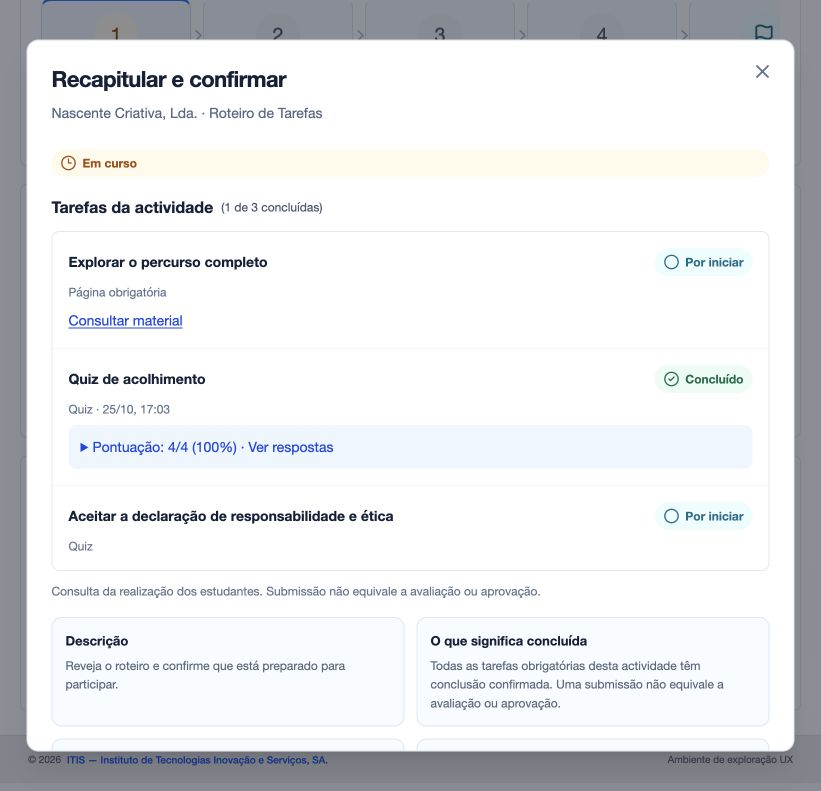

# Validação do Painel do Docente — 25/10/2026

## Âmbito

Alinhar a matriz, o percurso e o detalhe de tarefas com o roteiro das duas empresas, sem alterar o shell. A origem é o estado de cada repository do estudante, não o exemplo seleccionado na entrada.

## Verificações

- `npm run check`: TypeScript, lint, fronteiras e 83 testes unitários passaram.
- `npm run build` e `npm run build-storybook`: passaram. Mantém-se o aviso sobre dimensão do bundle, sem alteração do empacotamento nesta tarefa.
- `npm run test:e2e`: 53 dos 54 testes passaram na execução completa. Um timeout na acção de publicação de GIF da story do hub social foi repetido isoladamente, sem alteração de código/teste, e passou em 2,2 segundos. Todos os quatro novos testes do docente passaram na execução completa.
- Story do roteiro com duas empresas funciona sem AppShell e com armazenamento em memória.
- Testes com armazenamento novo: 15 actividades/48 tarefas em cada empresa; Horizonte Verde 24 tarefas concluídas e 47%; Nascente Criativa zero e 0%. Matriz com cinco blocos, filtros coerentes e primeiro ano fiscal «Brevemente».
- Comparação automática de cada tarefa com a origem: estado, título, ordem, obrigatoriedade, respostas, submissão e data. Teste de ficheiro submetido preserva conteúdo, nome, autor e data; registo confirmado preserva referência.
- Teste de conclusão no exemplo 2 não altera o exemplo 1; reload e nova selecção mantêm a correspondência.
- Mensagens específicas separadas por empresa; orientações gerais da turma entregues a ambas; conversas privadas ausentes do snapshot docente. Migração preserva o original e o âmbito das orientações antigas.
- Erro de leitura de um exemplo impede mostrar valores iniciais como actuais. Conclusão sem evento/resultado nem tarefas obrigatórias datadas é rejeitada.
- Verificação móvel a 390 px sem overflow da página; matriz conserva deslocamento interno.

## Revisão manual por computador

No browser local já existiam alterações guardadas da validação anterior. Foram consultadas sem reposição nem novas mutações:

- Horizonte Verde: 53%, constituição legal 7/7, quiz 4/4, registo confirmado e `exemplo-publicacao.pdf` submetido por Ana Machava. A matriz conserva os cinco blocos actuais.
- Nascente Criativa: 7%, Boas-vindas concluída e Recapitular e confirmar com 1/3; quiz 4/4, restantes tarefas pendentes. Estes valores posteriores prevalecem sobre os fixtures iniciais.
- Os detalhes abrem a empresa e o bloco escolhidos. Datas e autores surgem apenas quando presentes na origem. Sem prazo na fonte, aparece «Sem prazo».

## Limites

Dados de protótipo, locais a cada origem/browser. Localhost e GitHub Pages não sincronizam armazenamento entre si. Os nomes da equipa repetem-se nos dois fixtures por definição dos exemplos. Submissão não significa avaliação; não se fabricam prazos, resultados ou eventos para preencher lacunas. Os cenários antigos permanecem nos fixtures e snapshots originais, fora da lista corrente.
