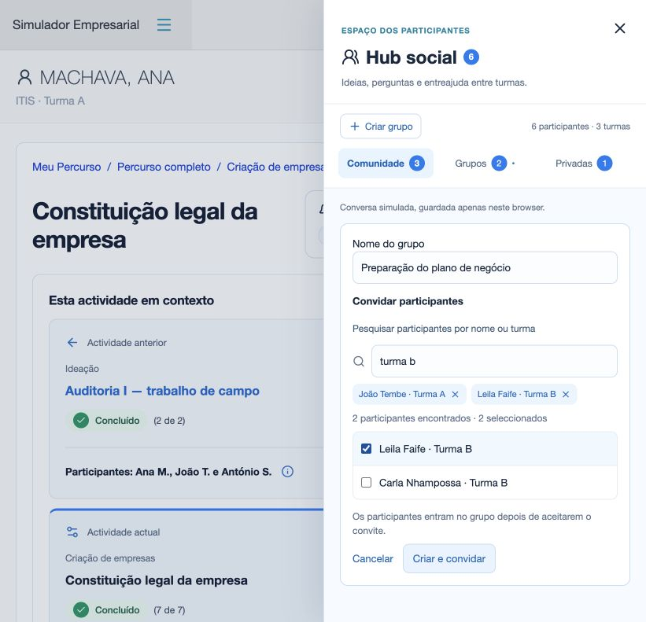

# Validação — pesquisa no hub e contexto da actividade

Data: 25/10/2026. Âmbito: `social-hub` e `student-journey`; PRD comum v0.19 e PRD do estudante v0.16.

## Alterações verificadas

- Grupos: pesquisa por nome/turma, sem distinção de acentos ou maiúsculas, selecção múltipla preservada entre filtros, remoção de selecções e lista com deslocamento interno.
- Privadas: pesquisa idêntica, escolha única, abertura/reutilização da conversa e recolha da pesquisa após sucesso.
- «Notificações de actividades» no painel e no popup dos quatro ecrãs do estudante; canais e total mantidos.
- Contexto: três cartões de actividades pela ordem do roteiro, centrados na actividade aberta, com o nome do bloco. Anterior/seguinte são navegação, não condições de desbloqueio. Nas extremidades, indicação de início/fim sem actividade inventada.
- Componentes isolados do shell, sem novas dependências e sem alteração de fixtures, progresso ou persistência.

## Verificações executadas

- `npm run check`: TypeScript, lint, fronteiras e 86 testes unitários aprovados.
- `npm run build` e `npm run build-storybook`: aprovados. Mantém-se o aviso de tamanho dos bundles já existente.
- 21 testes Playwright relevantes aprovados: pesquisa, contexto nos dois exemplos, quatro páginas de notificações, materiais, registo/evidência, colaboração e navegação.
- Após ajustar a pesquisa por turma, os 4 testes do hub/pesquisa foram repetidos com sucesso. A story usa 86 participantes; o teste verifica teclado, ausência de resultados, selecções entre filtros, reutilização da conversa e ausência de overflow a 390 px.
- Interacção manual no browser local: abertura do popup com o novo nome; pesquisa «joao»; selecção de João seguida de «turma b» e selecção de Leila; pesquisa privada «joao turma a» e reabertura da conversa existente; navegação para «Inicializar o gestor documental» com actualização dos três cartões.
- A revisão manual revelou que uma pesquisa por «turma b» podia coincidir com a letra B de um apelido de outra turma. Corrigido com filtro explícito da turma e teste de regressão.
- Rascunho manual de grupo cancelado; nenhum convite ou mensagem manual foi enviado. Registos existentes preservados.

## Evidências

