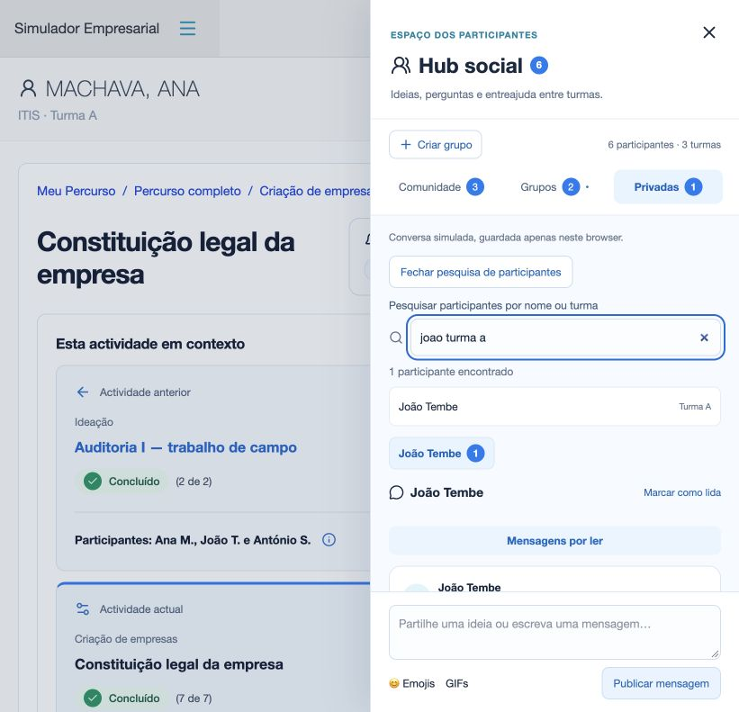
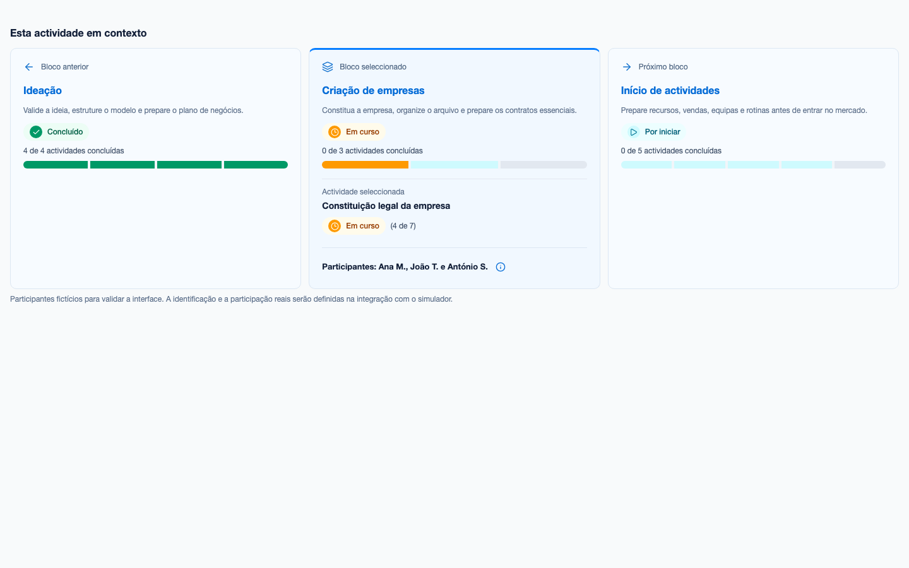

# Validação — pesquisa no hub e contexto da actividade

Data: 25/10/2026. Âmbito: `social-hub` e `student-journey`; PRD comum v0.19 e PRD do estudante v0.16.

## Alterações verificadas

- Grupos: pesquisa por nome/turma, sem distinção de acentos ou maiúsculas, selecção múltipla preservada entre filtros, remoção de selecções e lista com deslocamento interno.
- Privadas: pesquisa idêntica, escolha única, abertura/reutilização da conversa e recolha da pesquisa após sucesso.
- «Notificações de actividades» no painel e no popup dos quatro ecrãs do estudante; canais e total mantidos.
- Contexto: três cartões de actividades pela ordem do roteiro, centrados na actividade aberta, com o nome do bloco. Anterior/seguinte são navegação, não condições de desbloqueio. Nas extremidades, indicação de início/fim sem actividade inventada.
- Componentes isolados do shell, sem novas dependências e sem alteração de fixtures, progresso ou persistência.

## Verificações executadas

- `npm run check`: TypeScript, lint, fronteiras e 86 testes unitários aprovados.
- `npm run build` e `npm run build-storybook`: aprovados. Mantém-se o aviso de tamanho dos bundles já existente.
- 21 testes Playwright relevantes aprovados: pesquisa, contexto nos dois exemplos, quatro páginas de notificações, materiais, registo/evidência, colaboração e navegação.
- Após ajustar a pesquisa por turma, os 4 testes do hub/pesquisa foram repetidos com sucesso. A story usa 86 participantes; o teste verifica teclado, ausência de resultados, selecções entre filtros, reutilização da conversa e ausência de overflow a 390 px.
- Interacção manual no browser local: abertura do popup com o novo nome; pesquisa «joao»; selecção de João seguida de «turma b» e selecção de Leila; pesquisa privada «joao turma a» e reabertura da conversa existente; navegação para «Inicializar o gestor documental» com actualização dos três cartões.
- A revisão manual revelou que uma pesquisa por «turma b» podia coincidir com a letra B de um apelido de outra turma. Corrigido com filtro explícito da turma e teste de regressão.
- Rascunho manual de grupo cancelado; nenhum convite ou mensagem manual foi enviado. Registos existentes preservados.

## Evidências

## Correcção após esclarecimento — blocos do roteiro

O utilizador confirmou que os três cartões representam **blocos**, substituindo a interpretação de actividades adjacentes descrita acima. PRD comum actualizado para v0.20 e PRD do estudante para v0.17.

- Em «Constituição legal da empresa»: Ideação → Criação de empresas → Início de actividades. O bloco seleccionado é o da actividade aberta; consultar uma actividade concluída da ideação centra o contexto em Ideação, mesmo quando a empresa já está em Criação de empresas.
- Cada bloco apresenta descrição, estado agregado, contagem de actividades concluídas e barra segmentada. O nome abre o resumo do bloco. O central preserva a síntese da actividade seleccionada, a contagem das suas tarefas e os participantes.
- Primeiro/último bloco conservam três posições com mensagem na posição sem vizinho. O bloco futuro vazio é apresentado como «Brevemente», sem progresso fictício.
- Nenhuma alteração aos fixtures, repositories, progresso, menu, header ou footer.

Verificação desta correcção: TypeScript, lint, fronteiras e 87 testes unitários aprovados; builds da aplicação e Storybook aprovados; 17 testes de fluxos relevantes e um teste adicional de independência do shell aprovados. Cobrem os dois exemplos, primeira actividade, bloco futuro, navegação e persistência do progresso, tarefas/materiais, participantes, notificações e largura de 390 px. Mantém-se o aviso de tamanho de bundle já existente.

Validação por interacção no browser local: abrir constituição legal, entrar no bloco Ideação e abrir «Encontrar uma ideia de negócio». O contexto acompanha a selecção e mantém os registos existentes (8/15 actividades no cenário pessoal utilizado, sem reposição para o fixture inicial).

