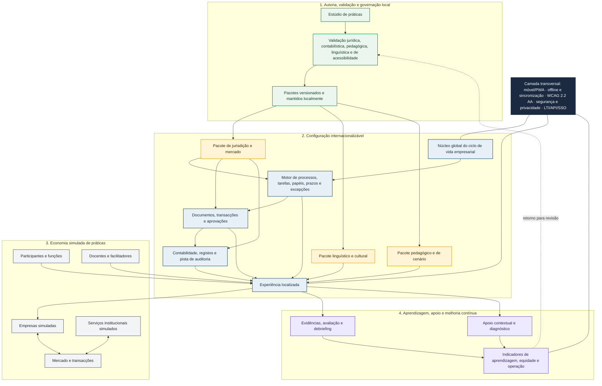

# Roteiro da apresentação final — Internacionalização do SPEE

## 1. Enquadramento da apresentação

**Título recomendado:** *Do SPEE actual a uma plataforma internacional de práticas empresariais*  
**Subtítulo:** *Evidência de docentes e do helpdesk, revisão de literatura e proposta de arquitectura*  
**Público assumido:** Direcção e equipa do ITIS, equipa técnica e pedagógica do SPEE, instituições de ensino e parceiros.  
**Duração recomendada:** 50–55 minutos, seguidos de 15 minutos de discussão.  
**Número de diapositivos principais:** 37.  
**Decisão a obter:** validar o conceito de internacionalização, aprovar a Fase 0 de consolidação do núcleo e autorizar a preparação de pilotos com parceiros locais.

### Resultado esperado da apresentação

No final, o público deverá compreender que a internacionalização do SPEE não consiste em traduzir uma plataforma moçambicana. Consiste em transformar o SPEE numa **economia configurável de práticas empresariais**, com um núcleo global, pacotes locais versionados, empresas e instituições simuladas, apoio pedagógico e autoria governada por actores de cada contexto.

### Mensagem central

> **O SPEE deve evoluir para uma rede internacional de empresas e instituições simuladas onde participantes de diferentes países aprendem a criar, operar, controlar e prestar contas de uma empresa segundo práticas localmente credíveis e globalmente interoperáveis.**

### Arco narrativo

| Secção | Diapositivos | Tempo | Função narrativa |
|---|---:|---:|---|
| Abertura e metodologia | 1–5 | 7 min | Apresentar a pergunta, as fontes e os limites |
| Parte 1 — entrevistas com docentes | 6–10 | 8 min | Demonstrar valor pedagógico e necessidades de evolução |
| Parte 2 — histórico de chats | 11–17 | 10 min | Localizar as rupturas do percurso e do apoio |
| Parte 3 — revisão de literatura e proposta | 18–36 | 27 min | Consolidar a evidência e apresentar conceito, arquitectura, governação e roteiro |
| Fecho e decisão | 37 | 3 min | Fixar a proposta e obter decisões |

---

## 2. Roteiro diapositivo a diapositivo

### Diapositivo 1 — Do SPEE actual a uma plataforma internacional de práticas empresariais

**Objectivo:** abrir com o resultado do trabalho, e não com a lista de actividades realizadas.

**No ecrã:**

- título e subtítulo;
- equipa/projecto e data;
- uma linha de tese: “internacionalizar processos, instituições e aprendizagem — não apenas a interface”.

**Notas do orador:** explicar que a apresentação cruza quatro fontes: entrevistas, chats de assistência técnica, documentos estratégicos do ITIS, S.A., e literatura científica/institucional. Indicar que as duas primeiras fontes mostram a experiência actual; a terceira esclarece prioridades organizacionais; a quarta transforma os achados numa proposta de futuro.

**Visual:** capa institucional simples, com a marca ITIS/SPEE e uma imagem conceptual de empresas e instituições interligadas.

**Transição:** “Comecemos pela conclusão que organiza toda a análise.”

---

### Diapositivo 2 — Internacionalizar não é traduzir: é tornar a economia de práticas configurável

**Objectivo:** fixar desde o início a definição de internacionalização.

**No ecrã:**

- **não é:** mudar língua, moeda e bandeira mantendo o modelo moçambicano;
- **é:** configurar processos, documentos, regras, instituições, cultura de trabalho e pedagogia;
- **resultado:** a mesma plataforma suporta experiências localmente credíveis sem duplicar o núcleo.

**Notas do orador:** distinguir tradução de transformação do produto. Uma factura, um contrato de trabalho ou uma declaração fiscal não mudam apenas de idioma: mudam campos, regras, actores, prazos, efeitos contabilísticos e formas de validação.

**Visual:** comparação “tradução superficial” versus “internacionalização estrutural”.

**Fonte:** revisão de literatura v1 e v2; W3C; Cossa et al. (2023a, 2023b).

**Transição:** “Que pergunta orientou, então, o trabalho?”

---

### Diapositivo 3 — A pergunta foi como escalar sem perder realismo, continuidade e valor pedagógico

**Objectivo:** apresentar a pergunta principal e as perguntas operacionais.

**No ecrã:**

> Que abordagens, componentes e funcionalidades permitem internacionalizar o ciclo completo de práticas empresariais à escala mundial, no Sul Global e especialmente em África?

Perguntas complementares:

1. O que pode constituir um núcleo global?
2. O que tem de variar por país e por contexto?
3. Como assegurar continuidade com recursos e conectividade desiguais?
4. Como garantir autoria, validação e manutenção locais?

**Notas do orador:** sublinhar que a unidade de análise não é apenas o “simulador”, mas o percurso completo de criação, operação, controlo e prestação de contas de uma empresa.

**Visual:** uma pergunta central ligada a quatro perguntas operacionais.

---

### Diapositivo 4 — Quatro fontes permitiram triangular experiência, estratégia e evidência

**Objectivo:** explicar a metodologia solicitada.

**No ecrã:**

1. **Entrevistas com docentes:** seis docentes de seis instituições/separadores, notas, sentimento, dores e sugestões.
2. **Histórico de assistência técnica:** 576 conversas e 2 705 mensagens, de 4 de Março de 2025 a 26 de Junho de 2026.
3. **Análise documental:** documentos de estratégia e evolução do ITIS, S.A./SPEE, incluindo o enquadramento do *Next Gen Upgrade* e materiais de auscultação.
4. **Revisão rápida de literatura:** aprendizagem pela prática, empresas simuladas, internacionalização, Sul Global, África, acessibilidade, interoperabilidade, governação e IA responsável.

**Notas do orador:** explicar que as entrevistas revelam expectativa pedagógica e funcional; os chats revelam rupturas observadas em utilização; os documentos estratégicos ligam a análise ao processo de modernização e internacionalização; a literatura fornece conceitos, padrões, riscos e arquitectura.

**Visual:** quatro fluxos que convergem para “conceito de internacionalização do SPEE”.

**Fonte interna:** matriz de entrevistas; relatório e apresentação do helpdesk; *Diagnóstico de Upgrades do SPEE*; revisões de literatura v1 e v2.

**Transição:** “A triangulação aumenta a força da proposta, mas não elimina os limites dos dados.”

---

### Diapositivo 5 — Os resultados são direccionais e devem ser aprofundados nos pilotos

**Objectivo:** estabelecer credibilidade através da explicitação dos limites.

**No ecrã:**

- entrevistas: amostra reduzida de seis docentes;
- chats: 466 de 576 visitantes sem perfil identificado com confiança;
- sentimento: classificação automática/léxica, adequada a triagem, não a diagnóstico psicológico;
- assistência: “sem resposta” significa sem resposta visível no *export*;
- satisfação: apenas oito avaliações explícitas;
- estudantes: o workshop de co-desenho foi preparado, mas os respectivos resultados ainda não integram este corpus;
- literatura: revisão rápida orientada à concepção, não revisão sistemática PRISMA;
- implicação: validar hipóteses com testes de usabilidade e pilotos locais.

**Notas do orador:** reforçar que estes limites impedem generalizações excessivas, mas não anulam a convergência dos padrões entre fontes. O guião do workshop prevê 12 a 18 estudantes, validação explícita das cinco hipóteses do helpdesk, co-desenho de soluções e priorização; deve ser apresentado como próximo passo metodológico, não como resultado já obtido.

**Visual:** faixa “o que os dados sustentam / o que ainda precisa de validação”.

**Transição:** “Comecemos por quem transforma o sistema em experiência de aprendizagem: os docentes.”

---

## Parte 1 — Resultados das entrevistas com docentes

### Diapositivo 6 — Os docentes reconhecem valor pedagógico, com uma avaliação média de 15,5 em 20

**Objectivo:** abrir a Parte 1 pelo valor já existente.

**No ecrã:**

- seis docentes analisados;
- nota média: **15,5/20**;
- três avaliações positivas;
- duas positivas com reservas;
- uma mista/neutra;
- nenhuma avaliação predominantemente negativa.

**Notas do orador:** afirmar que o SPEE não parte de uma rejeição do conceito. É percebido como útil, produtivo e capaz de aproximar teoria e prática. A exigência dos docentes nasce precisamente da percepção de potencial.

**Visual:** distribuição de sentimento e nota média, com amostra claramente assinalada.

**Fonte:** `analise_sentimento_matriz_sugestoes_spee.xlsx`, folhas “Resumo” e “Sentimento”.

---

### Diapositivo 7 — O principal activo do SPEE é permitir aprender fazendo

**Objectivo:** explicitar os aspectos valorizados nas entrevistas.

**No ecrã:**

- aplicação da teoria à prática;
- criação e operação de empresas simuladas;
- experiência em nuvem e trabalho colaborativo;
- utilização de modelos, transacções, facturação e relatórios;
- laboratório de formação e estágio;
- aproximação ao mercado real.

**Notas do orador:** usar formulações agregadas, sem transformar respostas individuais em testemunhos representativos. Associar estes achados à literatura sobre *Practice Enterprises*: tarefas, documentos, consequências, colaboração e reflexão.

**Visual:** ciclo curto “conhecimento → execução → consequência → retorno → correcção”.

**Transição:** “O valor é claro; as reservas mostram onde a experiência deixa de ser fiável.”

---

### Diapositivo 8 — As reservas concentram-se na fiabilidade do percurso e na capacidade de acompanhamento

**Objectivo:** apresentar as dores docentes por agrupamento.

**No ecrã:**

- desempenho: lentidão, bloqueios e congelamento;
- contabilidade: balancetes, relatórios, demonstrações e estornos;
- fiscalidade: modelos, comprovativos, calendário e lembretes;
- usabilidade: fluxos simples, campos editáveis e flexibilidade;
- gestão de estudantes: registo, recuperação de conta e visibilidade da actividade;
- continuidade: utilização em conectividade limitada;
- ecossistema: financiamento, legalização e ligação a profissionais.

**Notas do orador:** a leitura comum é que os docentes pedem uma plataforma operacionalmente previsível. Um problema técnico não afecta só um utilizador; pode interromper uma aula, uma turma ou uma sequência de práticas.

**Visual:** mapa de dores por “plataforma”, “prática”, “docente” e “ecossistema”.

---

### Diapositivo 9 — Vinte sugestões convergem em cinco prioridades de curto prazo

**Objectivo:** converter a auscultação em áreas de decisão.

**No ecrã:**

- 20 sugestões consolidadas;
- nove de prioridade alta, dez de prioridade média e uma exploratória;
- cinco prioridades altas:
  1. desempenho e estabilidade;
  2. relatórios, balancetes e demonstrações;
  3. ferramentas fiscais;
  4. usabilidade e flexibilidade;
  5. gestão e acompanhamento de estudantes.

**Notas do orador:** mencionar como prioridades seguintes a ligação ao mercado, capacitação/certificação docente, calendário, casos de sucesso e ciclo visível de incorporação dos contributos. A IA surge como exploração, não como fundação.

**Visual:** matriz impacto–urgência ou sequência 0–30, 30–90, 60–120 e 90+ dias.

**Fonte:** folhas “Matriz Sugestões” e “Prioridades”.

---

### Diapositivo 10 — A entrevista docente traduz-se em cinco requisitos de internacionalização

**Objectivo:** fechar a Parte 1 com implicações para a proposta.

**No ecrã:**

1. núcleo estável e rápido;
2. processos e documentos rastreáveis;
3. regras fiscais/contabilísticas configuráveis;
4. painel docente com autonomia controlada;
5. acesso móvel, resiliente e assistido.

**Notas do orador:** salientar que estas necessidades não são apenas “correcções da versão actual”. Tornam-se pré-condições para suportar mais países, regras, línguas, instituições e formas de trabalho.

**Transição:** “Os docentes mostram o que esperam; os chats mostram exactamente onde o percurso se interrompe.”

---

## Parte 2 — Resultados da análise do histórico de chats

### Diapositivo 11 — O histórico do helpdesk permite observar a experiência no ponto de ruptura

**Objectivo:** apresentar corpus e método.

**No ecrã:**

- 576 conversas;
- 2 705 mensagens: 1 660 de visitantes e 1 045 do helpdesk;
- período: Março de 2025 a Junho de 2026;
- unidade principal: conversa;
- análise: sentimento, temas, grupo, duração, resposta e evidência textual anonimizada;
- classificação conservadora: 89 estudantes, 21 docentes e 466 indeterminados.

**Notas do orador:** explicar a limpeza dos rótulos do formulário, a classificação multi-rótulo dos temas e a protecção de dados pessoais. Não apresentar nomes de assistentes nem mensagens sensíveis.

**Visual:** linha temporal do corpus e funil de classificação.

---

### Diapositivo 12 — A primeira resposta é rápida quando existe, mas a cobertura visível é desigual

**Objectivo:** separar velocidade de cobertura e resolução.

**No ecrã:**

- 326 conversas com resposta visível: **56,6%**;
- 250 sem intervenção visível no *export*: **43,4%**;
- mediana da primeira resposta: **1,34 minutos**;
- percentil 75: **3,15 minutos**;
- apenas oito avaliações: cinco positivas e três negativas.

**Notas do orador:** uma resposta inicial rápida não prova resolução. O serviço deve medir fecho, reincidência, reabertura, esforço e qualidade da orientação.

**Visual:** “responder cedo → resolver → confirmar → fechar”.

---

### Diapositivo 13 — A maioria das conversas é neutra, mas a negatividade concentra-se nos bloqueios

**Objectivo:** interpretar a distribuição de sentimento.

**No ecrã:**

- geral por conversa: 311 neutras, 168 negativas, 54 positivas e 43 mistas;
- estudantes classificados: 43,8% negativas e 23,6% mistas;
- docentes classificados: 28,6% negativas e 19,0% mistas;
- assistentes: 82,5% das mensagens em tom neutro/operacional.

**Notas do orador:** não confundir volume neutro com ausência de problemas. Mensagens curtas podem ser classificadas como neutras; os temas de erro concentram a frustração mais intensa.

**Visual:** comparação por grupo, com a nota de que as unidades diferem entre conversas e mensagens.

---

### Diapositivo 14 — Cinco dores aparecem antes de a prática empresarial avançar

**Objectivo:** mostrar a concentração da procura.

**No ecrã:**

| Tema | Conversas | % negativas |
|---|---:|---:|
| Registo, inscrição e dados | 132 | 48,5% |
| Acesso, conta e palavra-passe | 122 | 41,0% |
| Erro técnico ou bloqueio | 119 | 66,4% |
| Orientação de navegação | 118 | 33,9% |
| Sócios, convites e empresa | 115 | 37,4% |

**Notas do orador:** a dor surge ao entrar, registar, convidar, corrigir e desbloquear. Estes são pré-requisitos para a actividade avançada. “Erro técnico ou bloqueio” é a categoria mais negativa, embora não seja a de maior volume.

**Visual:** barras horizontais com volume; assinalar a percentagem negativa no fim de cada barra.

---

### Diapositivo 15 — O mesmo sistema produz necessidades diferentes por papel

**Objectivo:** mostrar que o apoio deve ser desenhado por actor.

**No ecrã:**

- **estudantes:** convites, sócios, empresa, registo, acesso e submissão;
- **docentes:** turmas, controlo pedagógico, correcção de dados e bloqueios colectivos;
- **helpdesk:** contexto inicial insuficiente, diagnóstico repetitivo e escalamento;
- **instituição:** capacidade de acompanhar adopção, qualidade e risco.

**Notas do orador:** 74,2% das conversas classificadas como estudantes referem sócios/convites/empresa; 71,4% das classificadas como docentes referem turmas e gestão pedagógica. Apresentar como sinal direccional, dada a dimensão das subamostras.

**Visual:** quatro actores à volta do mesmo percurso, com necessidades distintas.

---

### Diapositivo 16 — Diagnosticar sem contexto aumenta esforço e dependência de poucas pessoas

**Objectivo:** apresentar a perspectiva operacional do helpdesk.

**No ecrã:**

- “evidência/diagnóstico pedido”: mediana de 9,5 mensagens e 17,99 minutos;
- “plano de negócio e *pitch*”: sete mensagens e 13,62 minutos;
- três assistentes concentram 85,8% das mensagens de assistência;
- pedidos repetidos: captura do erro, correio electrónico, turma, empresa e passo exacto.

**Notas do orador:** a concentração cria risco de conhecimento tácito e respostas inconsistentes. A solução combina formulário estruturado, macros editáveis, base de conhecimento e contexto técnico/processual anexado automaticamente.

**Visual:** entrada incompleta → clarificação → diagnóstico → eventual escalamento, assinalando os pontos de espera.

---

### Diapositivo 17 — Os chats pedem uma experiência que orienta, confirma e recupera

**Objectivo:** fechar a Parte 2 com requisitos funcionais.

**No ecrã:**

1. indicar objectivo, dados e pré-requisitos;
2. permitir executar a tarefa;
3. confirmar o novo estado e o documento produzido;
4. mostrar o próximo passo e o actor seguinte;
5. explicar a causa do erro e permitir recuperação sem perda;
6. oferecer painel docente e apoio estruturado;
7. proteger palavras-passe e dados pessoais.

**Notas do orador:** explicar que a internacionalização acrescentará regras e dependências. Se o estado do processo continuar invisível, a complexidade multiplicará o volume do helpdesk.

**Transição:** “A revisão de literatura permite transformar estes sinais locais numa proposta de arquitectura internacional.”

---

## Parte 3 — Revisão de literatura e proposta de internacionalização

### Diapositivo 18 — A literatura consolida os achados: aprender exige executar um processo completo

**Objectivo:** explicar a função integradora da revisão.

**No ecrã:**

- Tampieri (2015), Bianchi et al. (2015), Riebenbauer e Stock (2015) e Gualdi (2020): aprendizagem pela execução, colaboração, documentos, prazos e reflexão;
- PEN Worldwide: rede de empresas simuladas, formadores, mentores e serviços centrais;
- OIT/SIYB: ideia, plano, marketing, custos, compras, inventário, registos, pessoas e produtividade;
- conclusão: o valor está nas ligações entre tarefas, funções e consequências.

**Notas do orador:** uma simulação não produz aprendizagem automaticamente. Exige integração curricular, preparação, facilitação, retorno, *debriefing* e avaliação múltipla.

**Visual:** tarefa → documento → transacção → consequência → reflexão.

---

### Diapositivo 19 — Cada operação deve ser trabalho, transacção, registo e evidência

**Objectivo:** apresentar a unidade pedagógica da arquitectura.

**No ecrã:** uma venda deve gerar:

- encomenda e obrigação de entrega;
- factura, imposto e conta a receber;
- movimento de inventário;
- cobrança e movimento de caixa/banco;
- lançamento contabilístico;
- informação para controlo e prestação de contas;
- evidência da competência exercida.

**Notas do orador:** usar a venda como exemplo para demonstrar integração entre comercial, operações, fiscalidade, tesouraria e contabilidade. O processo contabilístico começa na operação, não nas demonstrações financeiras.

**Visual:** cadeia de documentos e efeitos de uma venda a crédito.

---

### Diapositivo 20 — O ciclo internacional deve cobrir a vida completa da empresa

**Objectivo:** definir o âmbito funcional.

**No ecrã:**

1. ideação e validação;
2. planeamento e orçamento;
3. constituição e instalação;
4. operação comercial, financeira, laboral, fiscal e contabilística;
5. fecho, relato, auditoria e prestação de contas;
6. continuidade, transformação ou encerramento.

**Notas do orador:** sublinhar que um pacote só é funcional quando uma empresa consegue percorrer o ciclo de ponta a ponta com rastreabilidade, acessibilidade e validação pedagógica.

**Visual:** ciclo empresarial circular, não uma lista de módulos isolados.

---

### Diapositivo 21 — Quatro níveis impedem que internacionalização seja confundida com tradução

**Objectivo:** apresentar o quadro conceptual da revisão v1.

**No ecrã:**

- **internacionalização técnica:** preparar o núcleo para línguas, formatos e regras externas ao código;
- **localização:** adaptar uma versão a uma língua, país, mercado e regime institucional;
- **culturalização:** rever pressupostos sobre autoridade, equipa, negociação, género, conflito e sucesso;
- **glocalização/co-criação:** combinar plataforma comum com conteúdo e decisão locais.

**Notas do orador:** dar o exemplo de Moçambique e Angola: podem partilhar o português, mas não necessariamente instituições, fiscalidade, segurança social, pagamentos ou terminologia empresarial.

**Visual:** quatro camadas progressivas, evitando apresentá-las como sinónimos.

---

### Diapositivo 22 — Sequeira define a qualidade da experiência; Cossa define a legitimidade da expansão

**Objectivo:** destacar os contributos mais directamente relacionados com o SPEE.

**No ecrã:**

**Gércia Sequeira**

- realismo;
- multidisciplinaridade;
- comunicação e interacção;
- usabilidade e compatibilidade;
- acessibilidade e escala.

**Gildo Cossa**

- superar o ambiente centrado num único país;
- ultrapassar o português como única língua;
- permitir autoria local de conteúdo;
- representar redes, capital social e diversidade africana;
- favorecer interacção multiutilizador e apropriação local.

**Notas do orador:** formular a síntese: Sequeira ajuda a definir **como** as práticas devem funcionar; Cossa ajuda a definir **quem** deve representar e manter essas práticas.

---

### Diapositivo 23 — Conceito proposto: uma economia configurável de práticas empresariais

**Objectivo:** apresentar formalmente a proposta central.

**No ecrã:**

> **O SPEE internacional é uma plataforma de empresas e instituições simuladas, assente num núcleo global de ciclo de vida, processos, documentos, registos e evidências, complementado por pacotes de jurisdição, língua, cultura e cenário, mantidos com parceiros locais.**

Componentes essenciais:

- ciclo de vida empresarial comum;
- processos e tarefas configuráveis;
- documentos, regras, calendários e efeitos contabilísticos;
- serviços institucionais simulados;
- transacções entre empresas;
- papéis, evidências, avaliação e reflexão.

**Notas do orador:** esta definição deve ser lida como conceito de produto, conceito pedagógico e modelo de expansão.

**Visual:** uma frase central com seis componentes orbitais.

---

### Diapositivo 24 — A arquitectura deve padronizar o núcleo e descentralizar o conteúdo

**Objectivo:** apresentar os princípios de desenho antes do diagrama.

**No ecrã:**

1. separar código, conteúdo, regra e apresentação;
2. manter regras substantivas em pacotes versionados;
3. representar cada operação como processo ligado a documentos e contas;
4. permitir autoria local sem alterar o núcleo;
5. fixar a versão do pacote durante a execução de uma turma;
6. medir aprendizagem, equidade, apoio e manutenção;
7. tratar móvel, *offline*, acessibilidade, segurança e interoperabilidade como fundação.

**Notas do orador:** ligar estes princípios ao enquadramento interno do *Next Gen Upgrade*: evidência de uso, necessidades pedagógicas, viabilidade técnica e valor estratégico.

---

### Diapositivo 25 — Cinco famílias de elementos têm de ser internacionalizadas

**Objectivo:** explicar o conteúdo de um pacote local.

**No ecrã:**

- **entidades:** empresas, sócios, trabalhadores, bancos, autoridades, segurança social, municípios, alfândega, compradores públicos, seguradoras e auditores;
- **processos:** objectivo, papéis, passos, entradas, saídas, prazos, aprovações, excepções e evidências;
- **documentos:** contratos, facturas, recibos, folhas salariais, declarações, inventários, contas e relatórios;
- **regras e calendários:** moeda, impostos, salários, feriados, numeração, plano de contas e contratação pública;
- **práticas e cultura de trabalho:** formalidade, comunicação, hierarquia, negociação, comunidade, conflito e ética.

**Notas do orador:** insistir que cultura não deve ser codificada como estereótipo nacional. Deve ser validada localmente e tratada como contexto possível.

---

### Diapositivo 26 — A camada mundial fornece um núcleo comum e padrões abertos

**Objectivo:** resumir a camada global.

**No ecrã:**

- núcleo comum do ciclo de vida, processos, transacções, contabilidade, evidências e auditoria;
- BPMN 2.0.2 como referência interna para modelar processos e excepções;
- UBL 2.3 como inspiração para um modelo canónico de documentos;
- IFRS for SMEs e normas nacionais como referências configuráveis de relato;
- Unicode/UTF-8 e CLDR para língua, data, número, moeda e nomes;
- LTI 1.3, início de sessão único e API para interoperabilidade;
- WCAG 2.2 AA para interface e documentos.

**Notas do orador:** os padrões reduzem duplicação e permitem comparar variantes, mas não substituem as regras e modelos nacionais.

---

### Diapositivo 27 — No Sul Global, continuidade e inclusão são requisitos transaccionais

**Objectivo:** mostrar que *offline* e telemóvel não são características periféricas.

**No ecrã:**

- preparar trabalho sem ligação e distinguir rascunho de submissão;
- identificadores temporários, fila de sincronização e prevenção de duplicação;
- resolução de conflitos e pista de auditoria;
- tarefas móveis: consultar, aprovar, receber, pagar, carregar evidência e acompanhar obrigações;
- ensino incorporado: propósito, exemplo, glossário, validação, erro e correcção;
- representação de numerário, banco, moeda electrónica, registos em papel e percursos de formalização;
- avaliação de barreiras por género, deficiência, língua, dispositivo e ligação.

**Notas do orador:** uma venda *offline* afecta inventário, factura, imposto, cliente e contabilidade. Por isso, *offline* deve ser concebido como continuidade transaccional, não como simples leitura sem ligação.

---

### Diapositivo 28 — Em África, a unidade de localização é o país e a comunidade de prática

**Objectivo:** apresentar a camada africana sem homogeneização.

**No ecrã:**

- África não é uma jurisdição;
- combinação de núcleo global, cenários regionais, pacote nacional e variante sectorial;
- moedas electrónicas, agentes, microfinança e inclusão financeira;
- economia informal e percursos de formalização;
- capital social, associações, mentoria e ética;
- concursos públicos, alfândega e comércio intra-africano/AfCFTA;
- sectores, cadeias de valor, clima, energia e logística;
- línguas africanas, conteúdo bilingue, autoria e soberania locais.

**Notas do orador:** a AfCFTA pode suportar cenários transfronteiriços, mas não elimina a diversidade de procedimentos nacionais.

---

### Diapositivo 29 — Serviços centrais tornam a simulação numa economia que responde

**Objectivo:** explicar a rede institucional simulada.

**No ecrã:**

- registo empresarial e licenciamento;
- autoridade tributária e segurança social;
- banco, microfinança e moeda electrónica;
- serviços públicos e seguradora;
- entidade adjudicante e alfândega;
- auditoria e centro de coordenação.

**Notas do orador:** cada serviço recebe actos dos participantes e devolve documentos, estados, prazos ou excepções. Pode combinar resposta automática com intervenção humana de docentes, monitores ou parceiros.

**Visual:** empresas simuladas no centro, ligadas a serviços institucionais à volta.

---

### Diapositivo 30 — A nova arquitectura liga autoria local, configuração, economia simulada e evidência

**Objectivo:** apresentar o diagrama central da proposta.

**No ecrã:** usar o diagrama definido na secção seguinte, ocupando quase todo o diapositivo. Manter apenas o título e uma legenda mínima.

**Notas do orador:** ler o diagrama de cima para baixo:

1. actores locais criam e validam práticas;
2. os pacotes configuram um núcleo global;
3. a experiência localizada permite a operação de empresas e instituições simuladas;
4. execução, apoio e avaliação produzem evidência;
5. a evidência regressa à governação para revisão do conteúdo;
6. acesso, segurança, interoperabilidade e dados atravessam toda a arquitectura.

#### Markup Mermaid do diagrama



#### Descrição de desenho para um assistente de IA

```text
Criar um diagrama de arquitectura institucional, em formato horizontal 16:9, para uma apresentação executiva do ITIS/SPEE. O desenho deve ser limpo, plano, legível a partir de uma sala e com aparência profissional, evitando um painel de cartões ou uma ilustração futurista.

Organizar o diagrama em quatro faixas horizontais numeradas, lidas de cima para baixo:

1. “Autoria, validação e governação local”: mostrar o Estúdio de práticas, a validação multidisciplinar e os pacotes versionados. Representar a ideia de que universidades, profissionais, entidades e especialistas locais criam, validam e mantêm conteúdo.

2. “Configuração internacionalizável”: colocar o núcleo global ao centro, com uma sequência vertical ou horizontal: ciclo de vida empresarial → motor de processos e tarefas → documentos/transacções/aprovações → contabilidade/registos/pista de auditoria. Ligar três pacotes ao núcleo: jurisdição e mercado; língua e cultura; pedagogia e cenário. Todos convergem na “Experiência localizada”.

3. “Economia simulada de práticas”: mostrar participantes e docentes a entrarem na experiência localizada. A experiência alimenta empresas simuladas, que transaccionam num mercado. O mercado interage em ambos os sentidos com serviços institucionais simulados, como registo, autoridade tributária, banco, segurança social, alfândega e comprador público.

4. “Aprendizagem, apoio e melhoria contínua”: ligar a experiência localizada a evidências/avaliação/debriefing e a apoio contextual/diagnóstico. Ambos alimentam indicadores de aprendizagem, equidade e operação. Usar uma seta de retorno descontínua dos indicadores para a validação local, mostrando revisão contínua dos pacotes.

Acrescentar uma barra transversal na base com: “móvel/PWA; offline e sincronização; WCAG 2.2 AA; segurança e privacidade; LTI/API/SSO”. A barra deve parecer uma fundação comum a todas as camadas.

Semântica visual:
- verde ITIS para autoria e governação;
- âmbar para pacotes locais;
- azul-petróleo para o núcleo e os motores;
- cinzento claro para actores e economia simulada;
- violeta discreto para evidência e aprendizagem;
- azul-marinho para a fundação transversal;
- setas contínuas para fluxo operacional;
- setas bidireccionais para transacções;
- seta descontínua para retorno, validação e melhoria.

Usar rótulos curtos, sem parágrafos dentro das formas. Manter todos os textos em Português de Portugal. Usar ícones lineares apenas quando aumentem a compreensão: lápis/edição no estúdio; selo na validação; engrenagem nos motores; documento; empresa; mercado; edifício institucional; evidência; apoio; dados. Não usar globos decorativos, robôs, circuitos, efeitos 3D ou fotografias. Garantir contraste elevado, alinhamento rigoroso, espaços regulares e ausência de cruzamento de setas sobre rótulos.
```

---

### Diapositivo 31 — Uma transacção integrada torna o processo compreensível e auditável

**Objectivo:** traduzir a arquitectura para uma operação concreta.

**No ecrã:**

```text
Oportunidade → cotação → encomenda → aprovação → entrega → factura
→ imposto → conta a receber → cobrança → recibo → banco/caixa
→ reconciliação → contabilidade → relatório e contas
```

**Notas do orador:** cada passo pode pertencer a uma função diferente. O sistema deve conservar a ligação entre documentos, estados, actores e efeitos. Um erro deve ser classificado como conhecimento, documento incompleto, regra, pré-requisito, conflito, atraso, falha técnica ou falha de sincronização.

**Visual:** cadeia com documentos ligados por uma linha de rastreabilidade contínua.

---

### Diapositivo 32 — A experiência deve dar autonomia ao participante e visibilidade ao docente

**Objectivo:** mostrar como a proposta responde às Partes 1 e 2.

**No ecrã:**

**Participante**

- função, tarefas, prioridade, prazo e origem;
- dados, documentos, dependências e efeito esperado;
- ajuda, exemplo, confirmação e recuperação;
- rotação de funções e passagem de trabalho.

**Docente/facilitador**

- progresso por empresa, processo, participante e obrigação;
- bloqueios, atrasos e concentração de trabalho;
- reabertura, devolução, auditoria e ajuste de complexidade;
- avaliação por competência, evidência e reflexão.

**Notas do orador:** acrescentar que preparação, revisão e aprovação por pessoas diferentes permitem ensinar separação de funções e controlo interno.

---

### Diapositivo 33 — A expansão sustentável exige autoria e governação locais

**Objectivo:** apresentar o modelo de manutenção dos pacotes.

**No ecrã:**

- estúdio para modelar processo, papéis, documentos, regras, contas, evidências e excepções;
- validação por profissional local, especialista do domínio, contabilista/fiscalista, docente, linguista, acessibilidade, equipa técnica e participantes;
- metadados: jurisdição, língua, sector, fonte, vigência, versão, responsável e revisão;
- conselho de conteúdo por país;
- crédito, direitos de utilização, capacidade e participação no valor para autores locais;
- nenhuma alteração legal modifica silenciosamente uma turma em curso.

**Notas do orador:** relacionar este modelo com a recomendação organizacional de papéis claros, decisões próximas da operação, critérios de escalamento e prestação de contas.

---

### Diapositivo 34 — Tecnologia deve ampliar a prática, não substituir a aprendizagem

**Objectivo:** reunir acesso, segurança, interoperabilidade e IA responsável.

**No ecrã:**

- **prioridade:** PWA, baixo consumo, sincronização segura, acessibilidade, recuperação de conta, permissões e auditoria;
- **interoperabilidade:** LTI, SSO, API, importação de turmas, exportação de notas, portefólios e documentos;
- **privacidade:** dados mínimos, separação entre identidade, aprendizagem, apoio e investigação;
- **simulação segura:** nunca exigir palavra-passe, conta bancária ou documento pessoal real;
- **IA adequada:** ajuda contextual, explicação de erro, pesquisa, tradução e rascunho para revisão;
- **IA inadequada:** executar toda a prática, gerar contas, avaliar sozinha ou inventar regras.

**Notas do orador:** ligar ao conceito interno de *Agent Coach*: a IA pode orientar perguntas, propor missões e pedir evidência, mas a execução e o julgamento continuam com o participante e o docente.

---

### Diapositivo 35 — O sucesso mede aprendizagem, autenticidade, inclusão e capacidade local

**Objectivo:** apresentar o quadro de avaliação.

**No ecrã:**

- **prática:** completude, correcção, conformidade, rastreabilidade e integração;
- **competência:** controlo, colaboração, diagnóstico, julgamento e reflexão;
- **internacionalização:** erros por variante, autenticidade percebida, regras actualizadas e divergências de interpretação;
- **inclusão:** conclusão por língua, género, deficiência, dispositivo e qualidade de ligação;
- **operação:** apoio por prática, primeira resolução, reabertura, sincronização e reincidência;
- **sustentabilidade:** autores locais activos, custo de manutenção e reutilização dos cenários.

**Notas do orador:** lucro, rapidez, cliques ou uma nota de IA não devem ser indicadores únicos. Um erro bem diagnosticado e corrigido pode produzir mais aprendizagem do que uma tarefa concluída automaticamente.

---

### Diapositivo 36 — O roteiro reduz risco antes de ampliar escala

**Objectivo:** apresentar uma sequência executável.

**No ecrã:**

**Fase 0 — consolidar o modelo**

- mapear ciclo, processos, documentos, regras e serviços;
- separar o núcleo do pacote moçambicano;
- corrigir orientação, recuperação, painel docente, apoio e observabilidade.
- realizar o workshop de validação e co-desenho com estudantes.

**Fase 1 — completar e estabilizar Moçambique**

- percorrer o ciclo integral com documentos ligados e contas rastreáveis.

**Fase 2 — provar a arquitectura internacional**

- dois contextos lusófonos contrastantes, equipas locais e transacções entre países.

**Fase 3 — expansão africana**

- contexto anglófono e francófono, conteúdo bilingue, serviços centrais e comércio transfronteiriço.

**Fase 4 — plataforma global**

- catálogo internacional, interoperabilidade madura, investigação longitudinal e IA assistiva validada.

**Notas do orador:** apresentar critérios de saída por fase. O primeiro marco não é o número de línguas; é uma instituição noutro país conseguir manter e executar uma prática credível sem alterar o núcleo.

---

### Diapositivo 37 — A decisão é construir uma plataforma global através de pacotes localmente governados

**Objectivo:** fechar com uma proposta de decisão concreta.

**No ecrã:**

> **Padronizar o núcleo. Localizar as práticas. Descentralizar a autoria. Medir a aprendizagem.**

Decisões propostas:

1. validar o conceito de “economia configurável de práticas empresariais”;
2. aprovar a Fase 0 e os respectivos critérios de saída;
3. constituir um grupo de arquitectura, pedagogia e conteúdo;
4. definir o pacote moçambicano de referência;
5. seleccionar dois parceiros para o primeiro piloto internacional;
6. validar o diagrama de arquitectura e convertê-lo num mapa de produto.

**Notas do orador:** regressar à pergunta inicial. A internacionalização terá sucesso quando a plataforma conseguir conservar um núcleo comum e, ao mesmo tempo, permitir que actores locais representem, ensinem e actualizem as suas próprias práticas.

**Visual:** frase final e seis decisões; terminar em proposta, não num diapositivo genérico de agradecimento.

---

## 3. Diapositivos de reserva

### Reserva A — Matriz completa das sugestões docentes

Incluir as 20 sugestões, respectivos docentes e prioridade. Usar apenas durante perguntas sobre origem das prioridades.

### Reserva B — Quadro completo das dores do helpdesk

Incluir os dez temas, volume, negatividade, mensagens, duração e cobertura de resposta.

### Reserva C — Estrutura mínima de um pacote de jurisdição

Mostrar a lista de verificação: identidade, ciclo empresarial, práticas, serviços e validação.

### Reserva D — Cenário mínimo de validação internacional

Uma empresa deve conseguir criar e aprovar uma ideia, preparar plano e orçamento, constituir-se, abrir conta, contratar, comprar, vender, facturar, cobrar, pagar, declarar uma obrigação, concorrer, reconciliar, fechar contas, apresentá-las e responder a uma verificação.

### Reserva E — Riscos e mitigação

| Risco | Mitigação |
|---|---|
| Traduzir sem localizar procedimentos | Pacotes de jurisdição e testes locais |
| Tratar África como um país | Conteúdo nacional/regional e autoria local |
| Escalar antes de estabilizar | Fase 0 e métricas de recuperação |
| Processos demasiado complexos | Progressão por níveis |
| Processos demasiado simples | Validação profissional e ligação entre áreas |
| Conteúdo desactualizado | Fonte, vigência, responsável e versão |
| *Offline* sem controlo transaccional | Estados, identificadores, conflitos e auditoria |
| IA que executa a prática | Assistência graduada e transparência |
| Avaliação centrada no lucro | Evidências, reflexão e múltiplas dimensões |
| Autoria centralizada | Estúdio, formação e governação local |

---

## 4. Recomendações de construção da apresentação

### Estilo visual

- preservar a identidade visual institucional dos artefactos ITIS: verde, branco, verde-claro e âmbar;
- usar títulos que expressem conclusões, não apenas temas;
- privilegiar um gráfico, diagrama ou cadeia de processo por diapositivo;
- limitar o texto visível a uma ideia principal e três a seis elementos;
- colocar método, amostra, unidade e cautelas em rodapé;
- manter números e percentagens com a mesma convenção em toda a apresentação;
- reservar o diagrama de arquitectura para um diapositivo quase integral;
- utilizar os pormenores extensos deste roteiro como notas do orador, não como texto visível.

### Regras de evidência

- não apresentar as seis entrevistas como representação estatística de todos os docentes;
- não redistribuir as 466 conversas indeterminadas entre estudantes e docentes;
- escrever “sem resposta visível no *export*”, e não “sem atendimento”;
- não usar as oito avaliações explícitas para afirmar satisfação geral;
- identificar como hipóteses os sinais do relatório preliminar que não foram confirmados na análise consolidada;
- anonimizar nomes, correios electrónicos, telefones, códigos e palavras-passe;
- separar conclusões da evidência interna das recomendações derivadas da literatura.

### Transições-chave para o orador

- **Metodologia → entrevistas:** “A primeira fonte revela o valor percebido e a expectativa de quem facilita a aprendizagem.”
- **Entrevistas → chats:** “A segunda fonte testa essa expectativa nos pontos onde a actividade realmente se interrompe.”
- **Chats → literatura:** “Os problemas locais tornam-se requisitos de arquitectura quando pensamos em vários países e instituições.”
- **Literatura → conceito:** “A evidência converge numa plataforma de práticas configuráveis, não numa simples versão traduzida.”
- **Arquitectura → roteiro:** “A arquitectura só cria valor se for implementada por fases, com critérios de saída e autoria local.”
- **Roteiro → decisão:** “A decisão imediata é consolidar o núcleo e provar o modelo, antes de ampliar o catálogo de países.”

---

## 5. Artefactos internos que fundamentam o roteiro

1. `analise_sentimento_matriz_sugestoes_spee.xlsx` — síntese das seis entrevistas, sentimento, sugestões e prioridades.
2. `apresentacao_analise_helpdesk_spee_itis_graficos-2.pdf` — narrativa visual dos 576 chats, dores por grupo e recomendações.
3. `outputs/spee_helpdesk_chats_20260630/analysis_results.json` — contagens, temas, sentimento, resposta, domínios e concentração operacional.
4. `outputs/spee_helpdesk_chats_20260630/analise_sentimento_spee_helpdesk.md` — metodologia, resultados, cautelas e recomendações do helpdesk.
5. `output/revisao_literatura_internacionalizacao_spee_v2.md` — revisão principal orientada ao ciclo completo de práticas empresariais.
6. `output/revisao_literatura_internacionalizacao_spee.md` — quadro conceptual de internacionalização, localização, culturalização e glocalização.
7. `SPEE Next Gen Upgrade Charter.pptx` — enquadramento de modernização, evidência multi-*stakeholder*, viabilidade e valor estratégico.
8. `Auscultação ITIS Maio 2026.pptx` — papéis, decisão, autonomia, governação e prestação de contas como condições organizacionais.
9. `Prompt Spee next Gen.pdf` — conceito de assistência por IA orientada a perguntas, missões práticas e evidência, sem substituição do participante.
10. `guiao_workshop_estudantes_spee.md`, formulário e convite — protocolo preparado para validar as hipóteses do helpdesk e co-desenhar soluções com estudantes.

---

## 6. Referências essenciais para notas e rodapés

- African Union (2020, 2022, 2024a, 2024b, 2025): transformação digital, dados, comércio digital, IA e educação em África.
- Bianchi, Hernández-Lara e Gualdi (2015): empresas virtuais e aprendizagem por competências.
- Cossa (2018): capital social, redes e empreendedorismo em Moçambique.
- Cossa et al. (2023a, 2023b): jogo de simulação empresarial pan-africano e caso ITIS.
- Gualdi (2020): integração entre TIC, processos empresariais e educação contabilística.
- International Labour Organization: *Start and Improve Your Business*.
- Object Management Group (2014): BPMN 2.0.2.
- OASIS (2021): Universal Business Language 2.3.
- PEN Worldwide: conceito de *Practice Enterprise* e escritórios centrais.
- Riebenbauer e Stock (2015); Tampieri (2015): concepção e utilização pedagógica de empresas simuladas.
- Sequeira (2024); Sequeira et al. (2026): modernização do SPEE e tecnologias emergentes.
- Unicode Consortium/CLDR; W3C (2023): internacionalização e WCAG 2.2.
- UNCITRAL (2011): princípios de contratação pública.
- UNESCO (2021, 2023): ética da IA e tecnologia na educação.
- World Bank; GSMA; ITU: contexto digital, PME, conectividade e inclusão.
