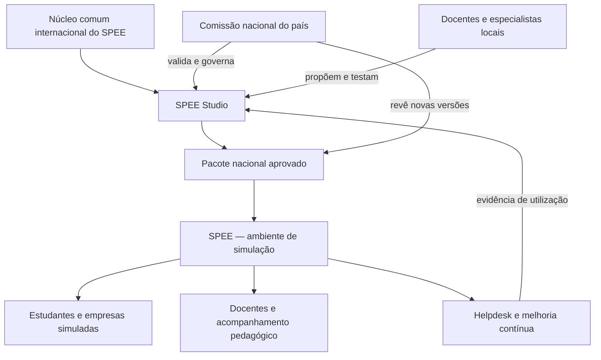

# SPEE Studio

## Visão executiva de uma ferramenta de internacionalização, localização e governação dos processos do SPEE

**Versão:** 1.1 — documento para público não técnico  
**Data:** 3 de Agosto de 2026  
**Público:** Direcção, equipa pedagógica, coordenação do SPEE, docentes, instituições parceiras e intervenientes no *upgrade*  
**Finalidade:** criar entendimento comum, apoiar discussão e orientar decisões; não é uma especificação técnica

---

## 1. Mensagem principal

O SPEE já permite realizar diversas actividades empresariais. O desafio do *upgrade* é fazer com que essas actividades deixem de ser percebidas como partes separadas, passem a formar um percurso empresarial completo e possam ser adaptadas legitimamente à realidade de cada país.

O **SPEE Studio** é o conceito proposto para responder a esse desafio. Será a ferramenta através da qual os processos empresariais do SPEE poderão ser desenhados, localizados, validados, publicados e actualizados para cada território.

Em linguagem simples, o SPEE Studio permitirá definir, para cada participante:

- o que deve fazer;
- por que razão deve fazê-lo;
- o que precisa de ter antes de começar;
- que documento deve produzir;
- quem deve participar, rever ou aprovar;
- o que acontece depois;
- como corrigir um erro e continuar;
- como aquela actividade afecta a empresa e a aprendizagem;
- que regras, documentos, instituições e termos se aplicam em cada país;
- quem tem autoridade para validar e actualizar essa configuração nacional.

O motor de processos continua a ser importante, mas passa a ser entendido como uma capacidade interna do SPEE Studio: é aquilo que faz os percursos funcionarem no SPEE depois de terem sido configurados e aprovados.

O modelo assenta em três elementos complementares:

1. **SPEE:** o ambiente no qual estudantes e docentes vivem a simulação empresarial;
2. **SPEE Studio:** a ferramenta na qual os processos, regras e conteúdos de cada país são configurados e mantidos;
3. **comissão nacional:** a entidade que assegura a legitimidade, a qualidade e a actualização dos processos aplicáveis no seu território.

> **O SPEE Studio permite que exista um único SPEE internacional, com processos empresariais localizados e governados em cada país.**

---

## 2. Decisão que este documento procura apoiar

Este documento propõe que o SPEE Studio seja assumido como um dos eixos estruturantes do *upgrade* do SPEE e como a principal ferramenta de internacionalização e localização da plataforma.

Não se pretende decidir já como será desenvolvido tecnicamente. Pretende-se discutir e validar se o conceito:

1. responde aos problemas observados na utilização actual;
2. reforça a aprendizagem pela prática;
3. ajuda a integrar as diferentes áreas do SPEE;
4. cria uma base sólida para internacionalização;
5. atribui responsabilidade e autoridade aos parceiros de cada território;
6. deve orientar o desenho da próxima versão.

### Decisão sugerida

> **Aprovar o SPEE Studio como ferramenta de internacionalização e localização do SPEE Next Gen e validar o princípio de uma comissão nacional responsável pela governação dos processos em cada território.**

---

## 3. Por que razão este conceito surge agora

O *upgrade* do SPEE tem dois desafios simultâneos:

- melhorar a experiência actual;
- preparar a plataforma para crescer, integrar mais instituições e funcionar noutros países.

Os documentos estratégicos do *upgrade* indicam quatro critérios de decisão:

1. evidência de utilização;
2. necessidades pedagógicas;
3. viabilidade e sustentabilidade da evolução;
4. valor estratégico para adopção e internacionalização.

O SPEE Studio responde aos quatro critérios porque procura resolver problemas actuais através de uma estrutura que também suporta expansão futura e distribui a governação pelos países participantes.

### O risco de melhorar apenas por partes

Se o *upgrade* se limitar a corrigir e acrescentar funcionalidades isoladas, o SPEE pode tornar-se mais completo, mas não necessariamente mais claro.

Será possível melhorar um formulário, um relatório ou uma área do sistema e, ainda assim, manter dúvidas como:

- “Já concluí esta etapa?”
- “Por que razão não consigo avançar?”
- “Quem deve agir agora?”
- “Que documento está em falta?”
- “O que esta operação mudou na empresa?”
- “Como é que o docente acompanha o processo?”

O SPEE Studio propõe uma resposta transversal a estas perguntas, transformando os percursos empresariais em conteúdo configurável, executável e sujeito a governação.

---

## 4. O que aprendemos com os artefactos analisados

### 4.1. Entrevistas com docentes

Os seis docentes analisados reconhecem valor pedagógico no SPEE. A avaliação média foi de 15,5 em 20 e o sentimento predominante foi positivo, embora acompanhado de expectativas de melhoria.

As principais necessidades concentram-se em:

- desempenho e estabilidade;
- relatórios, balancetes e demonstrações;
- fiscalidade;
- usabilidade e flexibilidade;
- gestão e acompanhamento de estudantes;
- maior ligação ao mercado real.

A mensagem subjacente é clara: os docentes valorizam o conceito, mas precisam de uma plataforma mais previsível, integrada e observável.

### 4.2. Histórico do helpdesk

Foram analisadas 576 conversas e 2 705 mensagens, entre Março de 2025 e Junho de 2026.

As dores mais frequentes estão ligadas a:

- registo e dados;
- acesso e palavra-passe;
- erros e bloqueios;
- orientação de navegação;
- sócios, convites e constituição da empresa.

O problema com maior concentração de sentimento negativo é “erro técnico ou bloqueio”. Os dados mostram que muitas dificuldades aparecem no início do percurso e impedem as actividades seguintes.

### 4.3. Revisão de literatura

A literatura sobre empresas simuladas e aprendizagem pela prática destaca que o valor pedagógico não está apenas na realização de tarefas. Está na ligação entre:

- funções empresariais;
- documentos;
- prazos;
- decisões;
- transacções;
- consequências;
- retorno e reflexão.

A revisão conclui que o SPEE deve evoluir para uma economia configurável de práticas empresariais, com processos completos, empresas simuladas e instituições que respondem às acções dos participantes.

### 4.4. Síntese

As três fontes convergem numa necessidade comum:

> **Tornar visível e governável o percurso que liga uma actividade empresarial à actividade seguinte, preservando um núcleo comum e legitimando as adaptações de cada país.**

---

## 5. O conceito explicado sem linguagem técnica

### 5.1. Uma oficina para construir a versão de cada país

O nome **Studio** traduz a ideia de um espaço de trabalho no qual especialistas autorizados podem preparar a experiência empresarial que será vivida no SPEE.

O SPEE Studio não é o espaço de aprendizagem quotidiana dos estudantes. É a ferramenta usada para construir e manter essa experiência. Nela será possível:

- seleccionar um processo empresarial comum;
- adaptar os seus passos ao contexto nacional;
- associar instituições, papéis, regras, documentos e prazos;
- definir a terminologia e os idiomas aplicáveis;
- testar o percurso antes de o disponibilizar;
- submeter alterações à comissão nacional;
- publicar uma versão aprovada no SPEE;
- conservar versões anteriores para auditoria e continuidade pedagógica.

### 5.2. Um coordenador invisível no SPEE

Depois de um processo ser configurado e publicado através do SPEE Studio, o motor de processos acompanha o trabalho da empresa simulada.

Não realiza o trabalho pelo estudante. Organiza-o.

Por exemplo, numa venda, ajuda a garantir que:

1. existe um cliente;
2. é preparada uma cotação;
3. é recebida ou registada uma encomenda;
4. a entrega é confirmada;
5. a factura é emitida correctamente;
6. o valor fica por receber;
7. o pagamento é registado;
8. é emitido um recibo;
9. o banco ou caixa é reconciliado;
10. a operação chega à contabilidade e às contas.

### 5.3. Um roteiro vivo, não uma lista rígida

O processo publicado não deve transformar o SPEE numa sequência inflexível. Deve permitir:

- caminhos normais e situações excepcionais;
- correcções e devoluções;
- tarefas realizadas por pessoas diferentes;
- respostas de bancos, autoridades e outros serviços simulados;
- níveis de dificuldade distintos;
- variações entre países e sectores.

### 5.4. Localização para além da tradução

Localizar o SPEE significa representar correctamente a forma como uma empresa funciona num determinado território. Inclui língua e terminologia, mas também instituições, documentos, impostos, regras laborais, formas jurídicas, moeda, calendários e práticas profissionais.

O SPEE Studio permitirá efectuar estas adaptações sem criar uma plataforma diferente para cada país.

### 5.5. Uma memória do que aconteceu

O SPEE e o SPEE Studio devem conservar a relação entre:

- quem fez;
- o que fez;
- que documento produziu;
- quem aprovou;
- que regra foi aplicada;
- que resultado surgiu;
- que correcção foi necessária;
- que aprendizagem ficou demonstrada.

Esta memória é importante para acompanhamento docente, apoio, avaliação e confiança.

---

## 6. Como seria a experiência antes e depois

| Situação | Experiência fragmentada | Experiência orientada por processos |
|---|---|---|
| Entrada numa actividade | O participante procura onde começar | O sistema mostra propósito, requisitos e primeiro passo |
| Pré-requisito em falta | A operação não avança | O sistema identifica o que falta e oferece ligação para corrigir |
| Tarefa concluída | O participante não sabe se resultou | O novo estado é confirmado e o passo seguinte aparece |
| Trabalho em equipa | Responsabilidades pouco visíveis | Cada função sabe o que deve preparar, rever ou aprovar |
| Documento | Ficheiro ou formulário isolado | Documento ligado à actividade que o produziu e aos seus efeitos |
| Erro | Mensagem genérica ou dependência do helpdesk | Causa, consequência e forma de recuperação explicadas |
| Acompanhamento docente | Consulta dispersa por aluno ou módulo | Visão do percurso, bloqueios, prazos e participação |
| Apoio técnico | Pedido com pouco contexto | Pedido identifica automaticamente processo, passo e erro |
| Internacionalização | Alteração directa de funcionalidades | Adaptação de processos, regras e documentos por contexto |

---

## 7. Como o SPEE Studio se encaixa no *upgrade* do SPEE

O SPEE Studio não representa todo o *upgrade*. É a camada que transforma conhecimento empresarial e decisões nacionais em processos executáveis no SPEE.



O ciclo repete-se em cada país. O núcleo tecnológico e pedagógico permanece comum; o pacote nacional contém os processos, documentos, regras, instituições e termos validados para o território.

### 7.1. Experiência e usabilidade

Os processos publicados pelo SPEE Studio suportam:

- orientação sobre o próximo passo;
- confirmação de conclusão;
- pré-requisitos visíveis;
- mensagens de erro úteis;
- recuperação sem perda de trabalho;
- ajuda no momento da dificuldade.

### 7.2. Integração empresarial

O SPEE Studio permite configurar e ligar:

- plano e orçamento;
- constituição;
- compras e vendas;
- pagamentos e cobranças;
- pessoas e salários;
- impostos;
- contabilidade;
- concursos públicos;
- fecho e prestação de contas.

### 7.3. Gestão pedagógica

O SPEE permite ao docente acompanhar os processos publicados pelo Studio e perceber:

- que etapa cada empresa está a executar;
- que tarefas estão bloqueadas;
- quem participa e em que função;
- que documentos foram produzidos;
- que prazos estão em risco;
- que apoio ou intervenção é necessário;
- que competências foram demonstradas.

### 7.4. Internacionalização e localização

O SPEE Studio permite preservar um percurso empresarial comum e adaptar:

- formas jurídicas;
- documentos;
- regras fiscais e laborais;
- moedas e meios de pagamento;
- instituições;
- prazos;
- língua e terminologia;
- práticas sectoriais e culturais.

Cada adaptação integra um pacote nacional sujeito à aprovação da respectiva comissão.

### 7.5. Apoio e melhoria contínua

O SPEE Studio ajuda a localizar problemas por etapa, em vez de tratar apenas mensagens soltas. O helpdesk e a equipa de produto poderão saber em que actividade os bloqueios se concentram e se resultam de orientação, regra, documento, falha do sistema ou coordenação entre pessoas. Esta evidência poderá fundamentar propostas de revisão submetidas à comissão nacional.

---

## 8. O SPEE Studio como ponte entre melhoria imediata e internacionalização

| | Melhoria do SPEE actual | Preparação do SPEE internacional |
|---|---|---|
| Experiência | Mostra próximo passo, estado e correcção | Suporta percursos em diferentes línguas e contextos |
| Docentes | Dá visibilidade e autonomia controlada | Permite gerir turmas e cenários com regras diferentes |
| Documentos | Liga formulários e relatórios à actividade | Permite modelos próprios de cada país |
| Regras | Explica bloqueios e validações | Separa regras locais do núcleo comum |
| Apoio | Fornece contexto ao helpdesk | Reduz dependência de apoio central por país |
| Produto | Organiza módulos em percursos | Evita criar uma versão separada do sistema para cada país |
| Governação | Torna explícita a responsabilidade pelo conteúdo | Atribui a uma comissão nacional a validação de cada território |
| Aprendizagem | Relaciona tarefa, consequência e reflexão | Permite comparar competências entre contextos sem apagar diferenças locais |

O SPEE Studio cria, assim, uma ponte entre problemas imediatos e ambição estratégica.

---

## 9. Exemplo 1 — Constituir uma empresa

### Sem uma visão de processo

O estudante pode encontrar vários formulários e áreas, mas continuar sem saber:

- se todos os sócios aceitaram;
- se as quotas estão correctas;
- que documento falta;
- quem está a analisar o pedido;
- por que motivo a empresa ainda não está activa;
- o que deve fazer depois.

### Com o motor de processos

```text
Escolher forma jurídica
→ definir sócios e funções
→ reservar nome
→ preparar documentos
→ submeter ao registo simulado
→ corrigir, se necessário
→ obter identificação fiscal
→ tratar licenças
→ abrir conta
→ configurar obrigações
→ activar empresa
```

Em cada etapa, o participante vê:

- estado;
- responsável;
- documento;
- prazo;
- condição de conclusão;
- próximo passo;
- forma de corrigir.

### Valor pedagógico

O estudante não aprende apenas a preencher um formulário. Aprende que constituir uma empresa envolve decisões, documentos, actores, validações e obrigações relacionadas.

---

## 10. Exemplo 2 — Vender, facturar e receber

```text
Oportunidade
→ cotação
→ encomenda
→ aprovação
→ entrega
→ factura
→ conta a receber
→ pagamento
→ recibo
→ reconciliação
→ contabilidade
→ relatório e contas
```

O motor torna visível que uma venda:

- começa antes da factura;
- envolve comercial, operações, tesouraria e contabilidade;
- produz documentos diferentes;
- afecta inventário, impostos, cliente e caixa;
- pode ter atrasos, devoluções ou pagamento parcial;
- só termina plenamente quando os registos são reconciliados.

### Valor pedagógico

Uma disciplina deixa de aparecer separada das restantes. O participante percebe como uma decisão comercial produz consequências operacionais, financeiras, fiscais e contabilísticas.

---

## 11. O que muda para cada interveniente

### 11.1. Estudantes

- maior clareza sobre o que fazer;
- menos incerteza e tentativas repetidas;
- melhor compreensão do ciclo empresarial;
- trabalho em equipa com responsabilidades visíveis;
- possibilidade de corrigir e aprender com erros;
- ajuda no momento certo;
- continuidade entre telemóvel, computador e ligação intermitente.

### 11.2. Docentes

- visão do progresso por empresa e processo;
- identificação de bloqueios colectivos;
- acompanhamento da contribuição de cada função;
- intervenção sem substituir o estudante;
- melhor base para retorno, avaliação e reflexão;
- capacidade de ajustar complexidade e cenários.

### 11.3. Helpdesk

- pedidos com contexto mais completo;
- menos perguntas repetidas para iniciar diagnóstico;
- distinção entre dúvida, regra, documento e falha técnica;
- respostas mais consistentes;
- informação para identificar problemas recorrentes do produto.

### 11.4. ITIS e equipa do SPEE

- visão integrada do produto;
- melhor priorização de melhorias;
- menor dependência de conhecimento informal;
- possibilidade de actualizar práticas através do SPEE Studio sem redesenhar todo o sistema;
- base mais sólida para parcerias e expansão;
- indicadores ligados ao percurso e não apenas a acessos ou pedidos.

### 11.5. Instituições parceiras

- maior alinhamento com currículo e calendário;
- configuração de cenários e níveis de dificuldade;
- relatórios de progresso e utilização;
- conteúdo adaptado ao contexto;
- possibilidade de participar na validação e manutenção das práticas.

### 11.6. Comissão nacional

- autoridade clara sobre os processos aplicáveis no território;
- acesso ao SPEE Studio para revisão e aprovação;
- capacidade de publicar actualizações com data de entrada em vigor;
- registo de quem propôs, validou e aprovou cada alteração;
- informação sobre dificuldades observadas na utilização real;
- possibilidade de representar a prática nacional numa rede internacional.

### 11.7. Parceiros empresariais e institucionais

- participação na validação de processos e documentos;
- representação de bancos, autoridades, compradores, fornecedores e mentores;
- cenários mais próximos da realidade;
- contribuição para formação e actualização de conteúdo.

---

## 12. O SPEE Studio como ferramenta de internacionalização e localização

O modelo evita dois extremos: impor a prática de um país a todos os outros ou construir uma plataforma completamente diferente para cada território.

O SPEE Studio permite trabalhar com um **núcleo comum internacional** e vários **pacotes nacionais governados localmente**.

### 12.1. O que permanece comum

Alguns percursos empresariais são reconhecíveis em muitos contextos:

- criar uma empresa;
- comprar;
- vender;
- contratar;
- pagar;
- manter registos;
- cumprir obrigações;
- fechar e prestar contas.

Também permanecem comuns a arquitectura pedagógica, a estrutura geral dos processos, os princípios de rastreabilidade e as capacidades tecnológicas do SPEE.

### 12.2. O que deve ser localizado

Mudam entre países e contextos:

- instituições;
- documentos;
- impostos;
- formas jurídicas;
- regras laborais;
- moeda;
- pagamentos;
- calendários;
- terminologia;
- práticas de trabalho;
- sectores e cadeias de valor.

### 12.3. O papel do SPEE Studio

O SPEE Studio conserva o sentido geral do percurso e permite substituir ou configurar os elementos locais.

Uma venda continua a ser uma venda, mas a factura, o imposto, a moeda, o documento de transporte e a forma de cobrança podem variar.

> **Internacionalizar não significa ensinar a prática moçambicana noutra língua. Significa permitir que cada contexto represente a sua própria prática dentro de uma plataforma comum.**

### 12.4. Uma comissão nacional em cada país

Cada país participante deverá constituir ou reconhecer uma **comissão nacional de governação dos processos do SPEE**.

Esta comissão será responsável pela qualidade, legitimidade e actualização do pacote nacional. Não terá de ser uma nova estrutura burocrática. Poderá funcionar sob coordenação de uma entidade profissional ou institucional reconhecida — por exemplo, uma ordem de contabilistas — e reunir representantes das áreas necessárias.

A composição deverá reflectir os processos abrangidos pelo SPEE e poderá incluir:

- ordem ou associação profissional de contabilistas;
- autoridade tributária;
- entidades responsáveis por trabalho e segurança social;
- entidades de registo comercial e licenciamento;
- instituições de ensino e docentes utilizadores do SPEE;
- associações empresariais e profissionais;
- especialistas jurídicos, contabilísticos e sectoriais;
- representação da equipa nacional de apoio e implementação.

A composição exacta poderá variar entre países, desde que exista competência técnica, legitimidade institucional, representação pedagógica e regras claras para evitar conflitos de interesses.

### 12.5. Responsabilidades da comissão nacional

A comissão deverá:

1. validar os processos empresariais aplicáveis no território;
2. confirmar regras, documentos, instituições, papéis, prazos e terminologia;
3. aprovar o pacote nacional antes da sua publicação;
4. definir a data de entrada em vigor de cada versão;
5. acompanhar alterações legais, profissionais e institucionais;
6. analisar propostas de docentes, especialistas, utilizadores e parceiros;
7. solicitar testes ou pareceres quando a matéria o exigir;
8. garantir que as adaptações preservam os objectivos pedagógicos do SPEE;
9. manter um registo das decisões e respectivas justificações;
10. representar o país nas decisões de compatibilidade internacional.

### 12.6. Fluxo de governação no SPEE Studio


Nenhuma alteração deverá entrar directamente no ambiente dos estudantes sem revisão, teste, aprovação e identificação da versão.

### 12.7. Divisão de responsabilidades

| Interveniente | Responsabilidade principal |
|---|---|
| ITIS / equipa central do SPEE | Manter o núcleo comum, a tecnologia, a segurança, a interoperabilidade e o funcionamento do SPEE Studio |
| Comissão nacional | Aprovar e governar os processos, regras e conteúdos do território |
| Especialistas nacionais | Propor, documentar, rever e testar alterações |
| Instituições de ensino e docentes | Validar adequação pedagógica e fornecer evidência de utilização |
| Helpdesk e equipa nacional | Identificar dificuldades recorrentes e apoiar a melhoria contínua |
| Utilizadores | Executar os processos publicados e fornecer retorno estruturado |

O ITIS mantém a integridade da plataforma comum. A comissão nacional mantém a legitimidade do conteúdo territorial. Nenhuma das duas responsabilidades substitui a outra.

---

## 13. O que o SPEE Studio não é

### Não é apenas um fluxograma

Um desenho do processo ajuda a compreender, mas o SPEE Studio deve permitir configurar, testar, aprovar, publicar e acompanhar a execução real da prática.

### Não é apenas uma ferramenta de tradução

A língua é apenas uma dimensão da localização. As práticas, instituições, regras, documentos e responsabilidades também devem ser adaptadas.

### Não é uma lista de tarefas

As tarefas têm relações, documentos, responsabilidades, prazos e consequências.

### Não é um substituto do docente

O docente continua a facilitar, interpretar, intervir e conduzir reflexão.

### Não é uma automatização total

O sistema não deve preencher automaticamente tudo aquilo que o estudante precisa de aprender a fazer.

### Não cria um SPEE separado para cada país

Todos os países partilham a mesma plataforma e os mesmos princípios comuns. O que varia é o pacote territorial aprovado.

### Não permite alterações sem governação

O acesso para propor ou editar conteúdo não equivale a autoridade para o publicar. A publicação depende da comissão nacional e de um processo de aprovação registado.

### Não substitui as autoridades competentes

A comissão nacional não legisla nem cria normas profissionais. Interpreta e representa no SPEE as regras emanadas pelas entidades competentes.

### Não é todo o *upgrade*

Desempenho, segurança, interface, conteúdos, formação e integrações continuam a exigir trabalho próprio. O motor ajuda a ligá-los a uma visão comum.

### Não é uma solução apenas técnica

Exige decisões pedagógicas, empresariais, jurídicas, contabilísticas, organizacionais e de governação.

---

## 14. Relação com outras frentes do SPEE Next Gen

| Frente do *upgrade* | Relação com o SPEE Studio |
|---|---|
| Desempenho e estabilidade | O percurso só funciona se as tarefas e transacções forem fiáveis |
| Interface e usabilidade | A interface apresenta estado, próximo passo, documentos e correcção |
| Gestão de estudantes | O painel docente observa processos e bloqueios |
| Documentos e relatórios | Cada documento nasce de uma actividade e mantém contexto |
| Contabilidade | As operações chegam às contas com rastreabilidade |
| Fiscalidade | Obrigações, calendários e documentos tornam-se configuráveis |
| Acesso móvel e *offline* | O percurso preserva trabalho e confirma sincronização |
| Helpdesk | O pedido identifica o ponto exacto do percurso |
| Inteligência artificial | A IA pode explicar e orientar sem executar a prática |
| Internacionalização | Processos comuns recebem regras, documentos e actores locais validados pela comissão nacional |
| Governação territorial | Propostas, pareceres, aprovações, versões e datas de vigência ficam registados |
| Dados e indicadores | A análise passa a medir etapas, dificuldades, correcções e aprendizagem |

---

## 15. Posicionamento proposto no *upgrade*

### 15.1. O SPEE Studio como eixo de internacionalização

O SPEE Studio deve ser posicionado como a estrutura que liga quatro níveis do *upgrade*:

1. **experiência:** o que o estudante e o docente vêem;
2. **prática:** o percurso empresarial, os documentos e as decisões;
3. **localização:** a adaptação legítima das práticas a cada território;
4. **expansão:** a capacidade de integrar instituições e países sem fragmentar a plataforma.

### 15.2. O SPEE Studio não deve ser um projecto isolado

Se for tratado como uma componente apenas técnica, poderá ficar desligado da pedagogia, dos conteúdos e das instituições que legitimam a prática. Deve ser construído a partir de processos empresariais reais, problemas observados e um modelo formal de governação nacional.

### 15.3. Moçambique como primeiro modelo de governação

Moçambique deve servir como primeiro pacote completo, não como regra fixa do sistema mundial.

O desenvolvimento inicial deverá incluir a constituição de uma comissão nacional piloto. Uma ordem ou associação profissional de contabilistas poderá assumir um papel de coordenação, em articulação com autoridades públicas, instituições de ensino, profissionais e a equipa do SPEE.

O objectivo inicial é demonstrar que uma empresa consegue:

- nascer;
- organizar-se;
- comprar e vender;
- contratar e pagar;
- cumprir obrigações;
- manter contabilidade;
- fechar e prestar contas.

Depois, o mesmo modelo — SPEE Studio, pacote nacional e comissão nacional — deverá ser testado noutros contextos sem duplicar a plataforma.

---

## 16. Implementação por fases, explicada em termos de produto

### Fase 0 — Alinhar o conceito

**Pergunta:** concordamos que o SPEE Studio deve ser a ferramenta de internacionalização e localização da plataforma?

Actividades:

- mapear a experiência actual;
- escolher processos prioritários;
- envolver docentes, estudantes, equipa técnica e especialistas;
- definir o que é comum e o que deve variar;
- identificar a entidade que coordenará a comissão nacional piloto;
- acordar mandato, composição e regras de decisão da comissão.

**Resultado:** visão funcional partilhada e modelo de governação preliminar.

### Fase 1 — Demonstrar o valor no SPEE actual

**Pergunta:** os processos configurados no SPEE Studio reduzem bloqueios e melhoram a compreensão do percurso?

Processos iniciais sugeridos:

1. constituição e sócios;
2. venda, factura e cobrança;
3. compra e pagamento;
4. obrigação fiscal simples;
5. reconciliação e fecho básico.

**Resultado:** percursos completos e observáveis no contexto moçambicano.

### Fase 2 — Consolidar e governar o pacote moçambicano

**Pergunta:** todos os principais processos, documentos e instituições estão coerentemente ligados?

**Resultado:** Moçambique funciona como pacote de referência sobre o núcleo comum, aprovado e mantido por uma comissão nacional piloto.

### Fase 3 — Provar a internacionalização

**Pergunta:** a comissão de outro país consegue adaptar, validar e publicar práticas e documentos através do SPEE Studio sem criar outro SPEE?

**Resultado:** dois contextos contrastantes utilizam o mesmo núcleo com conteúdo local e governação territorial própria.

### Fase 4 — Expandir a economia simulada

**Pergunta:** empresas e instituições de diferentes países conseguem interagir de forma pedagógica e credível?

**Resultado:** pequena rede internacional de empresas, bancos, autoridades e serviços simulados.

---

## 17. Como saber se o conceito está a funcionar

### Para estudantes

- sabem o que fazer e porquê;
- reconhecem o estado e o próximo passo;
- recuperam de erros com menos ajuda;
- compreendem relações entre áreas;
- concluem práticas com documentos coerentes.

### Para docentes

- localizam rapidamente bloqueios;
- acompanham participação e progresso;
- intervêm sem executar o trabalho pelo estudante;
- avaliam processo, evidência e reflexão;
- conseguem repetir a experiência noutra turma.

### Para o helpdesk

- recebe pedidos com contexto;
- reduz pedidos repetitivos;
- distingue falhas do sistema de dúvidas de utilização;
- mede resolução e reincidência por processo.

### Para o ITIS

- reduz a fragmentação do produto;
- actualiza conteúdo com maior controlo;
- demonstra valor pedagógico e institucional;
- consegue adaptar um processo a outro país;
- diminui dependência da equipa central para cada alteração local.

### Para a comissão nacional

- conhece os processos sob a sua responsabilidade;
- consegue rever, testar e aprovar alterações no SPEE Studio;
- publica versões nacionais com data de entrada em vigor;
- responde a alterações legais e profissionais em tempo útil;
- mantém decisões, pareceres e responsabilidades rastreáveis;
- utiliza evidência do SPEE para melhorar os processos locais.

---

## 18. Riscos e pontos de atenção

| Risco | O que pode acontecer | Resposta recomendada |
|---|---|---|
| Tornar os processos demasiado rígidos | O SPEE deixa de representar excepções e contextos reais | Permitir caminhos alternativos governados |
| Criar processos demasiado complexos | Estudantes e docentes sentem sobrecarga | Introduzir complexidade por níveis |
| Automatizar demasiado | O sistema faz o trabalho do estudante | Manter assistência graduada |
| Começar pela tecnologia | O conceito perde ligação à pedagogia | Desenhar com docentes, estudantes e profissionais |
| Tentar modelar tudo de uma vez | O projecto torna-se difícil de entregar | Começar com cinco processos de referência |
| Alterar regras durante uma turma | Resultados ficam inconsistentes | Fixar a versão usada em cada execução |
| Centralizar todo o conteúdo | Países e instituições ficam dependentes do ITIS | Criar autoria, validação e manutenção locais |
| Medir apenas conclusão ou lucro | A aprendizagem real fica invisível | Avaliar processo, qualidade, correcção e reflexão |
| Tratar África como uma jurisdição | Conteúdo perde legitimidade | Trabalhar com pacotes nacionais e parceiros locais |
| Comissão sem mandato ou legitimidade | As decisões são contestadas ou ignoradas | Formalizar composição, competência e relação com autoridades existentes |
| Domínio por uma única profissão | Processos ficam incompletos ou enviesados | Assegurar representação jurídica, fiscal, laboral, pedagógica e empresarial |
| Aprovação demasiado lenta | O pacote nacional fica desactualizado | Definir calendários, níveis de alteração e procedimentos urgentes |
| Alterações locais incompatíveis com o núcleo | A rede internacional fragmenta-se | Aplicar critérios comuns de compatibilidade antes da publicação |
| Confundir representação com regulação | A comissão ultrapassa o seu mandato | Explicitar que o SPEE representa regras emitidas pelas autoridades competentes |

---

## 19. Questões para discussão

### Sobre o conceito

1. Esta visão representa correctamente o futuro desejado para o SPEE?
2. O nome “SPEE Studio” comunica adequadamente a função de internacionalização e localização?
3. Está clara a diferença entre SPEE, SPEE Studio e comissão nacional?
4. Que risco ou oportunidade ainda não está representado?

### Sobre a experiência actual

5. Que processos são hoje mais fragmentados?
6. Em que momentos os estudantes deixam de saber o que fazer?
7. Que bloqueios afectam turmas inteiras?
8. Que informação falta actualmente aos docentes?

### Sobre prioridades

9. Os cinco processos propostos são os melhores para começar?
10. Que resultado demonstraria valor nos primeiros seis meses?
11. Que melhoria imediata não deve esperar pelo SPEE Studio?
12. Que dependências podem atrasar o trabalho?

### Sobre internacionalização

13. Que elementos do SPEE são genuinamente comuns entre países?
14. Que elementos moçambicanos estão actualmente incorporados na plataforma?
15. Que parceiros devem participar na validação do primeiro pacote internacional?
16. Que país ou contexto oferece o melhor contraste para o piloto?

### Sobre governação

17. Que entidade deverá coordenar a comissão nacional em Moçambique?
18. Que instituições e profissões devem ter representação permanente ou consultiva?
19. Como serão tomadas, documentadas e contestadas as decisões?
20. Que alterações exigem aprovação completa e quais podem seguir um procedimento simplificado?
21. Como serão incorporados contributos de docentes e estudantes?
22. Como se articula a comissão nacional com o ITIS e com as autoridades competentes?

---

## 20. Proposta de sessão de alinhamento

### Duração sugerida: 90 minutos

| Tempo | Actividade | Resultado |
|---:|---|---|
| 0–10 min | Apresentar problema e mensagem principal | Entendimento do motivo da discussão |
| 10–25 min | Percorrer os dois exemplos | Conceito tornado concreto |
| 25–40 min | Debater benefícios por interveniente | Valor e preocupações identificados |
| 40–55 min | Posicionar o SPEE Studio no *upgrade* | Relação com outras frentes clarificada |
| 55–70 min | Escolher processos prioritários | Lista inicial de processos de referência |
| 70–82 min | Discutir a comissão nacional | Entidade coordenadora, mandato e composição preliminares |
| 82–90 min | Confirmar decisões e responsáveis | Próximos passos definidos |

### Produtos esperados

- definição comum do conceito;
- decisão sobre o posicionamento no *upgrade*;
- três a cinco processos prioritários;
- lista de intervenientes a envolver;
- proposta de entidade coordenadora e composição da comissão nacional;
- dúvidas que exigem aprofundamento;
- responsável e prazo para a fase seguinte.

---

## 21. Decisões recomendadas nesta fase

### Decisão 1 — Validar o princípio

O SPEE Next Gen deve ser organizado por processos empresariais completos, e não apenas por módulos ou funcionalidades.

### Decisão 2 — Adoptar o SPEE Studio

O SPEE Studio deve ser a ferramenta através da qual os processos são configurados, localizados, testados, aprovados e publicados.

### Decisão 3 — Adoptar a governação territorial

Cada país deve dispor de uma comissão nacional responsável pela governação do respectivo pacote de processos.

### Decisão 4 — Começar pelo contexto actual

O pacote moçambicano deve ser documentado e consolidado antes de uma expansão ampla.

### Decisão 5 — Constituir uma comissão piloto

Deve ser identificada uma entidade coordenadora em Moçambique — por exemplo, uma ordem ou associação profissional de contabilistas — e acordada uma composição multissectorial.

### Decisão 6 — Provar com poucos processos

Constituição, venda, compra, obrigação fiscal e fecho básico devem ser considerados para a primeira demonstração.

### Decisão 7 — Desenhar com múltiplos intervenientes

Docentes, estudantes, equipa técnica, helpdesk, profissionais e parceiros institucionais devem participar na definição e validação.

### Decisão 8 — Separar conceito e escolha tecnológica

Primeiro deve validar-se o percurso, os papéis, documentos, regras e resultados. A decisão tecnológica deve seguir o desenho funcional.

---

## 22. Conclusão

O SPEE Studio oferece uma forma de ligar as necessidades imediatas do SPEE à ambição de construir uma plataforma internacional.

No presente, pode ajudar a reduzir bloqueios, tornar o percurso mais claro, melhorar o acompanhamento docente e dar melhor contexto ao apoio.

No futuro, poderá permitir que o mesmo SPEE represente práticas empresariais de diferentes países sem reduzir internacionalização a tradução e sem concentrar no ITIS todas as decisões sobre conteúdos locais.

Cada país terá capacidade para representar a sua própria prática, mas essa capacidade será acompanhada por responsabilidade institucional. A comissão nacional dará legitimidade às decisões; o SPEE Studio dará instrumentos para as executar e documentar; o ITIS assegurará a integridade da plataforma comum.

O conceito não substitui as restantes frentes do *upgrade*. Dá-lhes uma estrutura comum e um modelo de expansão governada.

> **A questão estratégica não é apenas como levar o SPEE a outros países. É como permitir que cada país se reconheça no SPEE, governe os seus processos e permaneça ligado a uma plataforma internacional comum.**

O próximo passo recomendado é discutir o SPEE Studio com os principais intervenientes, escolher os primeiros processos, identificar a entidade coordenadora da comissão moçambicana e produzir um mapa funcional do percurso actual e do percurso desejado.

---

## Documentos relacionados

- `especificacao_motor_processos_spee.md` — especificação conceptual e funcional do motor que suporta a execução dos processos.
- `revisao_literatura_internacionalizacao_spee_v2.md` — fundamento conceptual, pedagógico e de internacionalização.
- `roteiro_apresentacao_final_internacionalizacao_spee.md` — narrativa da apresentação final do trabalho.
- `analise_sentimento_matriz_sugestoes_spee.xlsx` — síntese das entrevistas com docentes.
- `analise_sentimento_spee_helpdesk.md` e `analysis_results.json` — evidência de utilização e apoio.
